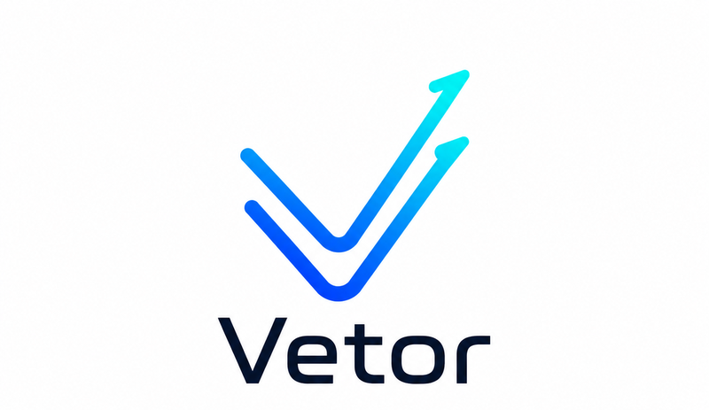
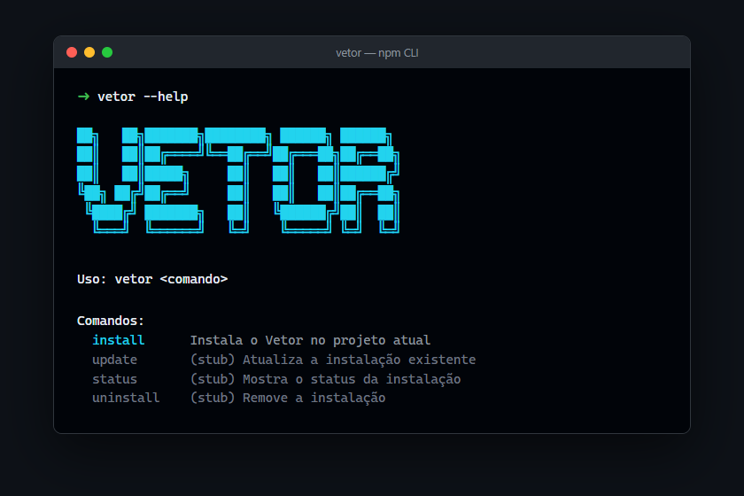

# Vetor

<div align="center">
  <picture>
    <source media="(prefers-color-scheme: dark)" srcset="assets/logo-dark.png">
    
  </picture>
</div>

Plugin de skills para automação de workflow de desenvolvimento — nativo do Claude Code, com compatibilidade parcial documentada para Antigravity, OpenAI Codex, OpenCode e Cursor (ver [Compatibilidade](wiki/Home.md#compatibilidade-com-outros-runtimes)). Distribuído como plugin do Claude Code e como instalador via npm (`@tavaressan/vetor`). **Agnóstico a projeto** — instale uma vez e use em qualquer repositório.

Cobre o ciclo completo: **ideação → backlog → worktree isolado → fix autônomo → ship → guarda**.

## Instalação e Atualização

O Vetor pode ser instalado **globalmente** (no ambiente do usuário/harness) ou **localmente** (no diretório de um projeto específico).

### Para Agentes de IA (Headless / TTY-less)

Se você é um agente de IA (Antigravity, Claude Code, Cursor, Codex ou OpenCode) com a instrução de instalar ou atualizar o Vetor neste projeto ou ambiente, use os comandos determinísticos abaixo (sem prompts interativos):

| Harness | Instalação Inicial (Headless) | Atualização | Escopo |
|---|---|---|---|
| **Antigravity** (Global) | Linux/macOS:<br>`git clone https://github.com/Tavaressan/Vetor.git /tmp/vetor-plugin && agy plugin install /tmp/vetor-plugin`<br><br>Windows (PowerShell):<br>`git clone https://github.com/Tavaressan/Vetor.git "$env:TEMP\vetor-plugin"; agy plugin install "$env:TEMP\vetor-plugin"` | `cd <clone-dir> && git pull && agy plugin install .`<br>*(ou `agy plugin remove vetor && agy plugin install <clone-dir>`)* | Global do usuário (`~/.gemini/config/plugins/`) |
| **Antigravity** (Projeto) | `npx @tavaressan/vetor install --engines antigravity --yes` | `npx @tavaressan/vetor update` | Local do workspace (`.agents/`) |
| **Claude Code** (Global) | Comandos nativos no prompt:<br>`/plugin marketplace add Tavaressan/Vetor`<br>`/plugin install vetor@vetor` | `/plugin update vetor` | Global do usuário |
| **Claude Code** (Projeto) | `npx @tavaressan/vetor install --engines claude-code --yes` | `npx @tavaressan/vetor update` | Local do workspace (`.claude/`) |
| **Cursor** (Projeto) | `npx @tavaressan/vetor install --engines cursor --yes` | `npx @tavaressan/vetor update` | Local do workspace (`.cursor/`) |
| **OpenAI Codex** (Projeto) | `npx @tavaressan/vetor install --engines codex --yes` | `npx @tavaressan/vetor update` | Local do workspace (`.codex/` e `.agents/skills/`) |
| **OpenCode** (Projeto) | `npx @tavaressan/vetor install --engines opencode --yes` | `npx @tavaressan/vetor update` | Local do workspace (`.opencode/`) |

> **Dica para multi-engine:** para instalar em múltiplos harnesses simultaneamente no projeto atual, use lista de IDs separada por vírgula:  
> `npx @tavaressan/vetor install --engines claude-code,antigravity,cursor,codex,opencode --yes`

### Instalação Manual por Desenvolvedor

#### 1. Claude Code (Plugin Nativo)
No prompt do Claude Code:
```
/plugin marketplace add Tavaressan/Vetor
/plugin install vetor@vetor
```
Para atualizar: `/plugin update vetor`.

#### 2. Google Antigravity (Plugin Global via `agy`)
Clone o repositório e registre o plugin globalmente no CLI `agy`:
```bash
# Clone em diretório temporário
git clone https://github.com/Tavaressan/Vetor.git /tmp/vetor-plugin
# Registra e instala o plugin
agy plugin install /tmp/vetor-plugin
```
*No Windows (PowerShell):*
```powershell
git clone https://github.com/Tavaressan/Vetor.git "$env:TEMP\vetor-plugin"
agy plugin install "$env:TEMP\vetor-plugin"
```

#### 3. Via CLI `vetor` (npm / npx)
Ideal para instalar em projetos locais com seleção interativa de harnesses detectados:
```bash
# Execução direta sem instalação global:
npx @tavaressan/vetor install

# Ou instalação global do CLI:
npm install -g @tavaressan/vetor
vetor install
```
Para atualizar os arquivos instalados no projeto: `vetor update` (ou `npx @tavaressan/vetor update`).

#### 4. Via Deno (CLI)
```sh
deno run -A npm:@tavaressan/vetor install
deno install --global --compile -A npm:@tavaressan/vetor
```
`-A` concede todas as permissões: o CLI lê e escreve no projeto, acessa variáveis de ambiente e executa ferramentas de checagem.

<div align="center">
  
</div>

### Configuração Inicial no Projeto
Após a instalação das skills/plugin, execute no projeto-alvo:
```
/vetor:install
```
Ele detecta o runtime do repositório, gera o mapeamento de comandos de teste e grava a configuração em `.claude/vetor/`.

**Pré-requisitos mínimos:**
- **[Deno](https://deno.com)** (`curl -fsSL https://deno.land/install.sh | sh` ou `winget install DenoLand.Deno`) — runtime essencial para execução das skills e scripts de inspeção do Vetor.
- **[GitHub CLI `gh`](https://cli.github.com)** autenticado (`gh auth status`) — para integração com issues e pull requests.
- **Git** com suporte a `git worktree` (Git >= 2.20).
*(Opcionais: `npx` para o MCP `chrome-devtools`, Docker com plugin `docker mcp` para o MCP `docker`, `agy`/`opencode`/`codex` para delegação agnóstica de runtime — ver `delegate-to-runtime.md`.)*

## Skills

| Comando | O que faz |
|---------|----------|
| `/vetor:install [--force]` | Porta de entrada — inicializa e configura o Vetor no projeto-alvo |
| `/vetor:now` | Kickoff diário — resume estado, prepara ferramentas e encaminha a próxima etapa |
| `/vetor:spec [tema]` | Descobre contexto do projeto (filesystem) e rascunha uma Spec estruturada a partir de um tema |
| `/vetor:spec-validate <path>` | Valida a qualidade de uma Spec (RF/RNF, Acceptance Criteria, Non-Goals) e reporta um score 0-100 |
| `/vetor:backlog [tema]` | Ideação guiada por docs do projeto → batch de issues GitHub com aprovação humana |
| `/vetor:coordinator [label] [--headless]` | Despacho paralelo de issues para sub-agentes isolados, com merge serializado |
| `/vetor:worktree-create <type> <slug> [issue#]` | Cria worktree isolado, headless |
| `/vetor:fix <descrição>` | Loop autônomo reproduce → fix → rebuild → test (máx. 5 iterações) |
| `/vetor:ship [issue#]` | Pipeline: test → push → PR draft → CI → code review → merge → cleanup |
| `/vetor:guardian [--cron]` | Audit + auto-fix de gaps que o pre-commit não cobre |
| `/vetor:architecture-review [foco]` | Survey de dívida arquitetural via deletion test — sempre manual, nunca `--cron` |
| `/vetor:design [<diretório>]` | Modo de operação de design, Design Contract e self-correction loop de frontend |
| `/vetor:stack-practices [--refresh]` | Gera regras de melhores práticas por stack detectada, via Context7 |
| `/vetor:retro` | Avalia o uso do Vetor na sessão e propõe melhorias no próprio plugin |

> Os nomes antigos /vetor:vetor, /vetor:backlog-ideator, /vetor:issue-coordinator, /vetor:fix-loop-agent e /vetor:worktree-ship continuam disponíveis como aliases de compatibilidade, mas estão deprecados. Use os comandos novos acima.

## Início rápido

**Automatizado** — do backlog ao merge:

```
/vetor:backlog resiliência       # cria issues com label ai-generated
/vetor:coordinator ai-generated    # despacha, implementa, testa, faz PR e merge
/vetor:guardian                          # audita o estado pós-merge
```

**Manual** — uma issue por vez:

```
/vetor:worktree-create fix auth-bug 42
# (desenvolve normalmente)
/vetor:fix testes falhando
/vetor:ship 42
```

> Para rodar o `/vetor:coordinator` com dispatch em background é preciso o modo de permissões autônomo — ver [Configuração › Permissões](wiki/Configuracao.md#permissões).

## Documentação

A [**wiki**](wiki/Home.md) tem o detalhe:

| Página | Conteúdo |
|--------|----------|
| [Configuração](wiki/Configuracao.md) | Testes por projeto, permissões, delegação ao Gemini |
| [MCPs](wiki/MCPs.md) | `context7`, `chrome-devtools` e `docker` embarcados |
| [Arquitetura](wiki/Arquitetura.md) | Composição das skills, subagentes nativos, observabilidade |
| [Hooks](wiki/Hooks.md) | O que é aplicado por hook, não por prompt |
| [Decisões de design](wiki/Decisoes-de-Design.md) | Trade-offs e limitações conhecidas |
| [Referência](wiki/Referencia.md) | Hard caps, custo de tokens, estrutura do repositório |
| [Compatibilidade](wiki/Home.md#compatibilidade-com-outros-runtimes) | Antigravity, OpenAI Codex, OpenCode, Cursor |

## Créditos

O Vetor se inspira em outros projetos de skills/agentes de IA:

- **[Reversa](https://github.com/sandeco/reversa)** — framework de engenharia reversa de especificações; a ideia de orquestrar times de agentes por fase (Discovery → Ideation → ...) espelhando skills em `.claude/skills/` ecoa no pipeline `spec → coordinator → fix-loop → ship → guardian` do Vetor.
- **[Skills do Matt Pocock](https://github.com/mattpocock/skills)** — conjunto de skills reutilizáveis para agentes de código; o `/grill-me` de lá é a inspiração declarada para o "loop de grilling" usado em `/vetor:architecture-review`.
- **[Superpowers](https://github.com/obra/superpowers)**, de Jesse Vincent — a skill `systematic-debugging`, que rastreia causa raiz por investigação socrática até a fonte do problema em vez de tratar o sintoma, é a inspiração declarada para a lógica de diagnóstico do `fix` do Vetor.

## Licença

[MIT](LICENSE) © 2026 Vitor Tavares Chaves.
