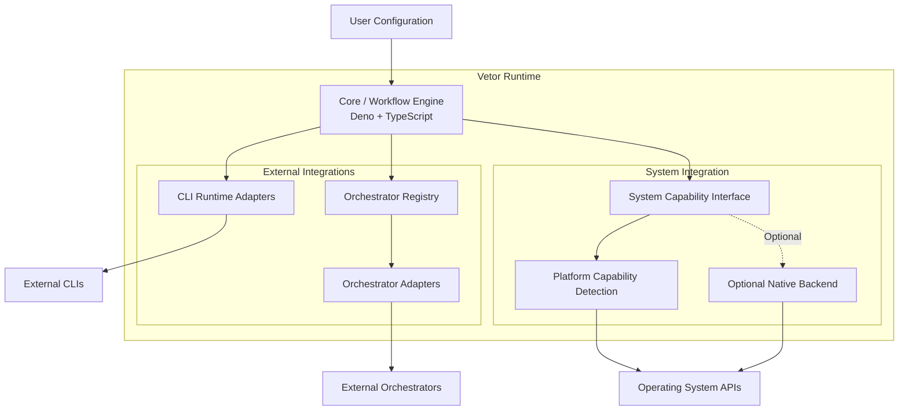

# ADR-001: Runtime Independence, Extensibility & Native System Integration

- **Status:** Proposed
- **Date:** 2026-11-08
- **Decision Owners:** Vetor Project
- **Primary Runtime:** Deno + TypeScript
- **Optional Native Runtime:** Rust
- **Scope:** Core Architecture, Orchestration, System Integration
- **Related Repository:** [Tavaressan/Vetor](https://github.com/Tavaressan/Vetor)

---

## 1. Context and Motivation

Vetor is evolving from a collection of development automation tools into an extensible runtime
capable of coordinating agent workflows, integrating external orchestration systems, and interacting
with the host operating system.

The project currently uses Deno and TypeScript as its primary implementation environment.

It already contains abstractions for external orchestration, CLI delegation, worktree management,
and workflow execution.

However, future capabilities may require deeper integration with operating system facilities,
including:

- Process supervision and resource management.
- System-level telemetry.
- Linux eBPF instrumentation.
- Linux cgroups v2.
- Native asynchronous I/O.
- Platform-specific process and resource APIs.

These capabilities raise an architectural question:

**Should Vetor introduce a second implementation layer in Rust, or should it continue using Deno and
TypeScript exclusively?**

A second, equally important question concerns runtime independence:

**How can Vetor maintain its own execution capabilities while integrating with external
orchestrators and tools without requiring users to adopt any particular ecosystem?**

This ADR establishes the architectural boundaries and the conditions under which additional native
components may be introduced.

## 2. Architectural Goals

The architecture must satisfy the following goals.

### 2.1 Runtime Independence

Vetor must retain its own execution and workflow capabilities without requiring an external
orchestrator.

External orchestration systems should extend Vetor's capabilities, not become mandatory
dependencies.

### 2.2 Orchestrator Independence

Vetor must support integrations with different orchestration systems through explicit adapters.

Examples include:

- Alethe.
- Orca.
- Other MCP-based orchestrators.
- Future orchestration platforms.

No external orchestrator should be embedded into the Core.

### 2.3 Tool Independence

Users must be free to choose their preferred development tools, agent CLIs, editors, and execution
environments.

Integrations should be optional and discoverable.

### 2.4 Platform Portability

The Core must remain compatible with Linux, Windows, and macOS.

Platform-specific capabilities must be isolated behind explicit interfaces.

### 2.5 Zero Mandatory Native Overhead

The basic Vetor runtime must not require additional native daemons, background collectors, or Rust
binaries.

Native capabilities should only be initialized when explicitly requested and available.

### 2.6 Incremental Evolution

New architectural abstractions must be introduced only when justified by concrete requirements.

Existing implementations should be extended rather than duplicated.

---

## 3. Current Architecture Assessment

The repository already contains important architectural foundations.

The following components are recognized as existing implementations and must be considered before
introducing new abstractions.

### 3.1 Orchestrator Adapter

Location: `scripts/lib/orchestrator/types.ts`

The existing `OrchestratorAdapter` defines the external orchestration lifecycle:

- `isAvailable()`
- `dispatch()`
- `check()`
- `release()`
- Optional `cancel()`

It also defines the associated execution types and normalized job states.

**Decision:** Preserve and evolve this interface. Do not replace it with a new generic adapter
architecture.

### 3.2 Orchestrator Registry

Location: `scripts/lib/orchestrator/registry.ts`

The registry already provides:

- Adapter registration.
- Adapter lookup.
- Adapter enumeration.
- Availability detection.
- Explicit adapter selection.

The current selection model preserves user control rather than silently choosing an available
orchestrator.

**Decision:** Preserve this registry as the integration point for external orchestration systems.

It must not become a generic registry for operating system capabilities.

### 3.3 Existing Alethe Integration

Location: `scripts/lib/orchestrator/adapters/alethe.ts`

A concrete adapter already implements delegation, job monitoring, delivery management, release, and
cancellation.

**Decision:** Preserve this integration and use it as a reference implementation for future
adapters.

### 3.4 CLI Delegation

Location: `scripts/lib/delegation-runtime.ts`

Vetor already supports selecting and invoking external CLI runtimes.

Examples include:

- Antigravity CLI.
- OpenCode.
- Codex.

This mechanism is distinct from asynchronous orchestration.

**Decision:** Maintain the distinction between CLI delegation and orchestrator delegation.

### 3.5 Worktree Management

Relevant locations:

- `scripts/prepare-worktree.ts`
- `scripts/prewarm-worktrees.ts`
- `skills/coordinator/SKILL.md`
- `skills/shared/references/issue-coordinator-dispatch.md`

Vetor already has mechanisms for preparing worktrees and coordinating isolated execution contexts.

**Decision:** Do not introduce another worktree manager as part of native system integration.

Resource ownership and cleanup responsibilities must remain explicit.

### 3.6 Orca Integration Status

The repository contains documentation discussing potential Orca integration, but the inspected
implementation does not establish a verified, operational Orca adapter.

**Decision:** Orca remains a potential integration target. Implementation requires verifiable
documentation or a working integration contract.

No tool names, schemas, or payloads should be assumed without evidence.

**Evidence collected on 2026-11-09 (input for INV-003):**

- Orca 1.4.251 is installed on the development host. Its public contract is a **CLI**
  (`orca orchestration <command>`), not an MCP server. Nothing observed confirms MCP tools named
  `task_dispatch` / `task_check` / `task_release`, which matches the earlier removal of the
  unsourced Orca adapter (`docs/specs/delegacao-orquestrador-contrato.md`, RF-06).
- The binary itself serves the version-matched usage guide (`orca skills get orchestration`), so
  that output is the authoritative source for an adapter, not documentation copied into this repo.
- Observed subcommands that map onto the `OrchestratorAdapter` lifecycle: `worker-start` (dispatch),
  `worker-show` / `worker-read` / `check` (status and output), `worker-release` (release),
  `worker-stop` and `worker-abandon` (cancel). Other primitives include `ask` / `reply` / `send`,
  `task-create` / `task-list`, and decision gates.
- **Lifecycle mismatch:** Orca's guide says coordinators must not poll, because Orca wakes the
  coordinator agent when a worker reports through `worker_done`. `OrchestratorAdapter.check()`
  assumes polling. An adapter has to resolve this before implementation (see INV-002).
- **Worktree ownership:** `worker-start` creates and owns the worker's workspace unless it is given
  `--worktree current`. §7.2 applies directly.
- **Detection hazard:** on Linux, outside an Orca-managed terminal, bare `orca` usually resolves to
  the GNOME Orca screen reader (`/usr/bin/orca`). Orca resolves its executable from
  `ORCA_CLI_COMMAND`, then `orca-dev`, then `orca-ide`, then `orca`. Availability detection must
  follow the same order. It must never launch bare `orca` just to see whether it exists.

---

## 4. Architectural Decision

Vetor will adopt a **TypeScript-first, native-when-justified architecture**.

Deno and TypeScript remain responsible for the Core runtime, workflow execution, integration
management, and orchestration.

Rust may be introduced as an optional native backend for capabilities that require direct operating
system integration or demonstrate measurable technical advantages.

The architecture will maintain three independent integration domains:

1. External orchestration.
2. External CLI runtimes and tools.
3. Operating system capabilities.

These domains must not be artificially unified.

### 4.1 Logical Architecture



The Core remains the owner of Vetor's workflow logic.

External integrations provide optional execution capabilities.

The native backend provides optional system-level functionality.

---

## 5. Core Runtime: Deno + TypeScript

Deno remains the primary runtime.

Its responsibilities include:

- Workflow execution.
- Agent lifecycle management.
- CLI process invocation.
- External orchestration integration.
- Worktree coordination.
- Filesystem operations.
- Tool and plugin integration.
- Configuration management.
- Capability discovery.
- Cross-platform application logic.

The Core must not depend on the presence of Rust.

### 5.1 Core Independence

The Core must remain usable when:

- No external orchestrator is installed.
- No optional native backend is available.
- The host operating system does not support advanced system capabilities.
- The user chooses not to enable optional integrations.

Native functionality must never become a prerequisite for basic runtime execution.

---

## 6. External Integration Architecture

External integrations remain divided into two existing domains.

### 6.1 CLI Runtime Adapters

CLI adapters provide access to external agent execution tools.

They are responsible for:

- Availability detection.
- Process invocation.
- Input and output handling.
- Exit status normalization.
- Execution error reporting.

They must not assume ownership of the entire workflow.

### 6.2 Orchestrator Adapters

The existing `OrchestratorAdapter` remains the contract for asynchronous external job execution.

Each adapter is responsible for translating Vetor's internal job lifecycle into the external
system's actual API.

The Core must not contain provider-specific assumptions.

### 6.3 Optional Integrations

External integrations must follow these principles:

- Explicit user configuration.
- Availability detection.
- Capability validation.
- Graceful fallback.
- No mandatory provider dependencies.
- No silent selection of external infrastructure.

### 6.4 Runtime Independence Versus Harness Independence

Runtime independence does not automatically imply independence from the environment that loads
Vetor's skills, hooks, and tools.

Full independence from the host harness would require a separate product and architectural
evolution.

This distinction must remain explicit.

---

## 7. Worktree and Resource Ownership

Worktrees are execution contexts, not complete operating system sandboxes.

Vetor must distinguish:

- Git isolation.
- Process isolation.
- Resource isolation.
- Filesystem isolation.
- Network isolation.

These capabilities must not be conflated.

### 7.1 Ownership Rules

1. A component creating a worktree is responsible for its lifecycle unless ownership is explicitly
   transferred.
2. External orchestrators retain responsibility for resources they exclusively manage.
3. Adapters must communicate resource ownership and cleanup requirements.
4. Native system components must not independently create or destroy worktrees.
5. Resource supervision must operate on existing execution contexts whenever possible.

### 7.2 Orca and Other Orchestrators

When an external orchestrator provides its own worktree management, Vetor must not duplicate that
functionality.

The adapter must establish:

- Which component creates the worktree.
- Which component controls its lifecycle.
- Which directory is used as the execution context.
- Which component performs cleanup.

The same contract must apply to future integrations.

---

## 8. System Capability Architecture

A separate operating system capability domain may be introduced when concrete requirements justify
it.

It must remain independent of `OrchestratorRegistry`.

### 8.1 Capability Discovery

The system integration layer should eventually expose a capability model describing which operations
are available.

Illustrative structure:

```ts
interface SystemCapabilities {
  processMetrics: boolean;
  processSupervision: boolean;
  resourceLimits: boolean;
  advancedTelemetry: boolean;
  nativeAsyncIO: boolean;
}
```

These properties describe functional capabilities, not assumptions about specific operating systems.

The implementation must consider:

- Operating system.
- Kernel version.
- Permissions.
- Installed dependencies.
- Runtime support.
- Security restrictions.

A capability must only be reported as available when the corresponding implementation can actually
perform it.

### 8.2 Capability-Driven Execution

The Core must request capabilities rather than depend directly on platform-specific implementations.

Unsupported functionality must produce an explicit, actionable result.

The absence of a capability must not prevent unrelated workflows from running.

### 8.3 Initial Scope

No generic system capability registry or permanent system daemon is required as part of this ADR's
initial implementation.

The first implementation must be justified by a specific use case.

---

## 9. Optional Native Backend: Rust

Rust is approved as a potential implementation technology for specialized native components.

It is not approved as a replacement for the existing Core.

### 9.1 Candidate Responsibilities

Potential Rust modules include:

**System Backend**

- Native operating system integrations.
- Process supervision.
- Resource management.

**Telemetry Engine**

- Process event collection.
- Advanced system instrumentation.
- Event aggregation.

**Linux Backend**

- eBPF integration.
- cgroups v2.
- Advanced process monitoring.

**Advanced I/O**

- io_uring experiments.
- Specialized asynchronous I/O workers.

### 9.2 Platform Implementations

Rust must not introduce Linux-only dependencies into the Core.

Potential platform-specific implementations include:

| Platform | Native mechanisms                                 |
| -------- | ------------------------------------------------- |
| Linux    | eBPF, cgroups v2, io_uring                        |
| Windows  | ETW, Job Objects, IOCP                            |
| macOS    | Supported DTrace facilities, process APIs, kqueue |

These mechanisms are not functionally identical. The abstraction must expose meaningful common
capabilities without pretending that every platform offers equivalent behavior.

### 9.3 Integration Mechanism

If a native backend becomes necessary, IPC is the preferred initial integration candidate.

Potential mechanisms:

- JSON-RPC over stdio.
- Unix Domain Sockets on supported systems.
- Equivalent named-pipe or local IPC mechanisms on other platforms.

The transport must be selected based on the actual use case.

The architecture should avoid unnecessary process boundaries and excessive serialization.

### 9.4 Native Backend Lifecycle

The backend must be:

- Optional.
- Lazily initialized.
- Reusable across relevant execution sessions.
- Explicitly shut down.
- Independent of individual worktree lifecycles.

A persistent daemon must not be introduced without a demonstrated requirement.

---

## 10. Performance and Overhead Principles

Performance must be measured rather than assumed.

The following principles are mandatory:

1. No mandatory background collection.
2. No native backend startup when unused.
3. No duplicated orchestration or process supervision.
4. No per-worktree native collector by default.
5. Event-driven collection when practical.
6. Bounded sampling frequency.
7. Explicit resource limits for collectors.
8. No advanced I/O optimization without benchmarks.
9. No permanent instrumentation of unrelated host processes.
10. No additional native dependency without measurable benefit.

### 10.1 Shared Host-Level Collection

When multiple agents run concurrently, system telemetry should be shared at the host level whenever
possible.

Process identification and attribution must use reliable execution metadata, not assumptions based
solely on working directory names.

### 10.2 Performance Validation

Any native component must be benchmarked against an equivalent Deno implementation.

Measurements should include:

- CPU consumption.
- Memory footprint.
- Startup latency.
- Event processing throughput.
- IPC overhead.
- Resource consumption under concurrent execution.
- Impact on normal workflows.

A native implementation should only be retained when its benefits justify its maintenance and
distribution costs.

---

## 11. Security Considerations

Native integrations can introduce privileged operations and broader access to the host.

Therefore:

- No unnecessary elevated permissions.
- No implicit privilege escalation.
- Explicit permission checks.
- Restricted process access.
- Safe handling of external inputs.
- Resource limits for collectors.
- Clear failure behavior.
- No silent changes to host security policies.

eBPF and other privileged system integrations require additional security review before
implementation.

---

## 12. Implementation Plan

Implementation is divided into incremental phases.

### Phase 0: Architectural Consolidation

**Objective:** Document and preserve existing architectural boundaries.

Tasks:

- Review existing orchestration contracts.
- Document CLI delegation separately.
- Document worktree ownership.
- Identify existing harness dependencies.
- Update architecture documentation.
- Validate current adapter behavior.

Expected deliverables:

- Approved ADR-001.
- Updated architecture documentation.
- Explicit integration boundaries.

### Phase 1: Runtime Extensibility

**Objective:** Establish the necessary contracts without introducing native dependencies.

Tasks:

- Evaluate existing extension points.
- Define requirements for system capability discovery.
- Identify which capabilities genuinely belong in the Core.
- Review configuration and optional integration behavior.
- Validate graceful fallback behavior.

Expected deliverables:

- Capability contract proposal.
- Integration architecture specification.
- Compatibility and fallback requirements.

### Phase 2: System Integration Investigation

**Objective:** Identify the first concrete system-level use case.

Tasks:

- Investigate Deno's existing system APIs.
- Evaluate process telemetry requirements.
- Investigate cgroups v2.
- Evaluate eBPF applicability.
- Identify permission and security requirements.
- Benchmark existing solutions.

Expected deliverables:

- Technical investigation reports.
- Performance baselines.
- Native backend feasibility assessment.

### Phase 3: Optional Native Prototype

**Objective:** Validate whether Rust offers measurable advantages.

Tasks:

- Select one concrete use case.
- Implement a minimal Rust prototype.
- Compare against a Deno implementation.
- Measure startup, CPU, memory, and IPC overhead.
- Evaluate build and distribution complexity.

Expected deliverables:

- Working prototype.
- Reproducible benchmarks.
- Go/no-go decision.

### Phase 4: Production Integration

**Objective:** Integrate the native backend only if justified.

Tasks:

- Stabilize the system capability contract.
- Implement the selected native component.
- Add lifecycle management.
- Implement permission handling.
- Add cross-platform fallback behavior.
- Introduce automated tests and benchmarks.

Expected deliverables:

- Optional native backend.
- Documented integration contract.
- CI coverage.
- Performance regression tests.

---

## 13. Investigation Backlog

The following investigations are required or recommended.

### INV-001: Existing Runtime Boundary Assessment

**Priority:** P0

Determine which responsibilities already belong to the Core, external adapters, CLI delegation, and
host harness.

Questions:

- Which components depend on the current execution harness?
- Which APIs can be used independently?
- Where does the current implementation duplicate responsibilities?
- What must change to support standalone runtime execution?

Deliverable: architecture gap analysis.

### INV-002: Orchestrator Adapter Contract Review

**Priority:** P0

Evaluate the current `OrchestratorAdapter` and its registry.

Questions:

- Are lifecycle semantics sufficiently generic?
- How are resource ownership and cleanup represented?
- Can external systems provide execution metadata?
- Are adapter failures normalized consistently?
- Can the contract represent push/wake completion (Orca's `worker_done`) as well as polling via
  `check()`?

Deliverable: contract review and proposed changes, if necessary.

### INV-003: Orca Integration Feasibility

**Priority:** P1

Investigate the actual Orca integration interface.

Questions:

- ~~Is there an official MCP interface?~~ Partially answered in §3.6: Orca 1.4.251 exposes a CLI
  (`orca orchestration …`), and no MCP interface was observed.
- What operations are available? (Initial mapping in §3.6.)
- How are worktrees provisioned?
- How are sessions identified? (Candidates: Run, Task and Dispatch IDs.)
- What are the cancellation and cleanup semantics? (`worker-stop` vs `worker-abandon`;
  `worker-release`.)
- How is the Orca executable resolved safely on each platform without starting the GNOME screen
  reader on Linux?
- How does a CLI adapter avoid tying Vetor to one Orca version, given that the binary serves its own
  versioned guide?

Deliverable: verified integration specification.

No implementation should begin before the external contract is validated.

### INV-004: Deno System API Assessment

**Priority:** P1

Determine how much system integration can be implemented without Rust.

Investigate:

- Process APIs.
- Filesystem access.
- Process monitoring.
- Permissions.
- Native executable invocation.
- Available telemetry mechanisms.

Deliverable: Deno capability assessment and implementation examples.

### INV-005: Rust Integration Feasibility

**Priority:** P2

Evaluate the practical costs of introducing Rust.

Questions:

- Which capabilities cannot be implemented adequately in Deno?
- What is the expected maintenance cost?
- How should binaries be distributed?
- What IPC mechanism provides the best trade-off?
- Is a native backend necessary at all?

Deliverable: Rust adoption recommendation.

### INV-006: Linux Observability Investigation

**Priority:** P2

Investigate eBPF and cgroups v2 for optional process telemetry and resource management.

Questions:

- Which metrics are unavailable through existing APIs?
- What permissions are required?
- Can collection be shared across agent sessions?
- What is the CPU and memory overhead?
- Which Rust libraries are appropriate?

Deliverable: Linux observability prototype and benchmarks.

### INV-007: Native I/O Performance Investigation

**Priority:** P3

Investigate whether io_uring provides meaningful advantages for Vetor workloads.

Questions:

- Are I/O operations actually a bottleneck?
- Does Deno already provide sufficient asynchronous behavior?
- What workloads justify a native worker?
- What is the IPC cost?

Deliverable: reproducible benchmark and adoption recommendation.

---

## 14. Consequences

### Positive Consequences

- Vetor remains independent of external orchestrators.
- Existing integration abstractions are preserved.
- Users retain freedom of tool selection.
- The Core remains cross-platform.
- Native functionality can evolve independently.
- Rust adoption becomes evidence-driven.
- No mandatory native infrastructure is introduced.
- Existing worktree and orchestration responsibilities remain explicit.

### Negative Consequences

- Some advanced system capabilities will initially remain unavailable.
- Native integrations will require additional testing and distribution work.
- Platform-specific behavior will require explicit compatibility handling.
- Maintaining multiple implementation languages may increase complexity.
- IPC introduces additional operational considerations when native components are eventually
  adopted.

These costs are accepted because native functionality is optional and must demonstrate sufficient
value.

---

## 15. Alternatives Considered

### Alternative A: Deno and TypeScript Exclusively

Advantages:

- Simplified development.
- Single primary runtime.
- Easier distribution.
- Lower maintenance complexity.

Disadvantages:

- Some low-level integrations may require external tools or native dependencies.
- Certain system capabilities may be difficult to expose efficiently.

**Decision:** Remains a valid implementation strategy. Rust is not mandatory.

### Alternative B: Rewrite the Core in Rust

Advantages:

- Native system integration.
- Strong performance characteristics.
- Memory safety.
- Single implementation language for lower-level functionality.

Disadvantages:

- Significant rewrite.
- Loss of existing Deno ecosystem advantages.
- Greater integration complexity.
- No demonstrated need for replacing the current Core.

**Decision:** Rejected.

### Alternative C: Mandatory Deno + Rust Runtime

Advantages:

- Clear separation of application and system responsibilities.

Disadvantages:

- Additional installation requirements.
- More complicated cross-platform distribution.
- Unnecessary overhead for users who do not need native features.

**Decision:** Rejected.

### Alternative D: Deno Core with Optional Rust Components

Advantages:

- Preserves the current architecture.
- Allows specialized native capabilities.
- Supports gradual adoption.
- Avoids mandatory dependencies.

Disadvantages:

- Requires explicit contracts and lifecycle management.
- Introduces multi-language maintenance when adopted.

**Decision:** Accepted as the long-term architectural direction.

---

## 16. Acceptance Criteria

This ADR can be considered implemented when:

- [ ] Existing orchestration abstractions remain functional.
- [ ] CLI delegation and orchestrator delegation are documented separately.
- [ ] Worktree ownership and cleanup responsibilities are explicit.
- [ ] Vetor can execute its supported workflows without an external orchestrator.
- [ ] External integrations remain optional.
- [ ] Unsupported platform capabilities do not break the Core.
- [ ] Native backend availability is not a mandatory runtime requirement.
- [ ] Any Rust implementation has documented benchmarks and a justified use case.
- [ ] No unnecessary persistent native service is introduced.
- [ ] Security and permission requirements are documented.
- [ ] Cross-platform behavior is tested.

---

## 17. Final Decision

Vetor will remain a Deno + TypeScript-first runtime.

Its existing orchestration, CLI delegation, and worktree abstractions will be preserved and evolved.

External orchestration systems will remain optional integrations.

Operating system capabilities will be treated as a separate architectural domain.

Rust is approved as an optional implementation technology for specialized native components, but its
adoption must be supported by measurable technical requirements and benchmarks.

The guiding architectural principle is:

**Vetor owns its runtime, integrates with external ecosystems, and uses native system capabilities
only when they provide demonstrable value.**

The project must remain independent without becoming isolated, extensible without becoming
dependent, and powerful without imposing unnecessary infrastructure on its users.

---

## 18. Related Documents

- [`docs/specs/delegacao-orquestrador-contrato.md`](../specs/delegacao-orquestrador-contrato.md)
- [`docs/specs/delegacao-runtimes-orquestradores.md`](../specs/delegacao-runtimes-orquestradores.md)
- [`scripts/lib/orchestrator/types.ts`](../../scripts/lib/orchestrator/types.ts)
- [`scripts/lib/orchestrator/registry.ts`](../../scripts/lib/orchestrator/registry.ts)
- [`scripts/lib/orchestrator/adapters/alethe.ts`](../../scripts/lib/orchestrator/adapters/alethe.ts)
- [`scripts/lib/delegation-runtime.ts`](../../scripts/lib/delegation-runtime.ts)
- [`scripts/prepare-worktree.ts`](../../scripts/prepare-worktree.ts)
- [`scripts/prewarm-worktrees.ts`](../../scripts/prewarm-worktrees.ts)
- [`wiki/Decisoes-de-Design.md`](../../wiki/Decisoes-de-Design.md)

**Document status:** Proposed. Implementation and investigation tasks should reference this ADR.
