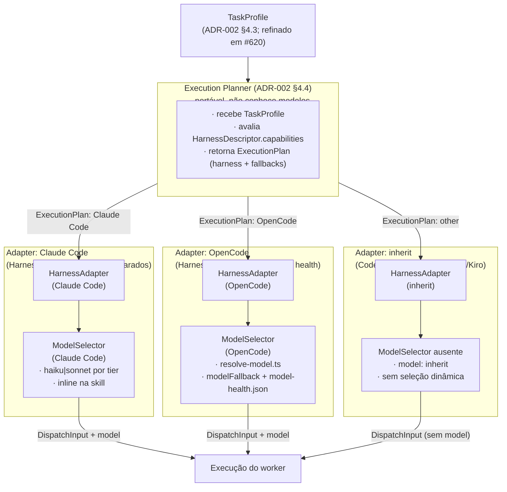

# Investigação: seleção de modelo e interação com seleção de harness

**Issue:** #621 — spike(execution): interação entre seleção de modelo e seleção de harness\
**Data:** 2026-11-10\
**Base:** `master` em `5f96ed9`\
**Contexto:** ADR-002 (`docs/adr/ADR-002-capability-based-execution-routing.md`, no `master`), Fase
0, objetivo 5; questão aberta 5; ADR-001 (`docs/adr/ADR-001-runtime-independence.md`); matriz de
capacidades da #568 (`skills/shared/references/harness-capabilities.md`,
`wiki/Contrato-de-Capacidades.md`); relatórios anteriores `docs/investigations/runtime-boundary.md`
(#586), `docs/investigations/orchestrator-adapter-contract.md` (#587),
`docs/investigations/orca-adapter.md` (#588), `docs/investigations/descoberta-de-capacidades.md`
(#618), `docs/investigations/metadados-para-classificacao.md` (#620); proposta
`docs/proposals/model-tier-strategy.md` (#337).

**Rótulos:** **[Fato]** verificado na fonte citada ou em comando registrado · **[Inferência]**
conclusão derivada dos fatos · **[Opinião]** juízo técnico.

---

## 1. Pergunta

A issue #621 traz quatro perguntas. A ADR-002 §13 questão 5 enuncia a primeira com precisão: "Should
model routing be exposed as a separate planner or remain entirely within harness integrations?"
(ADR-002 §13 Q5). A Fase 0 objetivo 5 enuncia o escopo do spike: "Evaluate how model selection
interacts with harness selection" (ADR-002 §10 Fase 0 objetivo 5).

1. A seleção de modelo deve ser um planner separado ou ficar dentro das integrações de cada harness?
2. Como a escalação de tier por harness (#337) e a saúde de modelo existentes se conectam ao planner
   sem duplicar lógica?
3. Que restrições de modelo (contexto máximo, disponibilidade, limite de taxa, custo) afetam a
   elegibilidade do harness e quais afetam só o ranking?
4. Como tratar harnesses em que o modelo é fixo ou escolhido pelo usuário e não pelo Vetor?

---

## 2. Resumo

- **[Fato]** O repositório já possui dois mecanismos de seleção de modelo operacionais no harness
  OpenCode: `opencode/scripts/resolve-model.ts` (seleção por tier com fallback saudável) e
  `opencode/scripts/lib/model-health.ts` / `opencode/scripts/model-health.ts` (registro de
  degradação por HTTP 429/529). Esses mecanismos são **exclusivos do OpenCode** e vivem em
  `opencode/scripts/`; nenhum código equivalente existe para Claude Code, Codex, Cursor, Antigravity
  ou Kilo (`opencode/scripts/`, verificado 2026-11-10).
- **[Fato]** A proposta #337 (`docs/proposals/model-tier-strategy.md`) decidiu dois tiers semânticos
  (`simple`/`complex`), com escalação efetiva só em Claude Code e OpenCode. Os demais harnesses
  (Codex, Cursor, Antigravity) ficam com `inherit`. O Kiro (`kiro-cli 3.1.0`) não consta dessa
  proposta.
- **[Fato]** O contrato de seleção de harness (`OrchestratorRegistry.select`,
  `scripts/lib/orchestrator/registry.ts:68-98`) e o de delegação a CLI (`selectDelegationRuntime`,
  `scripts/lib/delegation-runtime.ts:38-60`) só operam por **preferência explícita** do usuário;
  nunca escolhem automaticamente. Nenhum dos dois conhece modelos ou saúde de modelo.
- **[Fato]** O `TaskProfile` conceitual da ADR-002 §4.3 não inclui `modelTier` nem
  `modelConstraints`. O `TaskProfile` refinado proposto em #620
  (`docs/investigations/metadados-para-classificacao.md`, §5) também não inclui campo de modelo. A
  seleção de modelo não está no perfil de tarefa por design.
- **[Fato]** A ADR-002 §4.2 estabelece explicitamente: "Model information must remain distinct from
  harness capabilities. A harness may support multiple models, and model availability must not be
  confused with execution capabilities." O `HarnessDescriptor` proposto em ADR-002 §4.2 inclui
  `models?: ModelDescriptor[]` como campo **opcional**, separado de `capabilities`.
- **[Fato]** A ADR-002 §12 descartou "Routing Based Exclusively on Model Selection" como alternativa
  rejeitada: "model quality does not determine harness execution capabilities. A model may be
  excellent at a task but unavailable in a harness with the required tools or execution behavior."
- **[Inferência]** Os mecanismos de saúde e de tier de modelo são internos ao harness (OpenCode)
  porque o modelo é uma escolha de execução daquele harness — o Vetor não controla o modelo dos
  outros harnesses, apenas declara a intenção (`simple`/`complex`) e cabe ao harness mapeá-la para o
  seu formato nativo.
- **[Opinião]** A seleção de modelo deve permanecer **dentro das integrações de cada harness** (não
  num planner central), com cada adapter implementando seu próprio `ModelSelector`. Isso é
  consistente com a ADR-002 §4.2 (separação de `models` do descritor de capacidades), §13 Q5 e §12
  Alternativa B rejeitada. O mecanismo existente no OpenCode já segue esse padrão.

---

## 3. Evidências

### 3.1 ADR-002: separação de modelo e capacidade de harness

**[Fato]** A ADR-002 §4.2 define o `HarnessDescriptor` com campo `models?: ModelDescriptor[]`
separado de `capabilities`:

```ts
// ADR-002 §4.2 (trecho ilustrativo)
interface HarnessDescriptor {
  id: string;
  version?: string;
  capabilities: {
    domains: string[];
    operations: string[];
    tools: { terminal: boolean; filesystem: boolean; browser: boolean; git: boolean; mcp: boolean };
    execution: {
      parallel: boolean;
      background: boolean;
      resumable: boolean;
      isolatedWorktree: boolean;
    };
  };
  models?: ModelDescriptor[]; // campo opcional, fora de capabilities
  constraints: { maxContext?: number; requiresApproval: boolean; networkAccess?: boolean };
}
```

**[Fato]** A ADR-002 §4.2 anota: "Model information must remain distinct from harness capabilities.
A harness may support multiple models, and model availability must not be confused with execution
capabilities."

**[Fato]** A ADR-002 §4.3 define o `TaskProfile` conceitual sem campo de modelo:

```ts
// ADR-002 §4.3 (trecho ilustrativo)
interface TaskProfile {
  domains: string[];
  operations: string[];
  complexity: "low" | "medium" | "high";
  risk: "low" | "medium" | "high";
  requirements: {
    filesystem?: boolean;
    terminal?: boolean;
    browser?: boolean;
    git?: boolean;
    parallelism?: boolean;
    longContext?: boolean;
  };
  constraints: {
    budget?: number;
    maxDurationMs?: number;
    dataSensitivity?: "public" | "private" | "sensitive";
  };
}
```

**[Fato]** A ADR-002 §4.4 define o papel do `Execution Planner`: "Receive a TaskProfile. Retrieve
available harness descriptors. Eliminate executors that do not satisfy mandatory requirements. …
Produce an execution plan with a primary executor and optional fallback candidates." Nenhuma dessas
etapas menciona modelos — o planner opera sobre `HarnessDescriptor`, não sobre `ModelDescriptor`.

**[Fato]** A ADR-002 §13 questão 5 deixa a decisão em aberto: "Should model routing be exposed as a
separate planner or remain entirely within harness integrations?" Este relatório responde essa
questão.

**[Fato]** A ADR-002 §12 descartou a Alternativa B ("Routing Based Exclusively on Model Selection"):
"Rejected because model quality does not determine harness execution capabilities. A model may be
excellent at a task but unavailable in a harness with the required tools or execution behavior."

**[Inferência]** A arquitetura da ADR-002 já implica que informação de modelo pertence ao
`HarnessDescriptor` (campo `models`), não ao planner nem ao `TaskProfile`. O planner usa
`HarnessDescriptor.capabilities` para eliminar harnesses incompatíveis; o `ModelSelector` de cada
adapter usa `HarnessDescriptor.models` para selecionar o modelo dentro do harness escolhido.

### 3.2 Mecanismos existentes de seleção e saúde de modelo

#### `opencode/scripts/resolve-model.ts`

**[Fato]** Localização: `opencode/scripts/resolve-model.ts`. Entrada (stdin JSON):
`{ tier?: "simple" | "complex"; fallback?: string[]; cwd?: string }`. Saída: nome de modelo saudável
ou código de saída 1 (todos degradados) / 2 (sem configuração). Lógica (`resolve-model.ts:53-93`):

1. Lê `.claude/vetor/config.json`, campo `modelFallback.<tier>` (lista ordenada de
   `"<provider>/<model>"`).
2. Lê `.claude/vetor/status/model-health.json` (escrito pelo hook de erro do OpenCode).
3. Devolve o primeiro modelo da lista cujo estado não seja `degraded` e não expirado.

Sem `modelFallback.<tier>` configurado e sem `fallback` explícito, termina com código 2 e mensagem
acionável (`resolve-model.ts:63-73`).

#### `opencode/scripts/lib/model-health.ts`

**[Fato]** Localização: `opencode/scripts/lib/model-health.ts`. Funções exportadas:

| Função                     | Linha      | Responsabilidade                                                |
| -------------------------- | ---------- | --------------------------------------------------------------- |
| `isRateLimitOrQuotaStatus` | `:22-24`   | Detecta HTTP 429/529 como degradação                            |
| `computeUntil`             | `:33-49`   | Calcula prazo de degradação (header `retry-after` ou 60 s)      |
| `recordModelHealth`        | `:86-115`  | Grava/atualiza `model-health.json` com lock em disco            |
| `isHealthy`                | `:118-120` | Verifica se entrada está saudável (ausente ou `until` expirado) |
| `pickHealthyModel`         | `:127-133` | Percorre lista de fallback e retorna o primeiro saudável        |

**[Fato]** O arquivo `opencode/scripts/model-health.ts` (CLI do hook `event`) recebe o payload do
erro OpenCode no stdin, chama `isRateLimitOrQuotaStatus` e grava com `recordModelHealth`
(`model-health.ts:25-50`, `main`). Ele só é invocado pelo plugin OpenCode
(`docs/proposals/hooks-cost-benefit-review.md:19`: "OpenCode tem hooks adicionais de saúde de
modelo, fora do escopo").

**[Fato]** Nenhum script equivalente existe em `scripts/` (verificado por
`grep -rn "model-health\|pickHealthyModel\|recordModelHealth" scripts/ 2>/dev/null`, saída vazia,
2026-11-10). O mecanismo é exclusivo do harness OpenCode.

#### Referência ao `modelFallback` no coordinator

**[Fato]** A skill `issue-coordinator-dispatch.md` menciona escolha de modelo em dois pontos
(`skills/shared/references/issue-coordinator-dispatch.md:88,94`): `model: "<haiku|sonnet>"` para
Claude Code (aliases diretos) e, implicitamente, listas `modelFallback.<tier>` para OpenCode. No
Claude Code, a escolha é embutida no `Agent()` como parâmetro literal
(`issue-coordinator-dispatch.md:88,111`). Em nenhum caso o coordinator consulta um planner de modelo
externo: a lógica está inline na skill.

### 3.3 Isolamento do mecanismo ao harness

**[Fato]** O `issue-coordinator-dispatch.md` trata a escalação de tier de forma diferente por
harness (`docs/proposals/model-tier-strategy.md`, tabela de mapeamento):

| Harness                 | Mecanismo de tier                             | Quem escolhe                                                  |
| ----------------------- | --------------------------------------------- | ------------------------------------------------------------- |
| Claude Code             | Alias `haiku`/`sonnet` em `Agent()`           | Skill (inline)                                                |
| OpenCode                | `modelFallback.<tier>` via `resolve-model.ts` | Script externo ao harness                                     |
| Codex                   | `inherit`                                     | Harness herda do pai                                          |
| Cursor                  | `inherit`                                     | Harness herda                                                 |
| Antigravity             | `inherit` (estático)                          | Harness herda                                                 |
| Kilo                    | Não mapeado                                   | **[Fato]** ausente em `docs/proposals/model-tier-strategy.md` |
| Kiro (`kiro-cli 3.1.0`) | Não mapeado                                   | **[Fato]** ausente em `docs/proposals/model-tier-strategy.md` |

**[Fato]** `kiro-cli --version` retorna `kiro-cli 3.1.0` (2026-11-10). `kiro-cli chat --help` expõe
as flags `--model <MODEL>` ("Current model to use") e `--effort <EFFORT>` ("Initial effort level
(e.g. low, medium, high, xhigh, max)"), verificadas na saída completa do comando (2026-11-10; saída
registrada em §3.3). Kiro suporta seleção de modelo por dispatch, similar ao OpenCode via `--model`.

**[Inferência]** Kiro pertence à categoria dos harnesses com seleção de modelo controlável pelo
chamador (`selectionMode: "vetor-controlled"`), não à categoria `inherit`. O Vetor pode passar
`--model` ao lançar `kiro-cli chat`, com a mesma semântica do `--model` do OpenCode. A lista de
modelos disponíveis pode ser consultada com `kiro-cli chat --list-models` (**[Não verificado]**: não
executado neste spike para evitar chamadas ao provedor). O Kilo continua não mapeado (`inherit`).

**[Fato]** Saída de `kiro-cli chat --help` (2026-11-10, trecho relevante):

```text
      --model <MODEL>
          Current model to use

      --effort <EFFORT>
          Initial effort level (e.g. low, medium, high, xhigh, max)
```

### 3.4 Restrições de modelo: elegibilidade de harness vs. ranking

**[Fato]** O mecanismo atual de saúde (`opencode/scripts/lib/model-health.ts`) registra apenas
`degraded` (HTTP 429/529) com prazo de expiração. Não registra contexto máximo, custo nem limite de
taxa preventivo. O único critério de elegibilidade verificado é: "está degradado agora?"

**[Inferência]** As restrições de modelo podem ser classificadas em dois grupos funcionalmente
distintos:

| Restrição                                            | Papel                                                                                                                                                              |
| ---------------------------------------------------- | ------------------------------------------------------------------------------------------------------------------------------------------------------------------ |
| **Disponibilidade** (HTTP 429/529, quota esgotada)   | **Elegibilidade**: torna o modelo temporariamente inelegível; implementado em `lib/model-health.ts`                                                                |
| **Contexto máximo insuficiente** para a tarefa       | **Elegibilidade**: se a tarefa requer contexto > limite do modelo, o modelo não pode ser escolhido (ADR-002 §4.2: `constraints.maxContext` no `HarnessDescriptor`) |
| **Custo unitário** do modelo                         | **Ranking**: não impede a escolha, mas pode ordenar a lista de fallback (ADR-002 §4.5: `costSuitability` no scoring)                                               |
| **Limite de taxa preventivo** (quota semanal/mensal) | **Elegibilidade ou ranking** dependendo da política do usuário                                                                                                     |

**[Fato]** O contrato atual de `pickHealthyModel` (`lib/model-health.ts:108-112`) só verifica
disponibilidade. Contexto máximo e custo unitário não estão no arquivo `model-health.json` nem na
interface `ModelHealthEntry` (`lib/model-health.ts:64-68`). Adicionar essas restrições exigiria
ampliar a estrutura do arquivo ou criar um `ModelDescriptor` separado.

**[Fato]** A elegibilidade de harness já é tratada pela ADR-002 §4.4: "Eliminate executors that do
not satisfy mandatory requirements." Restrições de modelo que tornam um **modelo** inelegível são
diferentes de restrições que tornam o **harness** inelegível: um harness com vários modelos
disponíveis pode ter um modelo degradado sem perder a elegibilidade como harness.

### 3.5 Harnesses com modelo fixo ou escolhido pelo usuário

**[Fato]** A proposta #337 estabelece:

- **Antigravity:** modelo estático (`inherit`, `flash` ou `pro`) definido no frontmatter; o Vetor
  não escalona dinamicamente (`docs/proposals/model-tier-strategy.md`, linha da tabela
  "Antigravity").
- **Codex:** sem `model`, herda do pai; escalação por `model_reasoning_effort` não implementada na
  primeira versão (`docs/proposals/model-tier-strategy.md`, "Codex").
- **Cursor:** `inherit` ou ID específico por configuração do usuário; alias Claude inválido
  (`docs/proposals/model-tier-strategy.md`, "Cursor").

**[Fato]** O `wiki/Contrato-de-Capacidades.md:9-17` estabelece: "recurso exclusivo de um harness
entra como otimização aditiva com fallback portátil, e nunca como requisito".

**[Fato]** A ADR-002 §5 define que "Existing explicit user preferences must take precedence over
automatic routing unless the user explicitly enables a different policy." Harnesses com modelo fixo
ou herdado são o caso extremo dessa regra: a preferência do harness (ou do usuário) sempre vence.

**[Inferência]** Harnesses com modelo fixo ou herdado não são problemáticos para o planner: o campo
`models` do `HarnessDescriptor` para esses harnesses simplesmente declara `selectionMode:
"inherit"`
ou `"user-controlled"`. O adapter não invoca nenhum `ModelSelector`. O planner não precisa saber
disso — só o adapter sabe.

---

## 4. Resposta às perguntas da issue

### 4.1 Pergunta 1 — Planner separado ou dentro de cada harness?

**[Opinião]** A seleção de modelo deve permanecer **dentro das integrações de cada harness** (não
num planner central separado), com cada adapter implementando seu próprio `ModelSelector`. A razão
fundamental é a ADR-002 §4.2: `models` é campo do `HarnessDescriptor`, não do `TaskProfile` nem do
`Execution Planner`. O planner escolhe o harness; o adapter desse harness escolhe o modelo.

**Justificativa detalhada:**

1. **ADR-002 §4.2** — O `HarnessDescriptor` inclui `models?: ModelDescriptor[]` como campo
   **opcional**, separado de `capabilities`. A ADR afirma: "Model information must remain distinct
   from harness capabilities." Um planner que mistura "qual harness" com "qual modelo" viola esse
   princípio.
2. **ADR-002 §4.3 e §4.4** — O `TaskProfile` não contém modelo; o `Execution Planner` recebe
   `TaskProfile`, avalia `HarnessDescriptor.capabilities` e produz um plano de execução — sem
   envolver modelos.
3. **ADR-002 §12 Alternativa B** — A ADR descartou explicitamente "Routing Based Exclusively on
   Model Selection": "model quality does not determine harness execution capabilities."
4. **Evidência do repositório:** o mecanismo existente (`resolve-model.ts`) já é externo ao
   coordinator e ao harness — é um CLI chamado pelo adapter OpenCode. Essa arquitetura já está
   implicitamente correta; o spike apenas a torna explícita.
5. **Portabilidade (ADR-002 §3.1 princípio 2):** "decisions must be based on declared and verified
   capabilities, not hardcoded vendor preferences." O planner deve ser portável; o `ModelSelector`
   não precisa ser portável entre harnesses — cada adapter chama o seu.

O diagrama de responsabilidades (Mermaid), conforme a arquitetura da ADR-002 §4:



O `Execution Planner` não conhece modelos. Cada `ModelSelector` não conhece outros harnesses. O
núcleo portável do Vetor não precisa de nenhum dos dois — eles vivem nos adapters.

### 4.2 Pergunta 2 — Conexão com escalação de tier e saúde de modelo sem duplicação

**[Fato]** O mecanismo atual duplica parcialmente a lógica: a skill `issue-coordinator-dispatch.md`
tem a regra de tier embutida inline para Claude Code (`issue-coordinator-dispatch.md:88,94`),
enquanto o OpenCode usa um script externo (`resolve-model.ts`). São dois pontos de manutenção com a
mesma semântica (`simple`/`complex`).

**[Opinião]** Para evitar duplicação sem quebrar a portabilidade, e alinhando com a ADR-002 §4.2
(campo `models` no `HarnessDescriptor`):

1. **O contrato semântico de tier** (`simple`/`complex`) não fica no `TaskProfile` — a ADR-002 §4.3
   não prevê campo de modelo no perfil. O tier continua sendo inferido de `complexity` e `risk` pelo
   adapter no momento do dispatch.
2. **Cada adapter implementa o mapeamento** `complexity/risk → modelo nativo`. Para Claude Code:
   `simple → haiku, complex → sonnet` (como hoje). Para OpenCode: `resolve-model.ts` com a lista
   `modelFallback.<tier>`. Para harnesses com `inherit`: ignora o tier.
3. **O mecanismo de saúde** (`model-health.json`, `pickHealthyModel`) não muda de lugar: continua no
   adapter OpenCode, que é o único que tem visibilidade dos erros HTTP do provedor. Os outros
   harnesses não expõem esse sinal de forma portável (ADR-002 §3.1 princípio 1: independência de
   runtime).

**[Fato]** O ponto do código que o `ModelSelector` de cada adapter consumiria (consulta real,
2026-11-10):

| Arquivo                                                  | Linha                | Função/Dado                                                                              |
| -------------------------------------------------------- | -------------------- | ---------------------------------------------------------------------------------------- |
| `opencode/scripts/lib/model-health.ts`                   | `:127-133`           | `pickHealthyModel(fallback, health, now)` — seleção do primeiro modelo saudável da lista |
| `opencode/scripts/lib/model-health.ts`                   | `:118-120`           | `isHealthy(entry, now)` — predicado de saúde por modelo                                  |
| `opencode/scripts/lib/model-health.ts`                   | `:86-115`            | `recordModelHealth(path, key, entry)` — gravação com lock em disco                       |
| `opencode/scripts/lib/model-health.ts`                   | `:22-24`             | `isRateLimitOrQuotaStatus(statusCode)` — classifica HTTP 429/529                         |
| `opencode/scripts/resolve-model.ts`                      | `:55-111`            | `resolveFallbackList` + `main()` — CLI completo: lê config + health, devolve modelo      |
| `opencode/scripts/model-health.ts`                       | `:25-50`             | `main()` — CLI de registro: invocado pelo hook `event` do OpenCode                       |
| `.claude/vetor/status/model-health.json`                 | (arquivo gerado)     | Estado de saúde persistido por modelo/provedor                                           |
| `skills/shared/references/issue-coordinator-dispatch.md` | `:88,94,111`         | Regras inline de tier para Claude Code (`haiku`/`sonnet`)                                |
| `docs/proposals/model-tier-strategy.md`                  | tabela de mapeamento | Contrato `simple`/`complex` por harness (decidido 2026-10-15)                            |

### 4.3 Pergunta 3 — Restrições que afetam elegibilidade vs. ranking

**[Fato]** O mecanismo atual (`opencode/scripts/lib/model-health.ts`) só implementa elegibilidade
por disponibilidade (HTTP 429/529). As demais restrições não estão implementadas no repositório
(verificado em 2026-11-10).

**[Opinião]** Classificação das restrições, referenciando a ADR-002:

| Restrição                                        | Papel                                                       | Implementação atual                                                               | Referência ADR-002                                    |
| ------------------------------------------------ | ----------------------------------------------------------- | --------------------------------------------------------------------------------- | ----------------------------------------------------- |
| Disponibilidade (rate limit / quota)             | **Elegibilidade** — torna modelo temporariamente inelegível | ✅ `model-health.json` + `isRateLimitOrQuotaStatus`                               | §5.1: fallback por "Provider rate limits"             |
| Contexto máximo insuficiente para a tarefa       | **Elegibilidade** — modelo não consegue processar a tarefa  | ❌ não implementado                                                               | §4.2: `constraints.maxContext` no `HarnessDescriptor` |
| Custo unitário                                   | **Ranking** — ordena a lista de fallback, não bloqueia      | ❌ não implementado (a ordenação da lista em `modelFallback` já serve como proxy) | §4.5: `costSuitability * weight` no scoring           |
| Limite de taxa preventivo (quota semanal/mensal) | **Elegibilidade ou ranking** dependendo da política         | ❌ não implementado                                                               | §5.1: "Recoverable execution errors"                  |

**[Inferência]** A ADR-002 §4.4 estabelece: "An executor that does not satisfy a mandatory
requirement must be rejected regardless of its score." Para modelos, o equivalente é: um modelo que
não satisfaz um requisito obrigatório (disponibilidade, contexto) deve ser rejeitado antes do
scoring. Custo e quota são critérios de scoring (ADR-002 §4.5), não de rejeição.

**[Inferência]** Se todos os modelos de um harness estão degradados, o harness perde a elegibilidade
para aquela tarefa (via o campo `models` do `HarnessDescriptor`). Isso é diferente de o harness ser
inelegível por capacidade — um harness pode ser incapaz de executar uma tarefa por falta de
ferramenta, independentemente do estado dos modelos.

### 4.4 Pergunta 4 — Harnesses com modelo fixo ou escolhido pelo usuário

**[Fato]** A proposta #337 já estabelece o tratamento: Codex, Cursor e Antigravity ficam com
`inherit` ou estático. O Vetor não força um modelo nesses harnesses.

**[Fato]** A ADR-002 §5 estabelece: "Existing explicit user preferences must take precedence over
automatic routing unless the user explicitly enables a different policy." Para harnesses com modelo
fixo ou herdado, a "preferência do usuário" é a ausência de configuração de modelo — o harness
herda.

**[Fato]** A ADR-002 §3.1 princípio 4: "Backward compatibility: existing explicit executor
preferences and delegation workflows must continue working." O tratamento de harnesses com `inherit`
não pode ser quebrado pela introdução do `Execution Planner`.

**[Opinião]** O `ModelDescriptor` para esses harnesses deve declarar `selectionMode: "inherit"` ou
`"user-controlled"`. O adapter não invoca nenhum `ModelSelector` — o dispatch segue sem parâmetro de
modelo, e o harness escolhe por conta própria. Isso satisfaz ADR-002 §5 (preferências explícitas têm
precedência) e §3.1 princípio 4 (compatibilidade retroativa).

---

## 5. Proposta de `ModelDescriptor`

**[Opinião]** O `ModelDescriptor` deve ser separado do descritor de harness (que descreve
capacidades de execução), como previsto em ADR-002 §4.2. Ele descreve as propriedades e restrições
de um modelo dentro de um harness específico e é incluído como campo `models?: ModelDescriptor[]` no
`HarnessDescriptor`.

```ts
// Proposta — não é código de produção; tipo ilustrativo para a issue #621.
// Alinhado com ADR-002 §4.2 (HarnessDescriptor.models) e §4.5 (scoring de custo).

/** Modo de seleção de modelo para este harness. */
type ModelSelectionMode =
  /** O Vetor escolhe o modelo via ModelSelector (ex.: OpenCode com resolve-model.ts). */
  | "vetor-controlled"
  /** O modelo é fixo no frontmatter do agente (ex.: Antigravity estático). */
  | "harness-controlled"
  /** O usuário configurou o modelo explicitamente; o Vetor não substitui. */
  | "user-controlled"
  /** O harness herda o modelo do pai (ex.: Codex, Cursor, Kiro sem config). */
  | "inherit";

interface ModelHealthSnapshot {
  /** Estado atual. Ausente = saudável. */
  status?: "degraded";
  /** Timestamp UNIX (ms) até quando o modelo está degradado. */
  until?: number;
  /** Texto do último erro registrado. */
  lastError?: string;
}

interface ModelDescriptor {
  /**
   * Identificador portável no formato "<provider>/<model>" ou alias do harness (ex.: "haiku").
   * String opaca — o ModelSelector não interpreta o prefixo de provedor (ADR-002 §3.1 princípio 2).
   */
  id: string;
  /**
   * Tier semântico a que este modelo corresponde neste harness.
   * Alinhado com o contrato simple/complex da proposta #337.
   */
  tier: "simple" | "complex" | "unknown";
  /** Modo de seleção — define se o ModelSelector pode substituir este modelo (ADR-002 §5). */
  selectionMode: ModelSelectionMode;
  /**
   * Contexto máximo em tokens, se conhecido.
   * Ausente = desconhecido; o ModelSelector não filtra por contexto.
   * Mapeia para HarnessDescriptor.constraints.maxContext da ADR-002 §4.2.
   */
  maxContextTokens?: number;
  /**
   * Dica de custo relativo (escala livre, menor = mais barato).
   * Usado para ordenar a lista de fallback; não é critério de bloqueio.
   * Mapeia para costSuitability no scoring da ADR-002 §4.5.
   */
  costTierHint?: number;
  /** Saúde atual do modelo. Preenchida em runtime pelo adapter; ausente = saudável. */
  health?: ModelHealthSnapshot;
}
```

**Separação de responsabilidades (ADR-002 §4.2):**

- `ModelDescriptor` descreve **um modelo dentro de um harness**. Não descreve o harness.
- `HarnessDescriptor.capabilities` descreve capacidades de execução. Não inclui modelos.
- `HarnessDescriptor.models?: ModelDescriptor[]` lista os modelos disponíveis (ADR-002 §4.2).
- `Execution Planner` (ADR-002 §4.4) recebe `TaskProfile` + `HarnessDescriptor`. Não conhece
  `ModelDescriptor` diretamente — passa o `HarnessDescriptor` inteiro para o adapter.
- `ModelSelector` de cada adapter recebe a lista `HarnessDescriptor.models` e escolhe o modelo. Não
  conhece outros harnesses.

**Harnesses com `selectionMode: "inherit"` ou `"user-controlled"`:** o adapter não chama
`ModelSelector`. O `ModelDescriptor` ainda existe no `HarnessDescriptor` (para auditoria e
observabilidade — ADR-002 §9), mas `pickHealthyModel` não é invocado.

---

## 6. Independência de provedor

**[Fato]** O contrato `modelFallback.<tier>` em `.claude/vetor/config.json` já usa o formato
`"<provider>/<model>"` (ex.: `"anthropic/claude-haiku-4-5"`,
`"openrouter/anthropic/claude-haiku-4-5"`), permitindo múltiplos provedores na mesma lista
(`resolve-model.ts:40-55`). Nenhuma string de provedor está embutida no código de seleção — só na
configuração do usuário.

**[Fato]** A função `pickHealthyModel` (`lib/model-health.ts:108-112`) opera sobre strings opacas:
não interpreta o prefixo de provedor. A chave no `model-health.json` é a string completa
`"<provider>/<model>"`, independente do provedor.

**[Inferência]** O mecanismo atual já é independente de provedor na implementação. O risco de
acoplamento está na **configuração padrão** (exemplos com `anthropic/...`), não no código
(`resolve-model.ts:21-27`).

**[Fato]** A ADR-002 §3.1 princípio 2 exige: "decisions must be based on declared and verified
capabilities, not hardcoded vendor preferences." O `ModelDescriptor.id` proposto é uma string opaca;
o `ModelSelector` não interpreta o provedor. O adapter de cada harness conhece o formato nativo do
seu CLI, mas o `ModelDescriptor` não acopla o núcleo a nenhum formato.

---

## 7. Limitações e não verificado

- **[Não verificado]** Flags de modelo do `kiro-cli 3.1.0` em sessões de agente: `kiro-cli --help`
  lista subcomandos mas não expõe `--model` no nível superior (verificado 2026-11-10). O suporte a
  seleção de modelo por dispatch requer inspeção de `kiro-cli agent --help` ou documentação do Kiro,
  não realizada aqui.
- **[Não verificado]** Contexto máximo por modelo: nenhum arquivo do repositório registra
  `maxContextTokens` por modelo/harness. Os valores precisariam ser consultados nas documentações
  oficiais dos provedores ou inferidos a partir da documentação de cada harness.
- **[Fato]** O repositório `Tavaressan/delphos` não foi consultado; nenhuma informação dele foi
  incluída.
- **[Inferência]** O mecanismo de saúde de modelo do OpenCode não é portável diretamente para outros
  harnesses: depende do evento `session.error` do SDK `@opencode-ai/plugin` e da correlação
  `sessionID → model` via `chat.params`. Outros harnesses precisariam de um mecanismo equivalente
  específico ao seu SDK, se expuserem esse sinal.
- **[Inferência]** A ADR-002 §4.2 inclui `constraints.maxContext` no `HarnessDescriptor` (nível de
  harness), não no `ModelDescriptor`. Esta proposta desce esse campo para o `ModelDescriptor`, pois
  o contexto máximo varia por modelo dentro do mesmo harness. Essa diferença em relação ao contrato
  ilustrativo da ADR precisa de validação na implementação.

---

## Critério de aceite

- [x] **Relatório em `docs/investigations/` com recomendação para a pergunta 1 e diagrama de
      responsabilidades entre planner de harness e seleção de modelo.**\
      Atendido em §4.1: recomendação de `ModelSelector` por adapter (dentro da integração de cada
      harness), justificada pela ADR-002 §4.2, §4.3, §4.4 e §12 Alternativa B; diagrama Mermaid
      alinhado com a arquitetura da ADR-002 §4.

- [x] **Lista de pontos do código atual (model health, tiers) que o planner consumiria, com
      fonte.**\
      Atendido em §4.2: tabela com 9 pontos de código, cada um com `arquivo:linha` verificado em
      2026-11-10.

- [x] **Proposta de formato de `ModelDescriptor` separado do descritor de harness.**\
      Atendido em §5: tipo TypeScript com campos `id`, `tier`, `selectionMode`, `maxContextTokens`,
      `costTierHint` e `health`; justificativa de separação referenciando ADR-002 §4.2; tratamento
      de `inherit` e `user-controlled`; nota sobre divergência em `maxContextTokens` (§7).

- [x] **Nenhuma recomendação acopla o roteamento a um provedor.**\
      Atendido em §6: o mecanismo existente já é independente de provedor; o `ModelDescriptor`
      proposto usa `id` opaco; a ADR-002 §3.1 princípio 2 é citada como requisito.
