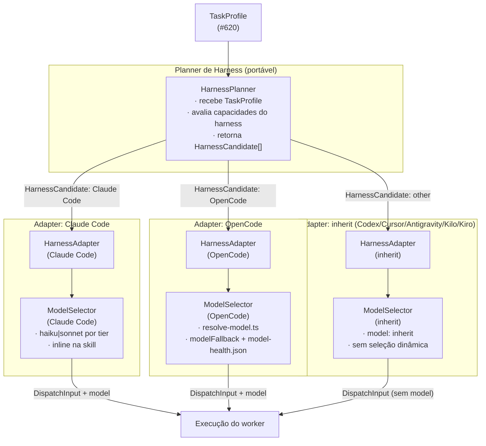

# Investigação: seleção de modelo e interação com seleção de harness

**Issue:** #621 — spike(execution): interação entre seleção de modelo e seleção de harness\
**Data:** 2026-11-10\
**Base:** `master` em `5f96ed9`\
**Contexto:** ADR-002 (`docs/adr/ADR-002-capability-based-execution-routing.md`, ainda não
commitada), Fase 0, objetivo 5; questão aberta 5; ADR-001
(`docs/adr/ADR-001-runtime-independence.md`); matriz de capacidades da #568
(`skills/shared/references/harness-capabilities.md`, `wiki/Contrato-de-Capacidades.md`); relatórios
anteriores `docs/investigations/runtime-boundary.md` (#586),
`docs/investigations/orchestrator-adapter-contract.md` (#587), `docs/investigations/orca-adapter.md`
(#588), `docs/investigations/descoberta-de-capacidades.md` (#618),
`docs/investigations/metadados-para-classificacao.md` (#620); proposta
`docs/proposals/model-tier-strategy.md` (#337).

**Rótulos:** **[Fato]** verificado na fonte citada ou em comando registrado · **[Inferência]**
conclusão derivada dos fatos · **[Opinião]** juízo técnico.

---

## 1. Pergunta

A issue #621 traz quatro perguntas:

1. A seleção de modelo deve ser um planner separado ou ficar dentro das integrações de cada harness?
2. Como a escalação de tier por harness (#337) e a saúde de modelo existentes se conectam ao planner
   sem duplicar lógica?
3. Que restrições de modelo (contexto máximo, disponibilidade, limite de taxa, custo) afetam a
   elegibilidade do harness e quais afetam só o ranking?
4. Como tratar harnesses em que o modelo é fixo ou escolhido pelo usuário e não pelo Vetor?

---

## 2. Resumo

- **[Fato]** O repositório já possui dois mecanismos de seleção de modelo operacionais no harness
  OpenCode: `opencode/scripts/resolve-model.ts` (seleção por tier com fallback saudável) e
  `opencode/scripts/lib/model-health.ts` / `opencode/scripts/model-health.ts` (registro de
  degradação por HTTP 429/529). Esses mecanismos são **exclusivos do OpenCode** e vivem em
  `opencode/scripts/`; nenhum código equivalente existe para Claude Code, Codex, Cursor, Antigravity
  ou Kilo (`opencode/scripts/`, verificado 2026-11-10).
- **[Fato]** A proposta #337 (`docs/proposals/model-tier-strategy.md`) decidiu dois tiers semânticos
  (`simple`/`complex`), com escalação efetiva só em Claude Code e OpenCode. Os demais harnesses
  (Codex, Cursor, Antigravity) ficam com `inherit`. O Kiro (`kiro-cli 3.1.0`) não consta dessa
  proposta.
- **[Fato]** O contrato de seleção de harness (`OrchestratorRegistry.select`,
  `scripts/lib/orchestrator/registry.ts:68-98`) e o de delegação a CLI (`selectDelegationRuntime`,
  `scripts/lib/delegation-runtime.ts:38-60`) só operam por **preferência explícita** do usuário;
  nunca escolhem automaticamente. Nenhum dos dois conhece modelos ou saúde de modelo.
- **[Fato]** O `TaskProfile` proposto em #620
  (`docs/investigations/metadados-para-classificacao.md`, §5) inclui os campos `complexity` e `risk`
  mas não inclui `modelTier` nem nenhuma referência a modelo: a seleção de modelo não está prevista
  no perfil de tarefa.
- **[Inferência]** Os mecanismos de saúde e de tier de modelo são internos ao harness (OpenCode)
  porque o modelo é uma escolha de execução daquele harness — o Vetor não controla o modelo dos
  outros harnesses, apenas declara a intenção (`simple`/`complex`) e cabe ao harness mapeá-la para o
  seu formato nativo.
- **[Opinião]** A seleção de modelo deve ser tratada como um **componente separado** chamado por
  cada adapter de harness — não embutida no planner de harness nem no `TaskProfile`. Isso preserva o
  princípio da ADR-001 §6.4 (independência de runtime vs. de harness) e da ADR-002 (informação de
  modelo separada das capacidades do harness).

---

## 3. Evidências

### 3.1 Mecanismos existentes de seleção e saúde de modelo

#### `opencode/scripts/resolve-model.ts`

**[Fato]** Localização: `opencode/scripts/resolve-model.ts`. Entrada (stdin JSON):
`{ tier?: "simple" | "complex"; fallback?: string[]; cwd?: string }`. Saída: nome de modelo saudável
ou código de saída 1 (todos degradados) / 2 (sem configuração). Lógica (`resolve-model.ts:53-93`):

1. Lê `.claude/vetor/config.json`, campo `modelFallback.<tier>` (lista ordenada de
   `"<provider>/<model>"`).
2. Lê `.claude/vetor/status/model-health.json` (escrito pelo hook de erro do OpenCode).
3. Devolve o primeiro modelo da lista cujo estado não seja `degraded` e não expirado.

Sem `modelFallback.<tier>` configurado e sem `fallback` explícito, termina com código 2 e mensagem
acionável (`resolve-model.ts:63-73`).

#### `opencode/scripts/lib/model-health.ts`

**[Fato]** Localização: `opencode/scripts/lib/model-health.ts`. Funções exportadas:

| Função                     | Linha      | Responsabilidade                                                |
| -------------------------- | ---------- | --------------------------------------------------------------- |
| `isRateLimitOrQuotaStatus` | `:23-25`   | Detecta HTTP 429/529 como degradação                            |
| `computeUntil`             | `:29-43`   | Calcula prazo de degradação (header `retry-after` ou 60 s)      |
| `recordModelHealth`        | `:67-97`   | Grava/atualiza `model-health.json` com lock em disco            |
| `isHealthy`                | `:100-102` | Verifica se entrada está saudável (ausente ou `until` expirado) |
| `pickHealthyModel`         | `:108-112` | Percorre lista de fallback e retorna o primeiro saudável        |

**[Fato]** O arquivo `opencode/scripts/model-health.ts` (CLI do hook `event`) recebe o payload do
erro OpenCode no stdin, chama `isRateLimitOrQuotaStatus` e grava com `recordModelHealth`
(`model-health.ts:35-51`). Ele só é invocado pelo plugin OpenCode
(`docs/proposals/hooks-cost-benefit-review.md:19`: "OpenCode tem hooks adicionais de saúde de
modelo, fora do escopo").

**[Fato]** Nenhum script equivalente existe em `scripts/` (verificado por
`grep -rn "model-health\|pickHealthyModel\|recordModelHealth" scripts/ 2>/dev/null`, saída vazia,
2026-11-10). O mecanismo é exclusivo do harness OpenCode.

#### Referência ao `modelFallback` no coordinator

**[Fato]** A skill `issue-coordinator-dispatch.md` menciona escolha de modelo em dois pontos
(`skills/shared/references/issue-coordinator-dispatch.md:88,94`): `model: "<haiku|sonnet>"` para
Claude Code (aliases diretos) e, implicitamente, listas `modelFallback.<tier>` para OpenCode. No
Claude Code, a escolha é embutida no `Agent()` como parâmetro literal
(`issue-coordinator-dispatch.md:88,111`). Em nenhum caso o coordinator consulta um planner de modelo
externo: a lógica está inline na skill.

### 3.2 Isolamento do mecanismo ao OpenCode

**[Fato]** O `issue-coordinator-dispatch.md` trata a escalação de tier de forma diferente por
harness (`docs/proposals/model-tier-strategy.md`, tabela de mapeamento):

| Harness                 | Mecanismo de tier                             | Quem escolhe                                                  |
| ----------------------- | --------------------------------------------- | ------------------------------------------------------------- |
| Claude Code             | Alias `haiku`/`sonnet` em `Agent()`           | Skill (inline)                                                |
| OpenCode                | `modelFallback.<tier>` via `resolve-model.ts` | Script externo ao harness                                     |
| Codex                   | `inherit`                                     | Harness herda do pai                                          |
| Cursor                  | `inherit`                                     | Harness herda                                                 |
| Antigravity             | `inherit` (estático)                          | Harness herda                                                 |
| Kilo                    | Não mapeado                                   | **[Fato]** ausente em `docs/proposals/model-tier-strategy.md` |
| Kiro (`kiro-cli 3.1.0`) | Não mapeado                                   | **[Fato]** ausente em `docs/proposals/model-tier-strategy.md` |

**[Fato]** `kiro-cli --version` retorna `kiro-cli 3.1.0` (2026-11-10). `kiro-cli --help` lista
subcomandos `chat`, `agent`, `mcp`, `powers`, entre outros. Nenhuma flag `--model` foi observada no
help de nível superior. O parâmetro de modelo, se existir, seria passado por configuração de agente
(não verificado sem `kiro-cli agent --help` aprofundado; marcado como **[Não verificado]**).

**[Inferência]** Kiro e Kilo estão na mesma categoria dos harnesses com herança (`inherit`): o Vetor
não tem como forçar um modelo específico sem apoio documentado do harness, portanto o tratamento
correto é `inherit` ou configuração explícita do usuário, como feito para Cursor e Codex.

### 3.3 ADR-002 e separação de modelo vs. capacidade de harness

**[Fato]** A issue #618 (`docs/investigations/descoberta-de-capacidades.md`, §3.1) registra que a
ADR-002 distingue capacidades declaradas, verificadas e operacionais no descritor/registry e exige
que anúncio não seja tratado como prova operacional. A mesma fonte anota que "informação de modelo"
é separada das "capacidades do harness" — um harness pode suportar vários modelos, e disponibilidade
de modelo não é capacidade de execução.

**[Fato]** O `TaskProfile` proposto em #620 (`docs/investigations/metadados-para-classificacao.md`,
§5) não inclui campo de modelo: inclui `complexity`, `risk` e `requirements`, mas não `modelTier`
nem `modelConstraints`.

**[Inferência]** Isso é consistente com a separação da ADR-002: o planner de harness recebe um
`TaskProfile` e decide qual harness usar; a seleção de modelo é um passo posterior, executado pelo
adapter daquele harness.

### 3.4 Restrições de modelo: elegibilidade de harness vs. ranking

**[Fato]** O mecanismo atual de saúde (`opencode/scripts/lib/model-health.ts`) registra apenas
`degraded` (HTTP 429/529) com prazo de expiração. Não registra contexto máximo, custo nem limite de
taxa preventivo. O único critério de elegibilidade verificado é: "está degradado agora?"

**[Inferência]** As restrições de modelo podem ser classificadas em dois grupos funcionalmente
distintos:

| Restrição                                            | Papel                                                                                               |
| ---------------------------------------------------- | --------------------------------------------------------------------------------------------------- |
| **Disponibilidade** (HTTP 429/529, quota esgotada)   | **Elegibilidade**: torna o modelo temporariamente inelegível; implementado em `lib/model-health.ts` |
| **Contexto máximo insuficiente** para a tarefa       | **Elegibilidade**: se a tarefa requer contexto > limite do modelo, o modelo não pode ser escolhido  |
| **Custo unitário** do modelo                         | **Ranking**: não impede a escolha, mas pode ordenar a lista de fallback                             |
| **Limite de taxa preventivo** (quota semanal/mensal) | **Elegibilidade ou ranking** dependendo da política do usuário                                      |

**[Fato]** O contrato atual de `pickHealthyModel` (`lib/model-health.ts:108-112`) só verifica
disponibilidade. Contexto máximo e custo unitário não estão no arquivo `model-health.json` nem na
interface `ModelHealthEntry` (`lib/model-health.ts:64-68`). Adicionar essas restrições exigiria
ampliar a estrutura do arquivo ou criar um `ModelDescriptor` separado.

**[Fato]** A elegibilidade de harness já é tratada pela ADR-002 §4.2 (citada indiretamente em #618
§3.1): capacidades do harness determinam se ele pode executar a tarefa. Restrições de modelo que
tornam um **modelo** inelegível são diferentes de restrições que tornam o **harness** inelegível: um
harness com vários modelos disponíveis pode ter um modelo degradado sem perder a elegibilidade como
harness.

### 3.5 Harnesses com modelo fixo ou escolhido pelo usuário

**[Fato]** A proposta #337 estabelece:

- **Antigravity:** modelo estático (`inherit`, `flash` ou `pro`) definido no frontmatter; o Vetor
  não escalona dinamicamente (`docs/proposals/model-tier-strategy.md`, linha da tabela
  "Antigravity").
- **Codex:** sem `model`, herda do pai; escalação por `model_reasoning_effort` não implementada na
  primeira versão (`docs/proposals/model-tier-strategy.md`, "Codex").
- **Cursor:** `inherit` ou ID específico por configuração do usuário; alias Claude inválido
  (`docs/proposals/model-tier-strategy.md`, "Cursor").

**[Fato]** O `wiki/Contrato-de-Capacidades.md:9-17` estabelece: "recurso exclusivo de um harness
entra como otimização aditiva com fallback portátil, e nunca como requisito".

**[Inferência]** Harnesses com modelo fixo ou herdado não são problemáticos para o planner: o
`ModelDescriptor` para esses harnesses simplesmente não inclui lista de fallback. O adapter deles
mapeia qualquer tier para `inherit` ou para o ID configurado pelo usuário. O planner não precisa
saber disso — só o adapter sabe.

---

## 4. Resposta às perguntas da issue

### 4.1 Pergunta 1 — Planner separado ou dentro de cada harness?

**[Opinião]** A seleção de modelo deve ser tratada como um **`ModelSelector` separado**, invocado
pelo adapter de cada harness, não embutida no planner de harness nem no núcleo do Vetor.

**Justificativa:**

1. **ADR-002 §objetivo 5** exige que informação de modelo fique separada das capacidades do harness.
   Um planner que mistura "qual harness" com "qual modelo" viola esse princípio.
2. **ADR-001 §6.4** distingue independência de runtime de independência de harness. O modelo é uma
   escolha de execução do harness, não do core.
3. **Evidência do repositório:** o mecanismo existente (`resolve-model.ts`) já é externo ao
   coordinator e ao harness — é um CLI chamado pelo adapter OpenCode. Essa arquitetura já está
   implicitamente correta; o spike apenas a torna explícita.
4. **Portabilidade:** o planner de harness pode ser portável (recebe `TaskProfile`, devolve harness
   elegível); o `ModelSelector` não precisa ser portável entre harnesses — cada adapter chama o seu.

O diagrama de responsabilidades (Mermaid):



O `HarnessPlanner` não conhece modelos. Cada `ModelSelector` não conhece outros harnesses. O núcleo
portável do Vetor não precisa de nenhum dos dois — eles vivem nos adapters.

### 4.2 Pergunta 2 — Conexão com escalação de tier e saúde de modelo sem duplicação

**[Fato]** O mecanismo atual duplica parcialmente a lógica: a skill `issue-coordinator-dispatch.md`
tem a regra de tier embutida inline para Claude Code (`issue-coordinator-dispatch.md:88,94`),
enquanto o OpenCode usa um script externo (`resolve-model.ts`). São dois pontos de manutenção com a
mesma semântica (`simple`/`complex`).

**[Opinião]** Para evitar duplicação sem quebrar a portabilidade:

1. **O contrato semântico de tier** (`simple`/`complex`) fica no `TaskProfile` como campo
   `modelTier?: "simple" | "complex"` derivado de `complexity` e `risk`. Não é novo conceito — é a
   mesma semântica da proposta #337 — mas agora flui do perfil em vez de ser regra inline.
2. **Cada adapter implementa o mapeamento** `modelTier → modelo nativo`. Para Claude Code:
   `simple → haiku, complex → sonnet` (como hoje). Para OpenCode: `resolve-model.ts` com a lista
   `modelFallback.<tier>`. Para harnesses com `inherit`: ignora `modelTier`.
3. **O mecanismo de saúde** (`model-health.json`, `pickHealthyModel`) não muda de lugar: continua no
   adapter OpenCode, que é o único que tem visibilidade dos erros HTTP do provedor. Os outros
   harnesses não expõem esse sinal de forma portável.

**[Fato]** O ponto do código que o planner consumiria (consulta real, 2026-11-10):

| Arquivo                                                  | Linha                | Função/Dado                                                                              |
| -------------------------------------------------------- | -------------------- | ---------------------------------------------------------------------------------------- |
| `opencode/scripts/lib/model-health.ts`                   | `:108-112`           | `pickHealthyModel(fallback, health, now)` — seleção do primeiro modelo saudável da lista |
| `opencode/scripts/lib/model-health.ts`                   | `:100-102`           | `isHealthy(entry, now)` — predicado de saúde por modelo                                  |
| `opencode/scripts/lib/model-health.ts`                   | `:67-97`             | `recordModelHealth(path, key, entry)` — gravação com lock em disco                       |
| `opencode/scripts/lib/model-health.ts`                   | `:23-25`             | `isRateLimitOrQuotaStatus(statusCode)` — classifica HTTP 429/529                         |
| `opencode/scripts/resolve-model.ts`                      | `:53-93`             | `main()` — CLI completo: lê config + health, devolve modelo                              |
| `opencode/scripts/model-health.ts`                       | `:35-51`             | `main()` — CLI de registro: invocado pelo hook `event` do OpenCode                       |
| `.claude/vetor/status/model-health.json`                 | (arquivo gerado)     | Estado de saúde persistido por modelo/provedor                                           |
| `skills/shared/references/issue-coordinator-dispatch.md` | `:88,94,111`         | Regras inline de tier para Claude Code (`haiku`/`sonnet`)                                |
| `docs/proposals/model-tier-strategy.md`                  | tabela de mapeamento | Contrato `simple`/`complex` por harness (decidido 2026-10-15)                            |

### 4.3 Pergunta 3 — Restrições que afetam elegibilidade vs. ranking

**[Fato]** O mecanismo atual (`opencode/scripts/lib/model-health.ts`) só implementa elegibilidade
por disponibilidade (HTTP 429/529). As demais restrições não estão implementadas no repositório
(verificado em 2026-11-10).

**[Opinião]** Classificação das restrições:

| Restrição                                        | Papel                                                       | Implementação atual                                                               | Onde vai no ModelDescriptor                   |
| ------------------------------------------------ | ----------------------------------------------------------- | --------------------------------------------------------------------------------- | --------------------------------------------- |
| Disponibilidade (rate limit / quota)             | **Elegibilidade** — torna modelo temporariamente inelegível | ✅ `model-health.json` + `isRateLimitOrQuotaStatus`                               | Campo `health.status` / `health.until`        |
| Contexto máximo insuficiente para a tarefa       | **Elegibilidade** — modelo não consegue processar a tarefa  | ❌ não implementado                                                               | Campo `maxContextTokens` no `ModelDescriptor` |
| Custo unitário                                   | **Ranking** — ordena a lista de fallback, não bloqueia      | ❌ não implementado (a ordenação da lista em `modelFallback` já serve como proxy) | Campo `costTierHint` ou ordem da lista        |
| Limite de taxa preventivo (quota semanal/mensal) | **Elegibilidade ou ranking** dependendo da política         | ❌ não implementado                                                               | Campo `quotaPolicy` no `ModelDescriptor`      |

**[Inferência]** Para a ADR-002, apenas disponibilidade (já implementada) afeta a elegibilidade de
harness de forma relevante: se todos os modelos do único harness disponível estão degradados, o
Vetor não pode executar a tarefa por esse harness. Contexto máximo é elegibilidade de modelo, não de
harness — a menos que o harness só tenha um modelo. Custo e quota são critérios de ranking, não
bloqueadores.

### 4.4 Pergunta 4 — Harnesses com modelo fixo ou escolhido pelo usuário

**[Fato]** A proposta #337 já estabelece o tratamento: Codex, Cursor e Antigravity ficam com
`inherit` ou estático. O Vetor não força um modelo nesses harnesses.

**[Opinião]** O `ModelDescriptor` para esses harnesses deve declarar
`selectionMode:
"user-controlled"` ou `selectionMode: "harness-controlled"`. O adapter não invoca
nenhum `ModelSelector` — o dispatch segue sem parâmetro de modelo, e o harness escolhe por conta
própria.

Isso preserva o princípio da ADR-001 §6.3: "Nenhum orquestrador deve ser embutido no Core". Da mesma
forma, nenhum modelo deve ser forçado em um harness que não oferece controle de modelo ao chamador.

---

## 5. Proposta de `ModelDescriptor`

**[Opinião]** O `ModelDescriptor` deve ser separado do descritor de harness (que descreve
capacidades de execução). Ele descreve as propriedades e restrições de um modelo dentro de um
harness específico.

```ts
// Proposta — não é código de produção; tipo ilustrativo para a issue #621.

/** Modo de seleção de modelo para este harness. */
type ModelSelectionMode =
  /** O Vetor escolhe o modelo via ModelSelector (ex.: OpenCode). */
  | "vetor-controlled"
  /** O modelo é fixo no frontmatter do agente (ex.: Antigravity estático). */
  | "harness-controlled"
  /** O usuário configurou o modelo explicitamente; o Vetor não substitui. */
  | "user-controlled"
  /** O harness herda o modelo do pai (ex.: Codex, Cursor, Kiro sem config). */
  | "inherit";

interface ModelHealthSnapshot {
  /** Estado atual. Ausente = saudável. */
  status?: "degraded";
  /** Timestamp UNIX (ms) até quando o modelo está degradado. */
  until?: number;
  /** Texto do último erro registrado. */
  lastError?: string;
}

interface ModelDescriptor {
  /** Identificador portável no formato "<provider>/<model>" ou alias do harness (ex.: "haiku"). */
  id: string;
  /** Tier semântico a que este modelo corresponde neste harness. */
  tier: "simple" | "complex" | "unknown";
  /** Modo de seleção — define se o ModelSelector pode substituir este modelo. */
  selectionMode: ModelSelectionMode;
  /**
   * Contexto máximo em tokens, se conhecido.
   * Ausente = desconhecido; o ModelSelector não filtra por contexto.
   */
  maxContextTokens?: number;
  /**
   * Dica de custo relativo (escala livre, menor = mais barato).
   * Usado para ordenar a lista de fallback; não é critério de bloqueio.
   */
  costTierHint?: number;
  /** Saúde atual do modelo. Preenchida em runtime pelo adapter; ausente = saudável. */
  health?: ModelHealthSnapshot;
}
```

**Separação de responsabilidades:**

- `ModelDescriptor` descreve **um modelo dentro de um harness**. Não descreve o harness.
- O descritor de harness (ADR-002 §4.1, ainda não commitado) descreve capacidades de execução. Não
  inclui modelos.
- `HarnessPlanner` recebe `TaskProfile` + lista de harnesses candidatos. Não conhece modelos.
- `ModelSelector` recebe lista de `ModelDescriptor` para o harness escolhido. Não conhece outros
  harnesses.

**Harnesses com `selectionMode: "inherit"` ou `"user-controlled"`:** o adapter não chama
`ModelSelector`. O `ModelDescriptor` ainda existe (para auditoria e logging), mas `pickHealthyModel`
não é invocado.

---

## 6. Independência de provedor

**[Fato]** O contrato `modelFallback.<tier>` em `.claude/vetor/config.json` já usa o formato
`"<provider>/<model>"` (ex.: `"anthropic/claude-haiku-4-5"`,
`"openrouter/anthropic/claude-haiku-4-5"`), permitindo múltiplos provedores na mesma lista
(`resolve-model.ts:40-55`). Nenhuma string de provedor está embutida no código de seleção — só na
configuração do usuário.

**[Fato]** A função `pickHealthyModel` (`lib/model-health.ts:108-112`) opera sobre strings opacas:
não interpreta o prefixo de provedor. A chave no `model-health.json` é a string completa
`"<provider>/<model>"`, independente do provedor.

**[Inferência]** O mecanismo atual já é independente de provedor na implementação. O risco de
acoplamento está na **configuração padrão** (exemplos com `anthropic/...`), não no código
(`resolve-model.ts:21-27`).

**[Opinião]** O `ModelDescriptor` proposto preserva essa independência: `id` é uma string opaca, e
`ModelSelector` não interpreta o provedor. O adapter de cada harness conhece o formato nativo do seu
CLI (`--model anthropic/claude-haiku-4-5` para OpenCode, `model: "haiku"` para Claude Code), mas o
`ModelDescriptor` não acopla o núcleo a nenhum formato.

---

## 7. Limitações e não verificado

- **[Não verificado]** Flags de modelo do `kiro-cli 3.1.0` em sessões de agente: `kiro-cli --help`
  lista subcomandos mas não expõe `--model` no nível superior (verificado 2026-11-10). O suporte a
  seleção de modelo por dispatch requer inspeção de `kiro-cli agent --help` ou documentação do Kiro,
  não realizada aqui.
- **[Não verificado]** Contexto máximo por modelo: nenhum arquivo do repositório registra
  `maxContextTokens` por modelo/harness. Os valores precisariam ser consultados nas documentações
  oficiais dos provedores ou inferidos a partir da documentação de cada harness.
- **[Fato]** O repositório `Tavaressan/delphos` não foi consultado; nenhuma informação dele foi
  incluída.
- **[Inferência]** O mecanismo de saúde de modelo do OpenCode não é portável diretamente para outros
  harnesses: depende do evento `session.error` do SDK `@opencode-ai/plugin` e da correlação
  `sessionID → model` via `chat.params`. Outros harnesses precisariam de um mecanismo equivalente
  específico ao seu SDK, se expuserem esse sinal.

---

## Critério de aceite

- [x] **Relatório em `docs/investigations/` com recomendação para a pergunta 1 e diagrama de
      responsabilidades entre planner de harness e seleção de modelo.**\
      Atendido em §4.1: recomendação de `ModelSelector` separado, diagrama Mermaid com
      `HarnessPlanner`, adapters e `ModelSelector` por harness.

- [x] **Lista de pontos do código atual (model health, tiers) que o planner consumiria, com
      fonte.**\
      Atendido em §4.2: tabela com 7 pontos de código, cada um com `arquivo:linha` verificado em
      2026-11-10.

- [x] **Proposta de formato de `ModelDescriptor` separado do descritor de harness.**\
      Atendido em §5: tipo TypeScript com campos `id`, `tier`, `selectionMode`, `maxContextTokens`,
      `costTierHint` e `health`; justificativa de separação; tratamento de `inherit` e
      `user-controlled`.

- [x] **Nenhuma recomendação acopla o roteamento a um provedor.**\
      Atendido em §6: o mecanismo existente já é independente de provedor; o `ModelDescriptor`
      proposto usa `id` opaco; o acoplamento atual está apenas na configuração do usuário
      (documentado como risco em §6, **[Inferência]**).
