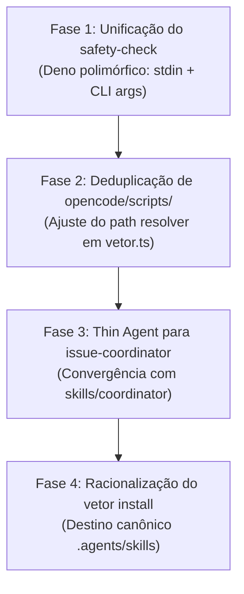

Status: **proposta técnica — Spike #404 em avaliação**

# Deduplicação de Skills, Agentes e Scripts entre Agent Harnesses (Spike #404)

## Decisão recomendada

1. **Unificar scripts de segurança e utilitários em `scripts/` (Deno como runtime comum):**
   - Eliminar `scripts/safety-check.sh` (66 linhas), estendendo `scripts/safety-check.ts` para suportar tanto stdin JSON (Claude Code, Codex, Cursor, OpenCode adapter) quanto argumentos de linha de comando `Deno.args` (Antigravity `run_command` hook via `hooks.json`). Isso fecha imediatamente o gap de segurança no Antigravity (que hoje não cobre comandos destrutivos, isolamento estrito de escrita, contaminação de `agent_id` nem frescor de worktree).
   - Eliminar as 8 cópias espelhadas em `opencode/scripts/` (1.203 linhas / 47.287 bytes duplicados com drift acumulado em relação às 1.638 linhas / 68.863 bytes de `scripts/`).
   - Fazer o adaptador OpenCode (`opencode/plugin/vetor.ts`) resolver os scripts diretamente de `scripts/` canônico, mantendo em `opencode/scripts/` apenas os módulos estritamente específicos de saúde de modelo (`model-health.ts`, `resolve-model.ts`, etc.) ou movê-los para `scripts/lib/opencode/`.

2. **Desfazer o fork de `opencode/agent/issue-coordinator.md` (570 linhas / 34.568 bytes):**
   - Substituir o agente monolítico forked por um agente fino que referencia `skills/coordinator/SKILL.md` e os documentos compartilhados em `skills/shared/references/` (`issue-coordinator-dispatch.md`, `monitoring.md`, `report.md`).
   - Manter em `opencode/agent/issue-coordinator.md` estritamente o frontmatter com permissões nativas do OpenCode e as diretrizes do modelo de execução por processo externo (`opencode run --dir <worktree>`).

3. **Adotar `.agents/skills/` como destino canônico compartilhado no instalador CLI (`vetor install`):**
   - Aproveitar o padrão emergente de Agent Skills (`.agents/skills/`), já descoberto nativamente por Google Antigravity, OpenAI Codex e Cursor.
   - Eliminar a multiplicação de cópias em projetos multi-harness: em vez de gravar 42 arquivos (~360 KB) repetidamente em `.cursor/skills/`, `.agents/skills/` e `.claude/skills/`, instalar skills prioritariamente em `.agents/skills/` e criar adapters/links declarativos apenas para harnesses com âncoras legadas rígidas.
   - Preservar manifestos nativos leves em cada harness (`.claude-plugin/plugin.json`, `.codex-plugin/plugin.json`, `.cursor-plugin/plugin.json`, `plugin.json` na raiz), seguindo o modelo comprovado por `obra/superpowers`.

---

## Contexto e Motivação Histórica

O Vetor foi concebido como um plugin nativo do Claude Code e progressivamente expandido para suportar outros harnesses de agentes autônomos: Google Antigravity, OpenAI Codex, OpenCode e Cursor.

Historicamente, cada novo harness foi integrado por meio de adaptações verticais pontuais:
1. **Antigravity (Issues #10, #28, #37, #38):** Adicionou `hooks.json` na raiz apontando para `scripts/safety-check.sh` porque o hook `run_command` do Antigravity envia o comando executado como argumentos de linha de comando (`$@`), e não como JSON em stdin. O script shell recebeu apenas as duas regras iniciais (bloqueio de push para branches protegidas e push de worker não-`GREEN`), ficando estagnado em 66 linhas enquanto `scripts/safety-check.ts` evoluiu para 357 linhas.
2. **OpenCode (Issues #82, #283, #306, #311, #312, #313, #335):** Como o OpenCode não possui manifesto único nem variáveis de ambiente de plugin (`$CLAUDE_PLUGIN_ROOT`/`$PLUGIN_ROOT`), a issue #283 introduziu a pasta `opencode/` contendo cópias completas de scripts em `opencode/scripts/` e um fork do coordenador em `opencode/agent/issue-coordinator.md`. Conforme documentado na `wiki/Compatibilidade-OpenCode.md:67-68`, esse trade-off de deriva foi assumido deliberadamente como solução temporária.
3. **Cursor e Codex (Issues #76, #256, #284, #396, #397):** Introduziram suporte a `apply_patch`, eventos `beforeShellExecution` e o manifesto `.codex-plugin/plugin.json` apontando diretamente para `"skills": "./skills"` e `"hooks": "./hooks/hooks-codex.json"`.

### O Custo do Modelo Atual
A coexistência desses mecanismos gerou dois problemas críticos:
- **No repositório do Vetor (Git):** Alto risco de drift silencioso e sobrecarga de sincronização manual. Por exemplo, o PR #401 exigiu replicar manualmente para `opencode/` alterações já testadas em #245 e #246. Além disso, `opencode/scripts/safety-check.ts` não recebeu as salvaguardas cruciais de comandos git destrutivos (#4, #123, #161, #184) nem a distinção de `agent_type` (#342, #374).
- **Nos projetos consumidores (`vetor install`):** Quando um desenvolvedor executa `vetor install` em um projeto com múltiplos harnesses configurados (ex.: Claude Code + Cursor + OpenCode + Antigravity), o instalador replica 42 arquivos de skills (~360 KB) e arquivos de agentes em até 4 diretórios distintos (`.claude/`, `.cursor/`, `.agents/`, `.opencode/`), adicionando mais de 1,2 MB de arquivos idênticos ao repositório do usuário.

---

## 1. Inventário Exaustivo de Duplicações (RF-01)

### 1.1 Duplicações entre `scripts/` e `opencode/scripts/`

A pasta `opencode/scripts/` possui atualmente **20 arquivos** (total de 103.585 bytes e 2.479 linhas).
Desses, **8 arquivos são cópias/forks diretos** de arquivos em `scripts/`, somando **47.287 bytes e 1.203 linhas de duplicação**:

| Arquivo em `opencode/scripts/` | Arquivo Canônico em `scripts/` | Linhas (Root / OpenCode) | Bytes (Root / OpenCode) | Linhas Diferentes (Diff) | Natureza do Drift Identificado |
|---|---|---:|---:|---:|---|
| `check-edit.ts` | `scripts/check-edit.ts` | 170 / 147 | 5.321 / 4.532 | 27 | OpenCode não possui o filtro de falsos positivos do Next.js (#345, #353, #384). |
| `safety-check.ts` | `scripts/safety-check.ts` | 357 / 202 | 17.090 / 8.368 | 201 | OpenCode não possui suporte a `apply_patch` (Codex #76), `beforeShellExecution` (Cursor #284), verificação de comandos git destrutivos (`git reset --hard`, `git clean -f*`, `git branch -D`, `git checkout .`) nem flexibilização de escrita por `agent_type` (#342, #374). |
| `vetor-checks.sh` | `scripts/vetor-checks.sh` | 531 / 317 | 25.279 / 14.042 | 224 | Root recebeu 214 linhas adicionais de verificações determinísticas ausentes no OpenCode. |
| `vetor-status.sh` | `scripts/vetor-status.sh` | 123 / 116 | 4.988 / 4.674 | 11 | Pequenas variações de formatação e flags de compatibilidade. |
| `lib/guard.ts` | `scripts/lib/guard.ts` | 68 / 48 | 2.648 / 2.043 | 32 | Root possui validações aprimoradas de write allowed para orquestrador vs worker. |
| `lib/project.ts` | `scripts/lib/project.ts` | 274 / 263 | 8.343 / 8.677 | 89 | Variações em resolução de cwd e comandos de teste. |
| `lib/status.ts` | `scripts/lib/status.ts` | 69 / 69 | 2.979 / 2.985 | 2 | Praticamente idênticos (diferença de quebras de linha/espaçamento). |
| `lib/worktree.ts` | `scripts/lib/worktree.ts` | 46 / 41 | 2.215 / 1.966 | 9 | Root inclui verificação de frescor de worktree linkado. |
| **Subtotal Duplicado** | **8 arquivos** | **1.638 / 1.203** | **68.863 / 47.287** | **595** | **47,2 KB de redundância pura sujeita a drift** |

Os outros **12 arquivos** em `opencode/scripts/` (56.298 bytes, 1.276 linhas) contêm extensões legítimas do OpenCode que não existem no root:
- Gestão de permissão de diretório externo: `ensure-external-directory-permission.ts` (163 linhas) e teste (206 linhas).
- Monitoramento de cotas e saúde de modelos: `model-health.ts` (50 linhas), `lib/model-health.ts` (133 linhas) e testes (261 linhas).
- Resolução de modelo dinâmico por fallback: `resolve-model.ts` (112 linhas) e teste (185 linhas).
- Suítes de teste de integração: `agent-registration_test.ts` (92 linhas), `issue-coordinator_test.ts` (70 linhas), `vetor-checks_test.ts` (79 linhas), `lib/project_test.ts` (68 linhas).

---

### 1.2 Duplicação entre `scripts/safety-check.sh` e `scripts/safety-check.ts`

| Dimensão de Comparação | `scripts/safety-check.sh` | `scripts/safety-check.ts` | Avaliação de Gap |
|---|---|---|---|
| **Tamanho e complexidade** | 66 linhas (3.036 bytes) | 357 linhas (17.090 bytes) | O script TS é 5,6× maior e cobre 5 camadas adicionais de segurança. |
| **Gatilho / Mecanismo de Entrada** | Argumentos de linha de comando (`$@`) | Stdin JSON (`HookInput`) | `safety-check.sh` foi criado apenas para atender `hooks.json:10` do Antigravity. |
| **Bloqueio de push a main/master/production** | Sim (linhas 13-27) | Sim (`checkBash`, linhas 106-137) | Ambos cobrem. |
| **Bloqueio de push/PR por worker não-GREEN** | Sim (linhas 33-64, com fallback #323) | Sim (`checkBash`, linhas 139-183) | Ambos cobrem. |
| **Comandos Git Destrutivos (`reset --hard`, `clean -f*`, `branch -D`)** | **Não** (ausente) | Sim (`checkBash`, linhas 185-236) | **Vulnerabilidade no Antigravity**: worker pode destruir worktree sem bloqueio. |
| **Confinamento de Escrita (`isWriteAllowed`)** | **Não** (ausente) | Sim (`checkWrite`, linhas 240-276) | **Vulnerabilidade no Antigravity**: subagente pode escrever fora do worktree. |
| **Binding de `agent_id` anti-contaminação (#63)** | **Não** (ausente) | Sim (`checkBinding`, linhas 278-299) | Ausente no Antigravity. |
| **Checagem de frescor da branch base (#114)** | **Não** (ausente) | Sim (`checkFreshness`, linhas 322-324) | Ausente no Antigravity. |
| **Suporte a Windows nativo sem Bash** | Falha se `bash` não estiver no PATH | Roda via Deno nativo em Windows/Linux/macOS | `safety-check.sh` falha no PowerShell padrão sem git-bash. |

---

### 1.3 Fork de `opencode/agent/issue-coordinator.md` vs `skills/coordinator/`

- **`opencode/agent/issue-coordinator.md`**: 570 linhas (34.568 bytes).
- **`skills/coordinator/SKILL.md`**: 492 linhas (28.153 bytes).
- **Documentos de referência modularizados (#373)**:
  - `skills/shared/references/issue-coordinator-dispatch.md` (141 linhas, 10.407 bytes)
  - `skills/shared/references/issue-coordinator-monitoring.md` (30 linhas, 1.749 bytes)
  - `skills/shared/references/issue-coordinator-report.md` (42 linhas, 2.477 bytes)

**Causa do Fork:**
O OpenCode descobre agentes executáveis via CLI (`opencode run --agent <nome>`) exclusivamente em `.opencode/agent/<nome>.md`. Quando o coordinator residia em `.opencode/skills/`, o CLI do OpenCode não o listava em `opencode agent list` nem permitia seu despacho headless (Issue #306). Para contornar isso, o arquivo foi copiado para `opencode/agent/` e todo o conteúdo das referências modulares foi embutido diretamente no corpo do agente em uma cópia monolítica de 570 linhas.

**Impacto:**
Toda refatoração conceitual do coordinator (ex.: melhorias no cálculo de afinidade, filtros de issues, formato do relatório final da Fase 7) exige edição dupla. Conforme apontado na issue #335 e PR #401, o risco de perda de paridade funcional entre Claude Code e OpenCode é permanente.

---

### 1.4 Manifestos de Plugin e Metadados

Hoje existem **5 arquivos de manifesto** no repositório:

1. `plugin.json` (raiz, 456 bytes, 9 linhas): Formato Antigravity (`$schema: https://antigravity.google/schemas/v1/plugin.json`).
2. `.claude-plugin/plugin.json` (739 bytes, 17 linhas): Formato Claude Code (`$schema: https://json.schemastore.org/claude-code-plugin-manifest.json`, inclui `userConfig` de `context7_api_key`).
3. `.claude-plugin/marketplace.json` (970 bytes, 21 lines): Metadados de publicação no marketplace do Claude Code.
4. `.codex-plugin/plugin.json` (531 bytes, 12 linhas): Formato Codex, declarando explicitamente `"skills": "./skills"` e `"hooks": "./hooks/hooks-codex.json"`.
5. `.cursor-plugin/plugin.json` (491 bytes, 11 linhas): Formato Cursor, declarando `"skills": "./skills"`.

**Diagnóstico:** Esses manifestos não representam duplicação de lógica, mas sim **manifestos finos nativos de integração**. Cada harness exige seu próprio arquivo de descoberta em local padronizado. O Codex e o Cursor já apontam diretamente para `./skills` canônico sem necessidade de duplicar arquivos. Manter manifestos finos por harness é exatamente o padrão adotado por `obra/superpowers`.

---

### 1.5 Multiplicação de Arquivos Gerada pelo `vetor install` no Projeto-Alvo

No projeto-alvo do usuário, `vetor install` escreve cópias físicas completas de acordo com as engines selecionadas:

| Componente | Tamanho Original Canônico | Cópias por Engine Selecionada | Impacto em Setup Multi-Engine (ex.: Claude + Cursor + OpenCode + Antigravity) |
|---|---|---|---|
| **Skills (42 arquivos)** | 360.354 bytes (~360 KB) | `.claude/skills/` (360 KB) `.cursor/skills/` (360 KB) `.agents/skills/` (360 KB) `.opencode/skills/` (se copiado) | **Até 1.080 KB de skills repetidas** em 3 a 4 diretórios no mesmo projeto! |
| **Agentes (4 arquivos)** | 18.885 bytes (~19 KB) | `.claude/agents/` `.cursor/agents/` `.agents/agents/` `.codex/agents/` | ~57 KB duplicados em 3 a 4 pastas. |
| **Scripts e Plugin OpenCode** | 155.127 bytes (~155 KB) | `.opencode/` (scripts, lib, agent, plugin) | ~155 KB copiados diretamente para a raiz do projeto consumidor. |
| **Total por Projeto Consumidor** | **~380 KB (único)** | **Multiplicado por N engines** | **De 850 KB a 1.250 KB de arquivos clonados no Git do usuário** |

---

## 2. Comparativo Técnico com Padrões de Mercado (RF-02)

Confrontamos a arquitetura do Vetor com as duas principais referências do ecossistema:
- **`obra/superpowers` (Jesse Vincent):** Framework de skills focado em engenharia de software e subagentes, com suporte a Claude Code, OpenCode, Cursor e Codex.
- **`mattpocock/skills` (Matt Pocock):** Conjunto modular de skills reutilizáveis baseado no padrão aberto de Agent Skills e distribuído via CLI agnóstica (`npx skills@latest add`).

### Matriz Comparativa

| Critério de Arquitetura | Vetor (Atual) | `obra/superpowers` | `mattpocock/skills` |
|---|---|---|---|
| **Estrutura de Diretórios** | Mista: `skills/` na raiz, `agents/` na raiz, `opencode/` com árvore espelhada (`agent/`, `scripts/`, `plugin/`), `cli/templates/` gerado. | **Fonte única canônica**: `skills/` e `agents/` na raiz. Manifestos leves em `.claude-plugin/`, `.codex-plugin/`, etc. | **Diretório plano único**: `<skill>/SKILL.md` ou `.agents/skills/<skill>/SKILL.md`. Zero duplicação no repo. |
| **Integração com OpenCode** | Cópia estática completa da pasta `opencode/` para dentro de `.opencode/` no projeto-alvo. | **Thin plugin package**: `"plugins": ["superpowers@git+..."]`. O plugin OpenCode é um pacote fino que carrega as skills da raiz. | Invocação como skill nativa via catálogo ou cópia direcionada para `.opencode/skills`. |
| **Tratamento de Scripts e Hooks** | Fragmentado: Deno para Claude/Codex, Bash para Antigravity (`safety-check.sh`), TS espelhado em `opencode/scripts/`. | Scripts universais em Node/Shell compartilhados, referenciados relativamente pelo plugin adapter. | Foco primário em prompts e markdown (`SKILL.md`), minimizando scripts externos dependentes de runtime. |
| **Instalação no Projeto Alvo** | `vetor install` copia arquivos para as âncoras locais de cada engine (`.claude`, `.cursor`, `.agents`, `.codex`, `.opencode`). | Instalação via marketplace nativo de cada harness ou plugin remoto via Git/npm. | `npx skills@latest add <repo>` instala no destino canônico configurado (`.agents/skills/` ou `.claude/skills/`). |
| **Descoberta Multi-Harness** | Cada harness recebe sua própria pasta física duplicada. | Harnesses compartilham `./skills` via manifestos declarativos apontando para o mesmo path relativo. | Aproveitamento do padrão comum `.agents/skills` reconhecido por múltiplos harnesses modernos. |
| **Risco de Drift de Código** | **Alto** (provado no PR #401, #245, #246, #335). | **Nulo** (existe apenas uma cópia de cada skill e agente no repositório). | **Nulo** (fonte única e canônica). |

### Principais Lições Aprendidas das Referências

1. **Manifestos Nativos Finos com Caminhos Relativos:** `obra/superpowers` demonstra que não é necessário ter árvores de skills separadas para cada engine. Manifestos como `.codex-plugin/plugin.json` e `.cursor-plugin/plugin.json` podem declarar `"skills": "./skills"` apontando diretamente para a pasta canônica da raiz. O Vetor já adota isso em `.codex-plugin` e `.cursor-plugin`; falta aplicar o mesmo princípio ao OpenCode e Antigravity.
2. **Thin Plugin Adapter para OpenCode:** O OpenCode permite carregar plugins via pacote npm ou git URL. Em vez de exigir que todas as skills e scripts residam fisicamente dentro de `.opencode/`, o plugin `opencode/plugin/vetor.ts` pode importar ou invocar os scripts a partir de uma localização central (ou empacotada), sem replicar o código-fonte em duas pastas do Git.
3. **Adoção de `.agents/skills/` como Pasta Canônica Compartilhada:** O padrão do Agent Skills specification (`agentskills.io`), popularizado por Matt Pocock e formalizado pelo ecossistema de agentes (incluindo Google Antigravity e OpenAI Codex), estabelece `.agents/skills/<name>/SKILL.md` como diretório de trabalho padrão. Se o `vetor install` instalar skills primariamente em `.agents/skills/`, Antigravity, Cursor e Codex podem ler a **mesma pasta física**, eliminando 2 a 3 cópias no projeto do usuário.

---

## 3. Matriz de Decisão Arquitetural

| Frente / Proposta | Classificação Epistêmica | Decisão Recomendada | Justificativa Técnica e Fatos |
|---|---|---|---|
| **Frente 1: Unificação de `safety-check`** | **Fato:** `safety-check.sh` possui 66 linhas e não cobre comandos destrutivos, isolamento estrito de escrita, contaminação de `agent_id` nem frescor. `safety-check.ts` possui 357 linhas e cobre todos esses pontos. **Opinião:** Manter duas implementações paralelas de segurança com linguagens diferentes (Bash vs TS) é uma falha grave de governança. | **Unificar em `scripts/safety-check.ts` e eliminar `safety-check.sh`** | Ajustar `scripts/safety-check.ts` para verificar se `raw` do stdin está vazio e, havendo `Deno.args`, tratar `Deno.args.join(" ")` como comando a inspecionar. No Antigravity `hooks.json`, alterar o comando para `deno run -A ./scripts/safety-check.ts`. Eliminar `scripts/safety-check.sh`. Paridade total e eliminação de duplicação. |
| **Frente 2: Eliminação de `opencode/scripts/`** | **Fato:** 8 dos 20 arquivos em `opencode/scripts/` são cópias defasadas de `scripts/` (595 linhas divergentes). O próprio comentário de `opencode/plugin/vetor.ts:12-13` afirma que a fonte única deveria ser `scripts/lib/*.ts`. **Inferência:** O OpenCode pode perfeitamente invocar `scripts/` canônico se o plugin resolver o path a partir do pacote instalado ou da raiz do monorepo. | **Eliminar os 8 scripts duplicados de `opencode/scripts/` e ajustar o resolver de `vetor.ts`** | Modificar `opencode/plugin/vetor.ts` para resolver `SCRIPTS_DIR` prioritariamente em `scripts/` canônico da raiz (ou a partir de `templates/scripts/` no pacote publicado do CLI). Manter em `opencode/scripts/` apenas os utilitários específicos de OpenCode (`model-health.ts`, `resolve-model.ts`, `ensure-external-directory-permission.ts`) ou agrupá-los em `opencode/lib/`. |
| **Frente 3: Desfazer o fork do `issue-coordinator`** | **Fato:** `opencode/agent/issue-coordinator.md` tem 570 linhas e duplica o texto de `skills/coordinator/SKILL.md` e das 3 referências modulares. **Fato:** O OpenCode exige que um agente chamado via `--agent` resida em `.opencode/agent/<nome>.md`. **Opinião:** O agente OpenCode pode ser um wrapper conciso (~60 linhas) que instrui o agente a executar a skill canônica do coordinator. | **Transformar `opencode/agent/issue-coordinator.md` em Thin Agent Wrapper** | O arquivo em `opencode/agent/` mantém o frontmatter nativo (`mode: primary`, permissões de bash/edit) e instruções essenciais de bootstrap (execução multi-processo `opencode run --dir`), mas orienta o agente a carregar e seguir `skills/coordinator/SKILL.md` e `skills/shared/references/*` diretamente, eliminando 500 linhas de texto duplicado. |
| **Frente 4: Racionalização do CLI e Destino Canônico `.agents/skills`** | **Fato:** Antigravity, Cursor e Codex conseguem descobrir skills em `.agents/skills/`. **Fato:** O instalador `cli/lib/installer/writer.js` hoje grava skills separadamente para `.cursor/`, `.claude/` e `.agents/`. **Opinião:** O instalador deve concentrar a instalação de skills em um diretório único quando múltiplas engines compatíveis estiverem ativas. | **Instalador com diretório canônico compartilhado `.agents/skills`** | Quando o projeto-alvo tiver mais de uma engine compatível com Agent Skills (Antigravity, Cursor, Codex), o `writer.js` grava as skills apenas uma vez em `.agents/skills/`. Para o Claude Code (que espera `.claude/skills/`), criar fallback ou links adequados, garantindo que o disco do usuário não sofra replicação 4×. |

---

## 4. Plano de Migração Incremental sem Quebra (RF-03)

Para assegurar que nenhuma funcionalidade seja degradada e que os testes em todos os harnesses continuem verdes em cada etapa, a migração é estruturada em **4 fases sequenciais**:

### Fase 1: Unificação de `safety-check` (Deno Universal)
1. **Alteração em `scripts/safety-check.ts`:**
   - Adicionar fallback para inspeção de `Deno.args` caso o payload JSON de stdin seja nulo/vazio. Se `Deno.args.length > 0`, junta os argumentos como comando shell e invoca `checkBash(command, wt)`.
2. **Atualização do manifesto Antigravity (`hooks.json`):**
   - Alterar `"command": "./scripts/safety-check.sh"` para `"command": "deno run -A ./scripts/safety-check.ts"`.
3. **Depreciação e remoção segura:**
   - Deixar `scripts/safety-check.sh` como wrapper transitório de 3 linhas chamando `deno run -A "$(dirname "$0")/safety-check.ts" "$@"` com aviso de depreciação, antes de sua remoção final.
4. **Critério de Aceite da Fase:**
   - Antigravity passa a bloquear tentativas de `git reset --hard` e escrita fora do worktree por workers.
   - Suíte de testes `scripts/tests/safety-check_test.ts` e `scripts/tests/session-check-sh_test.ts` 100% verde.

### Fase 2: Deduplicação de `opencode/scripts/`
1. **Refatoração do resolver em `opencode/plugin/vetor.ts`:**
   - Atualizar a constante `SCRIPTS_DIR`: se existir `join(HERE, "../../scripts")` (monorepo em desenvolvimento), usa-o; senão, busca em `join(HERE, "../scripts")` (ambiente empacotado).
2. **Remoção das 8 cópias espelhadas:**
   - Remover de `opencode/scripts/`: `check-edit.ts`, `safety-check.ts`, `vetor-checks.sh`, `vetor-status.sh`, `lib/guard.ts`, `lib/project.ts`, `lib/status.ts`, `lib/worktree.ts`.
3. **Preservação e isolamento dos módulos nativos do OpenCode:**
   - Manter em `opencode/scripts/` (ou `opencode/lib/`) os módulos específicos: `model-health.ts`, `resolve-model.ts`, `ensure-external-directory-permission.ts` e seus respectivos testes.
4. **Atualização do `sync-templates.js` do CLI:**
   - O script de sincronização do CLI passa a empacotar a pasta `scripts/` canônica em vez de carregar uma árvore duplicada.
5. **Critério de Aceite da Fase:**
   - Suíte `opencode/scripts/*_test.ts` executa e passa 100% verde consumindo `scripts/lib/*.ts` da raiz.

### Fase 3: Convergência do `issue-coordinator` do OpenCode
1. **Redução de `opencode/agent/issue-coordinator.md`:**
   - Manter o frontmatter YAML com configurações nativas do OpenCode (`mode: primary`, permissões granulares de bash e edit).
   - Substituir o corpo monolítico de 570 linhas por um Thin Agent de ~70 linhas que delega a lógica operacional para `skills/coordinator/SKILL.md` e importa os checkpoints de `skills/shared/references/`.
2. **Harmonização de paths:**
   - Garantir que todas as referências internas em `skills/coordinator/` continuem agnósticas (usando caminhos relativos ao projeto, sem depender de `$CLAUDE_PLUGIN_ROOT`, conformidade já verificada pela Issue #251).
3. **Critério de Aceite da Fase:**
   - Execução do teste `opencode/scripts/issue-coordinator_test.ts` sem falhas.

### Fase 4: Racionalização do Instalador CLI e Destino Canônico `.agents/skills`
1. **Refatoração de `cli/lib/installer/writer.js`:**
   - Quando tanto Antigravity quanto Cursor ou Codex forem selecionados, o instalador grava as skills exclusivamente em `.agents/skills/`.
   - Se Claude Code estiver selecionado conjuntamente, `.claude/skills/` só recebe cópia se a engine exigir explicitamente isolamento de diretório.
2. **Ajuste de Manifesto do CLI (`manifest.js` e `sync-templates.js`):**
   - Atualizar a lista de arquivos rastreados para evitar arquivos órfãos durante `vetor update`.
3. **Critério de Aceite da Fase:**
   - Suíte de testes do CLI (`cli/test/install.test.js`, `cli/test/installer-writer.test.js`) 100% verde com redução comprovada de bytes gravados em disco.

---

## 5. Tratamento de Edge Cases e Restrições de Plataforma

1. **Compatibilidade com Windows sem Symlinks:**
   - Em sistemas Windows sem o "Developer Mode" habilitado ou privilégios de Administrador, a criação de symlinks via sistema operacional (`mklink` ou `fs.symlinkSync`) falha com `EPERM`.
   - **Diretriz de Design:** O plano de deduplicação **NÃO** depende de symlinks do SO. A deduplicação é lógica no Git (eliminando arquivos espelhados no versionamento) e de resolução de caminhos no código (`path.resolve` / `join` em tempo de execução).
2. **Ambientes sem Deno Pré-instalado:**
   - O Claude Code e o Codex já utilizam Deno como dependência mandatória declarada no `README.md`. A unificação de `safety-check.ts` estende a mesma premissa para o hook do Antigravity, garantindo consistência comportamental e paridade de tipos em todas as plataformas.
3. **Isolamento de Worktrees com Workers Paralelos (Issue #63):**
   - No Claude Code, workers compartilham o mesmo processo e dependem da correlação `agent_id` -> worktree em `scripts/safety-check.ts`. No OpenCode, cada worker é um processo isolado do SO (`opencode run --dir <worktree>`). A resolução canônica de `scripts/safety-check.ts` preserva ambas as camadas defensivas sem conflito.

---

## 6. Proposta de Issues Derivadas de Implementação

Com a aprovação desta proposta, sugerem-se as seguintes 4 issues para fatiamento do trabalho:

### Issue 1: `feat(safety): unificar safety-check em Deno com suporte a stdin e CLI args`
- **Contexto:** `scripts/safety-check.sh` duplica parcialmente `scripts/safety-check.ts` e deixa o Antigravity desprotegido contra comandos destrutivos e violações de worktree.
- **Escopo:**
  1. Adicionar leitura polimórfica em `scripts/safety-check.ts` (suportando payload JSON via stdin ou string de comando via `Deno.args`).
  2. Atualizar `hooks.json` da raiz para invocar `deno run -A ./scripts/safety-check.ts`.
  3. Depreciar e remover `scripts/safety-check.sh`.
- **Critérios de Aceite:**
  - `deno test scripts/tests/safety-check_test.ts` passa cobrindo os dois modos de invocação (stdin e CLI args).
  - Tentativas de `git reset --hard` e escrita indevida no Antigravity são devidamente bloqueadas com código de saída 2.

### Issue 2: `refactor(opencode): eliminar scripts duplicados em opencode/scripts/ mantendo thin resolver`
- **Contexto:** 8 arquivos em `opencode/scripts/` acumulam 595 linhas de divergência/drift frente a `scripts/`.
- **Escopo:**
  1. Atualizar `opencode/plugin/vetor.ts` para resolver scripts canônicos em `scripts/`.
  2. Excluir os 8 arquivos espelhados de `opencode/scripts/`.
  3. Preservar módulos de saúde de modelo e testes específicos do OpenCode.
- **Critérios de Aceite:**
  - Execução completa de `opencode/scripts/vetor-checks_test.ts` e `agent-registration_test.ts` com sucesso sem a existência dos scripts redundantes no Git.

### Issue 3: `refactor(coordinator): unificar fork do issue-coordinator do OpenCode com skills/coordinator`
- **Contexto:** `opencode/agent/issue-coordinator.md` mantém 570 linhas de texto forked de `skills/coordinator/SKILL.md`.
- **Escopo:**
  1. Transformar `opencode/agent/issue-coordinator.md` em um Thin Agent que herda as instruções de `skills/coordinator/SKILL.md` e referências modulares.
  2. Preservar a sintaxe `opencode run --dir` para despacho externo de workers.
- **Critérios de Aceite:**
  - `issue-coordinator_test.ts` passa sem erros.
  - Modificações na skill coordinator passam a ser refletidas automaticamente para o agente OpenCode.

### Issue 4: `feat(cli): racionalizar instalador multi-harness com destino canônico .agents/skills`
- **Contexto:** `vetor install` quadruplica pastas de skills em projetos configurados com múltiplos harnesses.
- **Escopo:**
  1. Refatorar `cli/lib/installer/writer.js` para usar `.agents/skills/` como destino unificado para Antigravity, Cursor e Codex.
  2. Ajustar `cli/scripts/sync-templates.js` para sincronizar apenas a árvore canônica sem pastas órfãs.
- **Critérios de Aceite:**
  - Suíte `npm test` do CLI 100% verde.
  - Instalação com 3 ou mais engines selecionadas consome menos de 400 KB de disco no projeto-alvo.

---

## 7. Perguntas para o Mantenedor

1. **Substituição direta de `safety-check.sh` por Deno:** Podemos assumir o pré-requisito do Deno também para o hook do Google Antigravity (alinhar Antigravity aos mesmos pré-requisitos já obrigatórios para Claude Code e Codex)?
2. **Localização dos scripts específicos do OpenCode:** Os utilitários específicos de cotas (`model-health.ts`, `resolve-model.ts`) devem permanecer em `opencode/scripts/` ou devem ser organizados em uma subpasta canônica como `scripts/lib/opencode/` para centralizar todo o código TypeScript do monorepo sob `scripts/`?
3. **Ordem de prioridade de rollout:** A ordem proposta (Fase 1: safety-check → Fase 2: opencode scripts → Fase 3: coordinator → Fase 4: instalador CLI) está alinhada com as prioridades imediatas da versão 1.2.0?

---

## Fontes e Rastreabilidade

- **Manifestos e Configurações:** `plugin.json:1-9`, `hooks.json:1-16`, `.claude-plugin/plugin.json:1-17`, `.codex-plugin/plugin.json:1-12`, `.cursor-plugin/plugin.json:1-11`, `hooks/hooks.json:1-62`, `hooks/hooks-codex.json:1-48`.
- **Implementações Canônicas:** `scripts/safety-check.ts`, `scripts/safety-check.sh`, `scripts/check-edit.ts`, `skills/coordinator/SKILL.md`, `agents/issue-worker.md`.
- **Implementações OpenCode:** `opencode/plugin/vetor.ts:1-207`, `opencode/agent/issue-coordinator.md:1-570`, `opencode/agent/issue-worker.md:1-63`, `opencode/scripts/safety-check.ts`.
- **Instalador e Templates do CLI:** `cli/lib/installer/writer.js:1-120`, `cli/scripts/sync-templates.js:1-86`, `cli/lib/installer/cursor-hooks.js`.
- **Documentação do Repositório:** `wiki/Compatibilidade-OpenCode.md:1-120`, `wiki/Compatibilidade-Cursor.md`, `wiki/Compatibilidade-Codex.md`, `wiki/Hooks.md`.
- **Padrões e Referências Externas:**
  - `obra/superpowers`: [github.com/obra/superpowers](https://github.com/obra/superpowers)
  - `mattpocock/skills`: [github.com/mattpocock/skills](https://github.com/mattpocock/skills)
  - Agent Skills Open Standard: [agentskills.io](https://agentskills.io)
