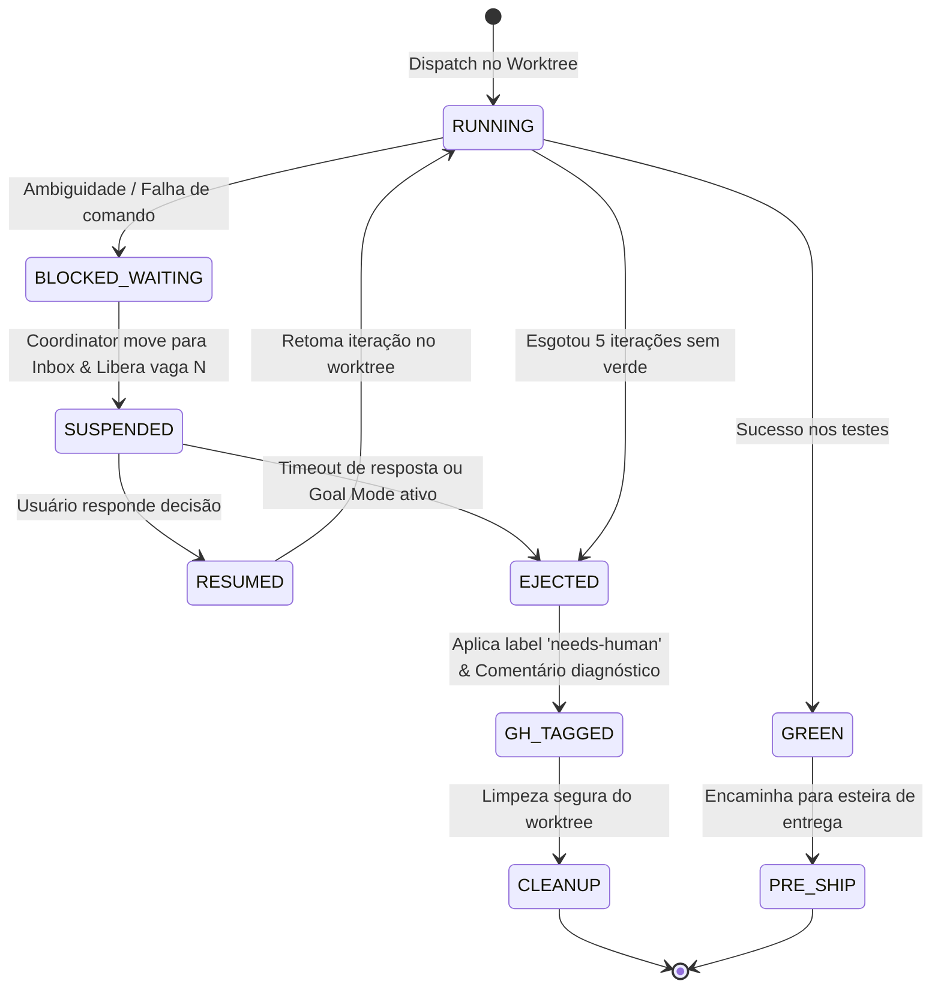

# Autonomia Contínua (Goal Mode) e Desacoplamento de Decisões Humanas no Vetor

## Summary

Especificar a camada de autonomia contínua e desacoplamento interativo no Vetor, eliminando os dois maiores gargalos de tempo ocioso do desenvolvimento assistido: o congelamento de sessões por gotejamento de perguntas interativas e a incompatibilidade com execuções de longa duração dos harnesses modernos (`/goal`). A arquitetura introduz o **Modo de Meta Contínua (`--goal`)** com convergência declarativa e ejeção graciosa de impasses, a **Entrevista Consolidada na Largada (Ahead-of-Time Batching)**, a **Caixa de Entrada Assíncrona de Decisões (Async Decision Inbox)** que impede o bloqueio em cabeça de fila (*Head-of-Line Blocking*), o **Avanço Otimista com Timeboxing**, o **Aquecimento Especulativo de Worktrees (Pre-Warming)** e a **Memória Cruzada de Aprendizados via MCP `ai-memory`**.

## Context

**Fatos e evidências verificados:**
1. **Gargalo de Gotejamento de Perguntas (*Question Drip*):** Nas Fases 1 e 2 de `skills/coordinator/SKILL.md`, o coordenador aciona até 4 turnos interativos sequenciais via `AskUserQuestion` (triagem de issues não-triviais sem Spec, definição do teto de concorrência $N$, confirmação de runtime delegado e aprovação formal do plano de execução). Cada turno impõe um ciclo síncrono de espera, exigindo que o desenvolvedor permaneça conectado à tela por vários minutos apenas para confirmar decisões previsíveis.
2. **Bloqueio em Cabeça de Fila (*Head-of-Line Blocking*) na Fase 5.b:** Quando um `issue-worker` encontra uma ambiguidade técnica, divergência arquitetural ou comando não auto-aprovado, ele registra `BLOCKED_WAITING` conforme `skills/coordinator/SKILL.md#L489-L510`. O coordinator pausa o loop de orquestração para interrogar o usuário via `AskUserQuestion`. Caso o desenvolvedor esteja ausente, toda a sessão de coordenação congela: novas issues não são despachadas da fila `QUEUED`, workers ativos que concluem não avançam para ondas seguintes e o cronômetro da sessão consome o timeout rígido de 90 minutos (`maxSessionMinutes`).
3. **Incompatibilidade com o Modo `/goal` de Longa Duração:** Os harnesses modernos de desenvolvimento (como Antigravity, Claude Code e Gemini) possuem o comando de barra `/goal`, projetado para delegar metas abrangentes e execuções contínuas (ex.: execuções noturnas ou resolução em lote de sprints). O desenho atual do Vetor aborta ou trava silenciosamente quando executado sob `/goal` devido à exigência incondicional de respostas humanas síncronas.
4. **Custo de Setup Frio de Worktrees:** A inicialização de um novo worktree isolado (`git worktree add`) somada à instalação fria de pacotes (`deno install`, `npm install`, `pnpm install`, `poetry install`) consome entre 40s e 90s por worker, atrasando o início efetivo da implementação.
5. **Redescoberta Redundante de Problemas:** Workers paralelos dentro da mesma sessão frequentemente encontram os mesmos desafios de ambiente (ex.: flags necessárias de compilação, dependências transitórias ou mocks ausentes). Como operam em isolamento de contexto, cada worker gasta de 2 a 4 iterações redescobrindo de forma independente soluções que outros colegas já encontraram.

## Goals

- Integrar formalmente o Vetor ao conceito de `/goal` dos harnesses através da flag `--goal "<meta>"`, operando em convergência contínua com autonomia de até 120 minutos sem interrupções síncronas bloqueantes.
- Substituir o gotejamento de perguntas das Fases 1 e 2 por uma **Entrevista Consolidada na Largada**, reduzindo o tempo de setup interativo inicial para menos de 15s.
- Implementar a **Async Decision Inbox**: se um worker entrar em `BLOCKED_WAITING`, ele é colocado em estado `SUSPENDED`, sua vaga no teto de concorrência é imediatamente liberada para a próxima issue da fila e a dúvida é encaminhada para uma fila assíncrona, eliminando 100% dos bloqueios de cabeça de fila.
- Implementar a política de **Avanço Otimista com Timeboxing de 60s**: assumir deterministicamente a opção `(Recommended)` caso o operador não responda a perguntas em sessões semi-supervisionadas, com ponto de restauração (*checkpoint*) rastreável no histórico git.
- Definir o protocolo de **Ejeção Graciosa (*Graceful Ejection*)**: issues que esgotarem tentativas ou exigirem insumo humano ausente recebem a label GitHub `needs-human`, anexam diagnóstico nos comentários e são arquivadas sem travar a conclusão da meta global.
- Provisionar **Aquecimento Especulativo de Worktrees (Pre-Warming)** em background durante o planejamento, reduzindo o tempo de setup inicial do worker para menos de 5s.
- Habilitar **Memória Cruzada entre Workers** via chamadas ao MCP `ai-memory`, reduzindo iterações duplicadas de depuração em pelo menos 30%.

## Non-Goals

- Burlar intencionalmente ou desativar permissões fundamentais de segurança aplicadas pelo sistema operacional ou pelo sandbox do harness.
- Eliminar a possibilidade de supervisão humana: o desenvolvedor pode intervir, pausar ou alterar decisões a qualquer momento através do relatório de status.
- Implementar loops infinitos de retentativa: o teto máximo de 5 iterações por issue (`fix-loop`) e o timeout global de sessão permanecem rigorosamente respeitados.
- Compartilhar o mesmo diretório de trabalho entre múltiplos workers: o isolamento estrito de filesystem por worktree é mantido integralmente.

## Users / Personas

- **Desenvolvedor em Modo Focado:** Inicia o coordinator para resolver um lote de issues enquanto trabalha em outra frente ou participa de reuniões, esperando que o sistema tome decisões padrão seguras sem interrompê-lo a cada minuto.
- **Desenvolvedor Noturno / Assíncrono (`/goal`):** Dispara metas complexas de refatoração ou fechamento de sprint no final do dia, esperando encontrar pela manhã o relatório com PRs criados e apenas impasses reais etiquetados para revisão.
- **Subagentes Workers (`issue-worker`):** Agentes de implementação que precisam de feedback pontual de arquitetura sem ficarem travados esperando horas por uma resposta.

## Functional Requirements

### RF-01 - Modo de Meta Contínua (`--goal`)

**Priority:** Must

**Description:** O coordinator deve suportar o parâmetro `--goal "<descrição da meta>"`, ativando o modo de convergência autônoma contínua que executa até que todas as issues do escopo estejam resolvidas ou formalmente ejetadas.

**Acceptance Criteria:**
- [ ] O comando `/vetor:coordinator --goal "<meta>"` ou `/vetor:coordinator [label] --goal "<meta>"` entra em modo de convergência contínua.
- [ ] No modo `--goal`, nenhuma pergunta síncrona `AskUserQuestion` bloqueia a sessão: todas as decisões de triagem, teto de workers e escolha de modelos adotam as recomendações padrão de forma determinística.
- [ ] A execução só é finalizada quando não houver mais issues pendentes na leva selecionada ou ao atingir o tempo limite configurado (`maxSessionMinutes`).
- [ ] Ao término, o coordinator emite o Goal Convergence Report listando: issues concluídas com sucesso, PRs preparados e issues ejetadas com justificativa.

**Happy Path:**
1. O desenvolvedor executa `/vetor:coordinator sprint-backlog --goal "Entregar correções de bugs da release"`.
2. O coordinator resolve dependências, aprova o plano com valores recomendados e despacha a primeira onda de workers em menos de 10s.
3. Workers implementam em paralelo; PRs são preparados e mergeados via fast-path.
4. O coordinator reporta a convergência da meta com 4 PRs entregues em 18 minutos sem nenhuma pausa interativa.

### RF-02 - Entrevista Consolidada na Largada (Ahead-of-Time Batching)

**Priority:** Must

**Description:** Em sessões interativas sem `--goal`, o coordinator deve consolidar todas as decisões de configuração e aprovação de plano em um único formulário ou diálogo de turno único.

**Acceptance Criteria:**
- [ ] O coordinator consolida em uma única apresentação estruturada: o teto recomendado de workers $N_{rec}$, a lista de issues com sinalização de Specs, a estratégia de entrega e a aprovação do plano.
- [ ] Cada item apresenta uma opção pré-marcada como `(Recommended)`, permitindo ao usuário aceitar o pacote completo com uma única confirmação (ex.: "sim" ou tecla Enter).
- [ ] O número de turnos de diálogo antes do primeiro dispatch de worker é reduzido para exatamente 1 turno.

### RF-03 - Caixa de Entrada Assíncrona de Decisões (Async Decision Inbox)

**Priority:** Must

**Description:** Quando um worker encontrar um bloqueio que requeira intervenção humana, o coordinator deve desacoplar o worker da execução corrente sem travar os demais subagentes.

**Acceptance Criteria:**
- [ ] Ao detectar status `BLOCKED_WAITING` no status file de um worker, o coordinator altera o estado do grupo para `SUSPENDED`.
- [ ] A vaga ocupada no teto de concorrência $N$ é liberada imediatamente em menos de 5s para despachar o próximo grupo `QUEUED` da mesma onda.
- [ ] Os dados da dúvida (`Blocked on`, `Options`, `Recommendation`) são persistidos no arquivo `<repo-root>/.claude/vetor/decision-inbox.json`.
- [ ] Uma notificação não-bloqueante é exibida no painel de status sem interromper o loop de monitoramento.
- [ ] Quando uma decisão for fornecida pelo usuário para um item da inbox, o worker correspondente é retomado em seu worktree intacto.

### RF-04 - Avanço Otimista com Timeboxing e Rollback Point

**Priority:** Should

**Description:** Em sessões interativas em que uma decisão pontual for solicitada, o coordinator deve aplicar um temporizador regressivo de 60s antes de assumir a recomendação padrão.

**Acceptance Criteria:**
- [ ] A pergunta ao usuário informa explicitamente: "Avançando automaticamente com a opção (Recommended) em 60s na ausência de resposta".
- [ ] Se o temporizador de 60s expirar sem resposta, a opção recomendada é aplicada, registrando um ponto de restauração git anotado (`git tag _vetor_checkpoint_<branch>_<timestamp>`).
- [ ] O evento de decisão otimista é registrado no status file com a tag `[OPTIMISTIC_DECISION]`.

### RF-05 - Ejeção Graciosa de Impasses (Graceful Ejection)

**Priority:** Must

**Description:** Quando uma issue esgotar seu orçamento de correções sem sucesso ou quando uma dependência humana crítica não for respondida em tempo hábil, a issue deve ser ejetada da leva de forma limpa.

**Acceptance Criteria:**
- [ ] A issue que atingir `FAILED_MAX_ITERATIONS` ou timeout de bloqueio recebe a label `needs-human` no GitHub (`gh issue edit <N> --add-label "needs-human"`).
- [ ] Um comentário diagnóstico estruturado é publicado na issue via `gh issue comment` contendo: resumo das tentativas realizadas, comandos de teste executados e trecho do log de erro final.
- [ ] O worktree é limpo em até 5s via `vetor-checks.sh safe-remove-worktree` preservando a branch remota para análise posterior.
- [ ] O coordinator registra a issue como `EJECTED` no relatório e prossegue sem interromper a meta global.

### RF-06 - Aquecimento Especulativo de Worktrees (Pre-Warming)

**Priority:** Should

**Description:** O coordinator deve inicializar e pré-aquecer os worktrees das issues da onda corrente em background enquanto aguarda a confirmação da largada.

**Acceptance Criteria:**
- [ ] Durante a análise de afinidades e exibição da entrevista inicial, o coordinator dispara a criação em segundo plano dos diretórios de worktree e a instalação de pacotes (`prepare-worktree.ts`).
- [ ] Quando o comando de dispatch do worker for executado, o worktree já deve estar materializado e com dependências instaladas, reduzindo o tempo de largada para menos de 5s.
- [ ] Se o usuário cancelar ou alterar o plano na largada, os worktrees pré-aquecidos não utilizados são removidos em menos de 10s.

### RF-07 - Micro-Specs Just-In-Time (JIT Inline Specs)

**Priority:** Should

**Description:** Para issues identificadas como não-triviais sem Spec formal na Fase 2, o coordinator deve gerar uma micro-spec de escopo reduzido de forma automatizada sem interromper o dispatch.

**Acceptance Criteria:**
- [ ] O coordinator invoca um modelo leve (`flash`/`haiku`) para sintetizar em até 10s uma micro-spec contendo: objetivo central, 3 critérios de aceite mensuráveis e 2 non-goals a partir da descrição da issue.
- [ ] O conteúdo sintetizado é gravado em `docs/specs/micro/<issue#>-<slug>.md` e injetado diretamente no `ContextPacket` do worker.
- [ ] A etapa substitui a necessidade de perguntar ao usuário se deseja remover a issue da leva para criar uma Spec manual completa.

### RF-08 - Memória Cruzada entre Workers via MCP `ai-memory`

**Priority:** Must

**Description:** Os workers devem consultar e publicar aprendizados técnicos efêmeros da sessão através do servidor MCP `ai-memory`.

**Acceptance Criteria:**
- [ ] Ao atingir status `GREEN`, o worker compila em até 3 linhas qualquer descoberta crítica de configuração ou correção de ambiente e grava via ferramenta `mcp__ai-memory__memory_write_page` na página `vetor/session-learnings`.
- [ ] Cada worker recém-despachado lê a página `vetor/session-learnings` antes de iniciar a primeira iteração de código.
- [ ] Em caso de falha de conexão ou ausência do MCP `ai-memory`, a execução segue normalmente sem falhas ou bloqueios (tolerância a falhas estrita).

## Non-Functional Requirements

### RNF-01 - Zero Bloqueio Global por Dúvida Local

**Priority:** Must

**Description:** A ocorrência de um bloqueio, dúvida ou falha em um subagente individual nunca deve interromper o progresso dos demais workers ativos ou o despacho de grupos independentes da mesma onda.

**Acceptance Criteria:**
- [ ] Teste de carga simulando 1 worker travado e 3 workers bem-sucedidos confirma que os 3 avançam até merge sem retenção pelo worker bloqueado.

### RNF-02 - Redução de Tempo de Onboarding e Setup

**Priority:** Must

**Description:** O tempo de largada entre a confirmação do plano e a primeira linha de código editada pelo worker deve ser inferior a 15s com worktrees pré-aquecidos.

**Acceptance Criteria:**
- [ ] Medição de tempo demonstra eliminação do intervalo ocioso de instalação de dependências no início do turno de trabalho.

### RNF-03 - Preservação de Rastreabilidade e Auditoria

**Priority:** Must

**Description:** Todas as decisões automáticas tomadas em Goal Mode ou via avanço otimista com timeboxing devem ser gravadas em trilha de auditoria explícita.

**Acceptance Criteria:**
- [ ] O relatório final lista individualmente cada decisão autônoma tomada, a opção recomendada adotada e o respectivo commit hash ou checkpoint gerado.

### RNF-04 - Limites Seguros de Execução Noturna

**Priority:** Must

**Description:** Toda execução autônoma de longa duração deve possuir teto de segurança operacional de no máximo 120 minutos e teto financeiro de tokens monitorado.

**Acceptance Criteria:**
- [ ] Atingidos 120 minutos de coordenação ativa, o coordinator encerra novos despachos, finaliza os workers correntes e produz o relatório consolidado.

## Behavior / States

### Ciclo de Vida da Caixa de Entrada Assíncrona e Ejeção



## Data

### Estrutura do `decision-inbox.json`

```json
{
  "sessionId": "coord-20261023-1745",
  "pendingDecisions": [
    {
      "id": "dec-issue-488",
      "issueNumber": 488,
      "branch": "feat/488-cache-redis",
      "worktreePath": "C:/Projetos/Vetor/.claude/worktrees/cache-redis",
      "blockedAt": "2026-10-23T17:40:00Z",
      "reason": "Ambiguidade no driver de conexão",
      "options": [
        "Usar biblioteca nativa redis-client (Recomendado)",
        "Implementar adaptador genérico sobre interface de cache",
        "Pular módulo e manter mock em memória"
      ],
      "recommendedIndex": 0,
      "timeoutSeconds": 60,
      "status": "AWAITING_INPUT"
    }
  ]
}
```

### Estrutura do Registro de Decisões do Goal Mode (`goal-audit.json`)

```json
{
  "goal": "Entregar correções de bugs da release",
  "startedAt": "2026-10-23T17:30:00Z",
  "completedAt": "2026-10-23T17:48:00Z",
  "concludedIssues": [482, 485, 486],
  "ejectedIssues": [
    {
      "issueNumber": 488,
      "reason": "Esgotamento de 5 iterações sem verde no módulo de cache",
      "labelApplied": "needs-human",
      "checkpointCommit": "7f8b9c0d1e2f"
    }
  ],
  "autoDecisionsApplied": 3
}
```

## Integrations / Dependencies

1. **Harness Slash Commands (`/goal`, `/compact`, `/schedule`)**: Alinha os contratos de execução autônoma às primitivas dos harnesses.
2. **MCP `ai-memory`**: Provedor de persistência e recuperação semântica de aprendizados entre subagentes concorrentes.
3. **GitHub CLI (`gh`)**: Manipulação assíncrona de labels de triagem (`needs-human`) e publicação de comentários diagnósticos em issues.
4. **Git Worktree Engine**: Gerenciamento do pool de diretórios pré-aquecidos (`Pre-Warming`).

## Edge Cases

- **Entrada inválida:** Se a string de meta passada para `--goal` contiver caracteres ilegais ou delimitadores de injeção de shell (ex.: `$(rm -rf)`), o script de validação de argumentos do coordinator deve escapar a string e tratá-la como texto literal sem execução.
- **Ausência de dados no arquivo de inbox:** Se o arquivo `decision-inbox.json` for corrompido ou apagado externamente durante a sessão, o coordinator deve recriar o arquivo em até 2s a partir dos status files individuais presentes em `.claude/vetor/status/*.md`.
- **Timeout no temporizador regressivo:** Se o temporizador de 60s expirar enquanto o terminal aguarda input, o coordinator assume a opção `(Recommended)`, remove a pendência da inbox e emite log audível ou visual da transição sem travar a thread de execução.
- **Dependência indisponível (MCP `ai-memory` desconectado):** Caso o servidor MCP de memória falhe ou retorne timeout de rede, a leitura e gravação de aprendizados é silenciada de forma graciosa sem propagar exceção para o worker.

## Error Handling

- Falha no pré-aquecimento de worktree: O erro é registrado em log e o coordinator recorre transparentemente à criação pontual síncrona na hora do dispatch do worker.
- Rejeição de label no GitHub por falta de permissão: Se a aplicação de `needs-human` falhar por token com permissão insuficiente, o motivo é impresso no Coordinator Report mantendo a ejeção local intacta.
- Timeout global de sessão noturna: Ao atingir 120 minutos, qualquer worker ativo recebe sinal de cancelamento suave, as branches são salvas no remoto e o estado de retomada é gravado para permitir `--resume` posterior.

## Security / Privacy

- **Prevenção de Execução Não Supervisionada Perigosa:** Em Goal Mode, comandos potencialmente destrutivos (`git reset --hard`, remoção de branches principais) continuam estritamente bloqueados pelos hooks de segurança (`safety-check.ts`).
- **Anonimização de Diagnósticos:** Comentários automáticos postados em issues públicas do GitHub são sanitizados pelo `DraftSanitizer` para prevenir vazamento de caminhos de arquivos absolutos locais de desenvolvimento ou variáveis de ambiente.

## Rollout

- **Fase 1:** Implementação da Entrevista Consolidada na Largada e da flag `--goal` com políticas de decisão determinísticas no coordinator.
- **Fase 2:** Implementação da `Async Decision Inbox` e do estado `SUSPENDED` para eliminar o bloqueio em cabeça de fila na Fase 5.b.
- **Fase 3:** Habilitação do pool de Worktree Pre-Warming e da integração com o MCP `ai-memory`.

## Open Questions

- Nenhuma pergunta aberta. Os padrões de tolerância a falhas e interfaces foram alinhados com as decisões de design vigentes do Vetor.

## Decisions

- **Ejeção Graciosa preferida a Paradas:** Em metas autônomas, ejetar uma issue problemática com label `needs-human` é infinitamente superior a paralisar o trabalho das outras 4 issues saudáveis da sprint.
- **Batching de Entrada:** A apresentação única de decisões na Fase 2 substitui a abordagem fragmentada anterior.
- **Async Inbox para Desbloqueio de Workers:** Subagentes bloqueados cedem a vaga do teto de concorrência imediatamente, maximizando a taxa de ocupação dos recursos de máquina.

## References

- `skills/coordinator/SKILL.md` — Despacho paralelo e monitoramento do Vetor.
- `skills/shared/references/planning-conventions.md` — Convenções de interação e economia de tokens.
- `docs/specs/pipeline-ship-e-delegacao-eficiente.md` — Spec irmã de Entrega Desacoplada e Delegação.
- `scripts/lib/orchestrator/` — Camada polimórfica de orquestração de subagentes.
- `wiki/Decisoes-de-Design.md` — Rationale histórico de decisões de arquitetura.

## Revision History

| Data | Autor | Mudança |
|---|---|---|
| 2026-10-23 | Antigravity Pair | Elaboração da Spec complementar para Autonomia Contínua (Goal Mode) e Desacoplamento Interativo. |
