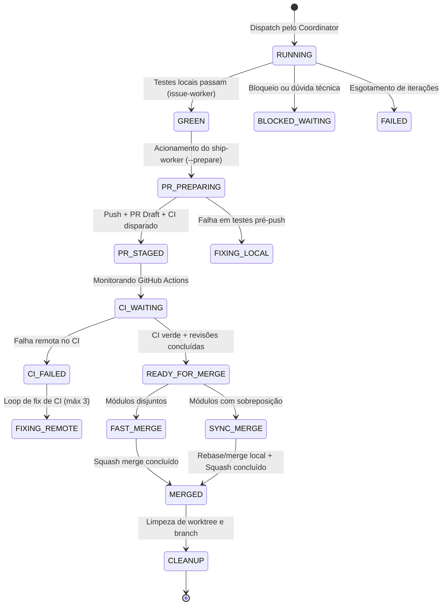

# Pipeline de Ship Desacoplado e Delegação Eficiente de Agentes

## Summary

Especificar a evolução da entrega (shipping) de Pull Requests e da delegação de agentes no Vetor, substituindo o gargalo do merge serializado monolítico por um pipeline desacoplado em duas fases (Pre-Ship paralelo nos worktrees e Fast Merge Gate com suporte a Merge Queue e detecção de módulos disjuntos) e otimizando a delegação de tarefas através de execução estratificada por modelos (Tiered Model Routing), especialização de papéis com o agente de entrega (`ship-worker`), injeção de pacotes enxutos de contexto (`ContextPacket`) e comunicação tipada via protocolo MCP/IPC sobre a infraestrutura de orquestradores (issue #482).

## Context

**Fatos e evidências verificados:**
1. **Gargalo de Merge Serializado no Coordinator:** Na Fase 6 de `skills/coordinator/SKILL.md`, o coordenador processa a entrega de cada grupo que atingiu `GREEN` de forma estritamente sequencial. Como cada invocação de `/vetor:ship` executa de ponta a ponta (sincronização, testes locais, push, criação de PR draft, espera bloqueante de CI de 5 a 15 minutos via `gh pr checks --watch`, revisões consultivas de código e segurança via subagentes, squash merge via `vetor-merge.sh`, sync-root e cleanup), o tempo de shipping para $K$ workers é de $O(K \times T_{ship})$. Em uma onda típica de 4 issues com CI de 8 minutos, a espera ociosa ultrapassa 35 minutos, consumindo mais de 40% do timeout global de 90 minutos da sessão (`maxSessionMinutes`) apenas assistindo pipelines remotos executarem.
2. **Restrição Histórica no Modo `--headless`:** Em sessões `--headless`, a Fase 6 de merge é completamente pulada conforme documentado em `wiki/Decisoes-de-Design.md`, sob a justificativa de prevenir deadlocks silenciosos por falta de operador humano para interações `AskUserQuestion`. Como consequência, rotinas automatizadas e execuções agendadas nunca concluem entregas ponta a ponta, mesmo quando 100% dos testes e verificações remotas passam.
3. **Compatibilidade dos Safety Hooks:** Os scripts normativos de proteção (`scripts/safety-check.ts` e `scripts/safety-check-antigravity.js`) já autorizam expressamente operações de `git push` e `gh pr create` quando o status do worker linkado é igual a `GREEN`. A proibição vigente de push/PR por workers reside unicamente em diretrizes textuais em `agents/issue-worker.md`.
4. **Cache de Arquivos Tocados Disponível:** O Vetor já mantém o artefato `<repo-root>/.claude/vetor/status/<branch>-touched-files.json` (conforme especificado em `skills/shared/references/touched-files-cache.md`), contendo a lista precisa de arquivos modificados e os módulos afetados do `module-test-map.md`.
5. **Fragilidade de Micro-delegação por Shell:** A referência `skills/shared/references/delegate-to-runtime.md` define a delegação de tarefas auxiliares (resumos de logs, rascunhos de PR, changelog) através de pipes de terminal (`<stream> | $DELEGATE "<prompt>"`). No Windows e sob o PowerShell, esse mecanismo sofre com restrições de comprimento de comando, falhas de escaping de aspas, problemas com caracteres UTF-8 acentuados e incompatibilidade com CLIs cujo modo padrão ignora o pipe de entrada (como o `agy`).
6. **Desperdício de Contexto em Invocação de Workers:** O `issue-worker` é despachado sem um pacote estruturado de contexto inicial, gastando entre 3 e 6 chamadas de ferramentas consecutivas apenas para redescobrir comandos de build, convenções de teste e caminhos de arquivo que o coordinator já determinou na fase de planejamento.
7. **Abstração de Orquestradores:** A issue #482 entregou em `scripts/lib/orchestrator/` uma arquitetura polimórfica tipada para despacho assíncrono e gestão segura de ciclo de vida com teto de polling de 50000ms (`safePollTimeoutMs`).

## Goals

- Desacoplar o pipeline `/vetor:ship` em duas etapas modulares: `--prepare` (Pre-Ship Paralelo) e `--finalize` (Fast Merge Gate).
- Permitir que múltiplos workers que atingiram status `GREEN` executem o Pre-Ship concorrentemente em seus próprios worktrees (push, PR draft, disparo de CI e subagentes de revisão consultiva).
- Reduzir a latência agregada de entrega em levas com 4 PRs em pelo menos 60% em relação ao modelo serializado anterior.
- Implementar o Fast-Path de merge para conjuntos disjuntos de arquivos (`Disjoint Sets`), permitindo squash merge sequencial imediato (em menos de 10s por PR) quando não houver sobreposição nos módulos e arquivos tocados.
- Integrar suporte transparente ao GitHub Merge Queue (`gh pr merge --auto --squash`) quando o repositório possuir branch protection com fila de merge configurada.
- Habilitar entrega autônoma confiável no modo `--headless` quando atendidos três gates determinísticos: CI remoto verde, zero apontamentos impeditivos nas revisões consultivas e ausência de conflitos em migrations ou árvore git.
- Introduzir a especialização do subagente `vetor:ship-worker` para assumir o Pre-Ship de forma assíncrona, mantendo o `issue-worker` 100% focado na implementação e testes TDD.
- Padronizar o contrato `ContextPacket` para despacho de workers, reduzindo o consumo de tokens na inicialização em pelo menos 40%.
- Integrar a delegação de micro-tarefas (resumo de logs de CI, rascunho de PR e changelog) à interface de orquestradores tipados (`scripts/lib/orchestrator/`), eliminando pipes frágeis de shell.

## Non-Goals

- Substituir a suíte real de testes do repositório por verificações sintéticas ou atalhos que comprometam a qualidade da branch default.
- Permitir que workers executem pushes diretos para branches protegidas (`main`, `master`, `production`) sem passar pelo processo de Pull Request — a integridade aplicada pelos hooks `PreToolUse` permanece inalterada.
- Exigir conta GitHub Enterprise ou recursos pagos de Merge Queue para o funcionamento do Vetor: o Fast-Path de módulos disjuntos atua como alternativa padrão completa para repositórios sem Merge Queue nativo.
- Fundir os papéis de `issue-worker` e `ship-worker` em um agente monolítico: a separação de privilégios e ciclo de vida deve ser preservada.

## Users / Personas

- **Desenvolvedor Operador do Vetor:** Executa `/vetor:coordinator` para entregar lotes de issues e espera que o encerramento da sessão ocorra em minutos após os testes passarem, sem bloqueios ociosos assistindo CIs individuais.
- **Coordinator Autônomo (`coordinator/SKILL.md`):** Orquestrador principal que despacha ondas de trabalho, coleta status e gerencia a transição de branches no repositório com consumo mínimo de turnos de raciocínio.
- **Ambientes de Automação e CI/CD (`--headless`):** Rotinas programadas que necessitam de fechamento de ciclo ponta a ponta (implementação -> validação -> merge) sem intervenção humana manual quando todos os critérios de qualidade forem atingidos.

## Functional Requirements

### RF-01 - Desacoplamento do Ship em `--prepare` e `--finalize`

**Priority:** Must

**Description:** A skill `/vetor:ship` deve suportar dois submodos de execução através de flags de linha de comando, além da execução monolítica padrão legada, separando a preparação concorrente da resolução final de merge.

**Acceptance Criteria:**
- [ ] `/vetor:ship --prepare [issue#]` executa estritamente: guarda de worktree (§1), sincronização inicial (§2), colisão de migrations (§2.b), detecção de módulos (§3), testes locais (§4), debug scan (§4.b), push da branch (§5), criação de PR draft (§6), disparo do monitoramento de CI (§7) e disparo em background das revisões consultivas (§8.5). Ao concluir o disparo ou verificar o estado inicial dos checks, grava o status `PR_STAGED` no status file e encerra sem tentar merge.
- [ ] `/vetor:ship --finalize <PR-number>` executa estritamente: verificação de review humano ou automático (§9), execução do merge via `vetor-merge.sh` (§10), sincronização determinística do root em até 5s (§11) e limpeza de worktree/branch/status (§12).
- [ ] A execução sem flags (`/vetor:ship [issue#]`) mantém retrocompatibilidade executando o ciclo sequencial completo existente de 1 a 12.

**Happy Path:**
1. O invocador chama `/vetor:ship --prepare 42` a partir de um worktree com status `GREEN`.
2. A skill roda os testes locais do módulo afetado, faz push da branch `feat/42-slug` e abre o PR draft.
3. Dispara a checagem remota e os subagentes consultivos (`code-review` e `security-review`).
4. Atualiza o status file para `PR_STAGED` contendo o número da PR criada e retorna com exit code 0 em menos de 120s.

**Alternative Flows:**
- Se os testes locais falharem durante o `--prepare`, o processo é interrompido imediatamente com exit code 1 e nenhuma branch remota é criada.

### RF-02 - Paralelização do Pre-Ship na Fase 5/6 do Coordinator

**Priority:** Must

**Description:** Quando um ou mais workers atingirem status `GREEN` na Fase 5 do coordinator, o coordinator deve acionar o Pre-Ship concorrentemente para todos os grupos verdes da onda, em vez de processá-los de forma serializada.

**Acceptance Criteria:**
- [ ] O coordinator despacha a execução de `--prepare` em paralelo para cada worktree em estado `GREEN`, utilizando instâncias isoladas ou o subagente `ship-worker`.
- [ ] O monitoramento do coordinator agrega os estados dos PRs criados através de uma única consulta consolidada `gh pr list --state open --json number,headRefName,statusCheckRollup`.
- [ ] O tempo total de espera de CI para $N$ grupos em paralelo é limitado a $\max(T_{ci}) + 60\text{s}$, eliminando o somatório linear $N \times T_{ci}$.

**Happy Path:**
1. Três workers (W1, W2, W3) completam suas tarefas e registram status `GREEN`.
2. O coordinator dispara o Pre-Ship nos três worktrees simultaneamente.
3. As três suítes de CI no GitHub Actions executam ao mesmo tempo.
4. Conforme os CIs atingem conclusão verde no remoto, o coordinator encaminha os PRs individualmente para o Fast Merge Gate.

### RF-03 - Fast-Path de Merge para Módulos Disjuntos

**Priority:** Must

**Description:** O script `vetor-merge.sh` e o coordinator devem analisar os conjuntos de arquivos tocados entre PRs finalizados para aplicar squash merge imediato quando não houver sobreposição textual ou semântica.

**Acceptance Criteria:**
- [ ] O coordinator lê o cache `<repo-root>/.claude/vetor/status/<branch>-touched-files.json` de cada PR candidato.
- [ ] Quando um PR $A$ é mergeado na branch default, o próximo PR $B$ é avaliado contra $A$:
  - Se $Files(A) \cap Files(B) = \emptyset$ E $Modules(A) \cap Modules(B) = \emptyset$;
  - E a consulta `gh pr view $PR_B --json mergeable` retornar `MERGEABLE`;
  - O coordinator executa `bash vetor-merge.sh $PR_B` imediatamente, sem exigir re-execução de suítes de teste locais frias ou re-sincronização demorada.
- [ ] O tempo de processamento de merge de um PR com módulos disjuntos deve ser inferior a 15s.
- [ ] Se houver intersecção ($Files(A) \cap Files(B) \neq \emptyset$ ou $Modules(A) \cap Modules(B) \neq \emptyset$), o coordinator faz checkout no worktree de $B$, executa `git merge origin/$DEFAULT_BRANCH`, roda apenas a suíte de testes do módulo coincidente e faz push da atualização.

**Happy Path:**
1. PR #101 alterou arquivos exclusivamente em `cli/`.
2. PR #102 alterou arquivos exclusivamente em `scripts/`.
3. PR #101 é mergeado em `main` via squash merge.
4. O coordinator confirma intersecção nula entre #101 e #102 e estado `MERGEABLE`.
5. PR #102 é mergeado logo em seguida em menos de 10s sem aguardar nova rodada de CI completa de 8 minutos.

### RF-04 - Suporte a Auto-Merge Nativo do GitHub

**Priority:** Should

**Description:** Caso o repositório possua proteção de branch com Merge Queue habilitada ou suporte a auto-merge configurado, o coordinator deve delegar o enfileiramento das entregas à API nativa do GitHub.

**Acceptance Criteria:**
- [ ] O coordinator detecta se o repositório suporta auto-merge através da checagem `gh pr view <PR> --json autoMergeRequest`.
- [ ] Havendo suporte a auto-merge ativo, o coordinator invoca `gh pr merge <PR> --auto --squash` para todos os PRs que concluíram o Pre-Ship com sucesso.
- [ ] O coordinator encerra a Fase 6 delegando a ordenação das fusões ao GitHub Actions, sem reter a sessão local em espera de polling desnecessária.

### RF-05 - Entrega Autônoma Segura no Modo `--headless`

**Priority:** Must

**Description:** Permitir que o coordinator no modo `--headless` execute a finalização de PRs quando todos os critérios determinísticos de segurança forem satisfeitos, sem acionar perguntas bloqueantes ao usuário.

**Acceptance Criteria:**
- [ ] No modo `--headless`, a Fase 6 de merge não é pulada se a flag `--auto-ship` for fornecida ou se `autoShipHeadless: true` constar em `.claude/vetor/config.json`.
- [ ] O merge autônomo em `--headless` só é executado se TODOS os seguintes critérios forem válidos:
  1. Todos os status checks do GitHub Actions estiverem com conclusão `SUCCESS`;
  2. Nenhuma vulnerabilidade de severidade crítica ou blocker tiver sido apontada pelos subagentes de revisão consultiva;
  3. A checagem `vetor-checks.sh migrations` sair com código 0 (sem colisão semântica de versões);
  4. O estado retornado pelo GitHub for `mergeable == MERGEABLE`.
- [ ] Se qualquer um dos critérios acima falhar, o PR permanece aberto como rascunho ou pendente para intervenção humana, sendo registrado detalhadamente no Coordinator Report sem abortar com erro.

### RF-06 - Agente Especializado de Entrega (`vetor:ship-worker`)

**Priority:** Must

**Description:** Criar a definição do subagente `agents/ship-worker.md` dedicado exclusivamente a gerenciar o ciclo de entrega de um worktree verde até a criação do PR e monitoramento de checks.

**Acceptance Criteria:**
- [ ] O arquivo `agents/ship-worker.md` define as ferramentas permitidas (`Bash`, `Read`, `Grep`, `Glob`) com permissão controlada para comandos `git push` e `gh pr create/checks`.
- [ ] O subagente utiliza modelo leve (`haiku` ou equivalente `flash`) por padrão, reduzindo o custo computacional da esteira.
- [ ] O prompt do `ship-worker` orienta a execução autônoma de `/vetor:ship --prepare`, notificação de conclusão ao status file e proibição expressa de comandos de merge em `main`.

### RF-07 - Injeção Estruturada de Contexto (`ContextPacket`)

**Priority:** Must

**Description:** O coordinator deve montar e injetar um pacote de contexto pré-estruturado em formato JSON no prompt inaugural do worker, eliminando turnos frios de exploração do repositório.

**Acceptance Criteria:**
- [ ] O `ContextPacket` inclui obrigatoriamente: identificador da issue, critérios de aceite extraídos, caminho absoluto do worktree, branch de trabalho, módulo mapeado em `module-test-map.md`, comando de teste já resolvido e lista de arquivos com probabilidade de alteração com base no título/descrição.
- [ ] O worker lê as orientações do `ContextPacket` e executa a reprodução do teste TDD diretamente no primeiro turno, sem disparar comandos de busca global no workspace (`Glob` ou `find`).
- [ ] O número de tool calls consumidas pelo worker antes de iniciar a escrita do primeiro teste deve ser reduzido em pelo menos 50%.

### RF-08 - Delegação Tipada de Micro-Tarefas via Adaptadores MCP

**Priority:** Should

**Description:** Migrar as tarefas de condensação de texto e geração de resumos de `skills/shared/references/delegate-to-runtime.md` dos pipes de shell para chamadas estruturadas baseadas na camada de orquestradores de `scripts/lib/orchestrator/`.

**Acceptance Criteria:**
- [ ] O módulo de delegação detecta adaptadores MCP ativos com capacidade de texto.
- [ ] Tarefas de condensação de logs de falha do CI (`gh run view --log-failed`) são enviadas via chamada de função estruturada com payload JSON, sem pipes (`|`) em strings de comando shell.
- [ ] O parser de saída sanitiza quebras de linha e acentuação no padrão UTF-8 utilizando `DraftSanitizer` (`scripts/lib/draft-sanitizer.ts`), prevenindo corrupção de caracteres em terminais Windows.

## Non-Functional Requirements

### RNF-01 - Redução de Latência no Merge de Lote

**Priority:** Must

**Description:** O tempo total gasto na Fase 6 para consolidar um lote de 4 issues independentes concluídas deve ser inferior a 15 minutos (para suítes de CI com tempo médio de 6 minutos), representando redução de no mínimo 60% comparado aos 35-45 minutos do fluxo serializado.

**Acceptance Criteria:**
- [ ] Medição em benchmark ou execução real demonstra que a etapa de espera de CI não se multiplica pela quantidade de workers em paralelo.

### RNF-02 - Compatibilidade Multiplataforma

**Priority:** Must

**Description:** O conjunto completo do pipeline de Pre-Ship, scripts de detecção de conjuntos disjuntos e despacho de workers deve operar de forma idêntica em Windows (PowerShell/cmd), Linux e macOS.

**Acceptance Criteria:**
- [ ] Tratamento estrito de caminhos de arquivos utilizando separadores normalizados (`/`) para evitar inconsistências em paths do Git Bash e Windows.
- [ ] Ausência de dependência de binários exclusivos POSIX para o fluxo crítico de merge.

### RNF-03 - Economia de Tokens por Issue

**Priority:** Must

**Description:** A combinação de `ContextPacket` na inicialização com o uso de modelos econômicos (`haiku`/`flash`) no `ship-worker` deve reduzir o consumo agregado de tokens da issue em pelo menos 40% em relação ao uso de instâncias monolíticas de modelo de alto custo.

**Acceptance Criteria:**
- [ ] O log de execução demonstra menor quantidade de tokens de entrada em turnos exploratórios do worker.

### RNF-04 - Timeout e Polling Seguro

**Priority:** Must

**Description:** Qualquer operação assíncrona ou de monitoramento de status remota deve aplicar teto estrito de polling seguro de 50000ms (`safePollTimeoutMs <= 50000`) para não exceder limites de transporte de rede ou MCP.

**Acceptance Criteria:**
- [ ] Nenhum loop de espera aguarda ativamente mais de 50000ms por ciclo sem ceder controle ou verificar encerramento do processo.

## Behavior / States

### Máquina de Estados da Entrega de Worktree



## Data

### Estrutura do `ContextPacket` (JSON injetado no worker)

```json
{
  "$schema": "https://vetor.dev/schemas/context-packet.v1.json",
  "issue": {
    "number": 485,
    "title": "feat(cli): adicionar comando de status em lote",
    "slug": "status-em-lote",
    "acceptanceCriteria": [
      "Retornar JSON com lista de status ativos",
      "Executar em menos de 500ms no P95"
    ]
  },
  "worktree": {
    "path": "C:/Projetos/Vetor/.claude/worktrees/status-em-lote",
    "branch": "feat/485-status-em-lote",
    "baseBranch": "main"
  },
  "context": {
    "module": "cli",
    "testCommand": "deno test -A cli/tests/status_test.ts",
    "targetFiles": [
      "cli/status.ts",
      "cli/tests/status_test.ts"
    ],
    "conventions": "Seguir Deno standard guidelines; tratar exit codes explicitamente."
  }
}
```

### Estrutura de Metadados do Pre-Ship (`<branch>-preship.json`)

```json
{
  "branch": "feat/485-status-em-lote",
  "prNumber": 512,
  "prUrl": "https://github.com/org/repo/pull/512",
  "headSha": "a1b2c3d4e5f6",
  "stagedAt": "2026-10-23T17:30:00Z",
  "modulesTouched": ["cli"],
  "filesTouched": ["cli/status.ts", "cli/tests/status_test.ts"],
  "ciStatus": "PENDING",
  "reviewsStatus": "PENDING"
}
```

## Integrations / Dependencies

1. **GitHub CLI (`gh`)**: Consome comandos `gh pr create`, `gh pr checks`, `gh pr merge`, `gh pr view` e APIs GraphQL para leitura consolidada de checks e enfileiramento de auto-merge.
2. **Git Local (`git`)**: Utiliza `git worktree`, `git merge-tree`, `git push` e `git rev-parse`.
3. **Deno Runtime**: Executa scripts utilitários de validação e sanitização (`scripts/lib/draft-sanitizer.ts`, `scripts/lib/orchestrator/`).
4. **Camada de Orquestradores (`scripts/lib/orchestrator/`)**: Fornece os drivers para comunicação com runtimes e ferramentas MCP externas.

## Edge Cases

- **Entrada inválida:** Se o número da issue ou branch contiver caracteres de escape ou injeção de shell (ex.: `; rm -rf`), o validador `vetor-checks.sh validate-issue-ref` deve rejeitar com código de saída 1 antes de qualquer execução de git.
- **Ausência de dados no touched-files cache:** Se o arquivo `<branch>-touched-files.json` estiver ausente por remoção acidental, o coordinator deve recalcular os arquivos tocados na hora via `git diff --name-only origin/$DEFAULT_BRANCH...HEAD` antes de avaliar a independência de módulos.
- **Timeout na execução de CI:** Se os checks remotos excederem o timeout configurado de 20 minutos (1200000ms), o `ship-worker` marca o status como `CI_TIMEOUT`, preserva o worktree e notifica o coordinator sem entrar em loop infinito.
- **Dependência indisponível (GitHub API fora do ar):** Se o GitHub retornar HTTP 500 ou erro de conexão durante a criação do PR ou consulta de checks, o script deve aplicar retentativa exponencial (backoff de 2s, 4s, 8s até no máximo 3 vezes) antes de classificar como falha transitória de infraestrutura.
- **Colisão de merge durante Fast-Path:** Se entre a verificação de independência e a execução do squash merge outro commit externo entrar na branch default e causar conflito no servidor, `vetor-merge.sh` recebe exit code 3 do `gh pr merge`, aborta o fast-path e redireciona o PR para sincronização local com testes antes de tentar novamente.

## Error Handling

- Falhas nos testes locais do `--prepare`: Nenhum comando remoto é executado; o worktree permanece intacto para depuração local.
- Erros de compilação ou falhas de asserção no CI remoto: O coordinator aciona o loop de correção de código (§8.c de `skills/ship/SKILL.md`) com teto estrito de até 3 tentativas.
- Falhas de infraestrutura no runner de CI: O script `scripts/detect-infra-failure.ts` detecta billing/outage e aciona o circuit breaker, pausando a fila sem queimar tentativas de fix.

## Security / Privacy

- **Princípio do Menor Privilégio:** Subagentes de desenvolvimento e workers em worktree não recebem permissão para executar merge ou exclusão de branches protegidas; essa ação é restrita ao coordinator executando `vetor-merge.sh` a partir de regras verificadas.
- **Sanitização de Rascunhos:** Todo texto proveniente de delegação externa passa por `DraftSanitizer` para prevenir execução inadvertida de instruções maliciosas ou caracteres nulos injetados.
- **Preservação de Segredos:** Logs brutos de CI e arquivos `.env` ou segredos nunca são transmitidos em payloads de delegação externa ou gravados em status files públicos.

## Rollout

- **Fase 1 (Experimental / Opt-in):** Disponibilizar as flags `--prepare` e `--finalize` na skill `/vetor:ship`, mantendo o comportamento monolítico padrão para chamadas normais.
- **Fase 2 (Coordinator Integration):** Atualizar o `/vetor:coordinator` para adotar o Pre-Ship concorrente na Fase 6 sob chave de configuração `features.concurrentShip: true`.
- **Fase 3 (General Availability):** Tornar o Pre-Ship concorrente e o Fast-Path de módulos disjuntos o comportamento padrão soberano do Vetor em todas as plataformas compatíveis (Claude Code, Antigravity, OpenCode).

## Open Questions

- Nenhuma pergunta aberta no momento. Todas as decisões fundamentais foram alinhadas na arquitetura.

## Decisions

- **Desacoplamento em duas fases:** Adotou-se a separação estrita entre preparação de PR e portão de merge para resolver a contenção de tempo de CI.
- **Independência via Disjoint Sets:** O critério de aceleração de merge baseia-se na interseção vazia de arquivos e módulos mapeados, garantindo segurança semântica antes de qualquer squash merge consecutivo.
- **Ship-Worker dedicado:** Criou-se um agente específico com modelo econômico para absorver a esteira de entrega assíncrona.

## References

- `skills/ship/SKILL.md` — Pipeline de entrega do Vetor.
- `skills/coordinator/SKILL.md` — Orquestrador de issues e despacho paralelo em worktrees.
- `skills/shared/references/touched-files-cache.md` — Especificação do cache de arquivos tocados por branch.
- `skills/shared/references/delegate-to-runtime.md` — Contrato de delegação agnóstica de runtime.
- `scripts/lib/orchestrator/` — Abstração de adaptadores de orquestradores (issue #482).
- `scripts/vetor-merge.sh` — Script de merge com verificação de estado real.

## Revision History

| Data | Autor | Mudança |
|---|---|---|
| 2026-10-23 | Antigravity Pair | Criação inicial da Spec cobrindo Ship Desacoplado e Delegação Eficiente. |
