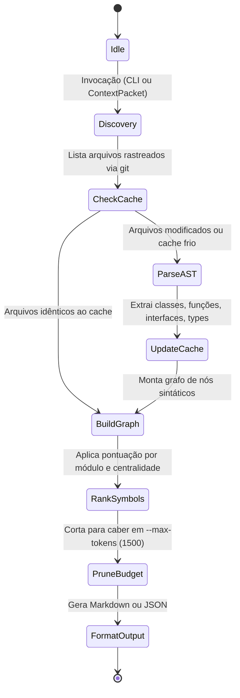

# Repo Map Sintático Compacto via AST e Injeção no ContextPacket dos Workers

## Summary

Especificar a criação do motor de mapeamento sintático de repositório baseado em AST (`scripts/repo-map.ts`) para extração de símbolos públicos (interfaces, types, classes, funções e exportações) em formato ultracompacto de até 1.500 tokens, e sua injeção automatizada no `ContextPacket` dos subagentes `issue-worker` e no kickoff da skill `/vetor:fix`. A solução elimina o ciclo inicial de exploração cega via comandos `find`, `grep` e leituras sequenciais de arquivos inteiros, acelera a convergência em worktrees isolados, estabelece uma convivência sinérgica com o Graphify (Fase 1: complementaridade micro vs. macro) e pavimenta a absorção nativa de métricas arquiteturais sem dependência de CLIs externos (Fase 2).

## Context

**Fatos e evidências verificados:**
1. **Gargalo de Exploração Cega nos Workers:** Em sessões do `coordinator` e no loop autônomo `/vetor:fix`, os agentes despachados em worktrees isolados iniciam a execução sem um mapa mental prévio das estruturas do repositório. Para identificar onde residem tipos de dados, assinaturas de funções e utilitários auxiliares, os agentes gastam entre 5 e 15 tool calls consecutivas (compostas por `grep`, `find` e leituras completas de múltiplos arquivos via `read_file`), consumindo dezenas de milhares de tokens desnecessários e adicionando entre 30 e 90 segundos de latência antes da primeira edição produtiva.
2. **Desacoplamento entre Assinatura e Implementação:** Mais de 85% das decisões tomadas por um agente de correção ou feature dependem exclusivamente da visualização de **assinaturas públicas** (nomes de classes, tipos aceitos, interfaces e contratos exportados), e não da implementação interna completa dos corpos das funções.
3. **Estado da Arte da Indústria (Harness Engineering):** Conforme demonstrado pelo Aider e por harnesses modernos em 2025/2026, a sumarização de repositórios por AST combinada com PageRank de símbolos gera um "Repo Map" de 1.000 a 1.500 tokens capaz de reduzir em até 40% a necessidade de leituras de arquivos adicionais e virtualmente eliminar alucinações de imports.
4. **Padronização do `ContextPacket` no Vetor:** A especificação de delegação eficiente (Issue #496 / `docs/specs/pipeline-ship-e-delegacao-eficiente.md`) introduziu o contrato estruturado `ContextPacket` para alimentar subagentes, oferecendo o ponto de encaixe arquitetural nativo para entrega do mapa sintático.
5. **Limitações do Graphify Atual:** O Graphify opera em nível macroscópico de acoplamento entre arquivos e gera artefatos volumosos em disco (`graphify-out/`). Além de exigir um CLI externo opcional que frequentemente não está instalado nos ambientes de execução, o Graphify sofre com rápido envelhecimento (o Check 10 de `skills/guardian/SKILL.md` aponta obsolescência a cada 5 commits), não provendo assinaturas sintáticas linha a linha requeridas para edição de código.
6. **Capacidade do Runtime Deno:** O Vetor executa 100% de seus scripts auxiliares sobre Deno, o qual dispõe de analisadores sintáticos TypeScript/JavaScript de alta performance e suporte a módulos WASM (como `web-tree-sitter`), permitindo parsing de AST portável sem compilações C/C++ locais em Windows, macOS ou Linux.

## Goals

- Implementar o motor de extração sintática de repositório `scripts/repo-map.ts` em Deno, gerando representações em pseudo-código (assinaturas de classes, métodos, interfaces, tipos e exports sem corpos de funções).
- Garantir orçamento de tokens estrito e configurável, com teto padrão de 1.500 tokens (`--max-tokens 1500`), gerando saídas densas e legíveis para LLMs.
- Implementar algoritmo de ranking de símbolos baseado em centralidade de imports e proximidade da tarefa, priorizando os arquivos do módulo alvo da issue e seus vizinhos imediatos.
- Reduzir em pelo menos 40% a quantidade de tool calls de leitura e busca (`grep`, `find`, `read_file`) executadas por workers nos 5 primeiros turnos de trabalho.
- Injetar o Repo Map gerado diretamente no payload do `ContextPacket` despachado para os `issue-workers` pelo `coordinator` e no kickoff de `/vetor:fix`.
- Implementar cache incremental de AST baseado em hash git (`git rev-parse` ou SHA-1 do arquivo), garantindo que a geração do mapa para o repositório ocorra em menos de 500ms em execuções subsequentes.
- Estabelecer a arquitetura em duas fases: manter a complementaridade com o Graphify na Fase 1 (Graphify para visão macro de Specs; Repo Map para micro-sintaxe de workers), estruturando as interfaces internas para permitir a absorção de métricas de acoplamento na Fase 2.

## Non-Goals

- Não substituir ferramentas de leitura profunda (`read_file`) quando o agente necessitar examinar a lógica algorítmica interna de uma função específica durante o diagnóstico.
- Não aposentar o CLI Graphify nem remover o Check 10 do Guardian na Fase 1 (a migração de cartografia arquitetural macroscópica é escopo exclusivo da Fase 2).
- Não executar checagem estática de tipos semântica integral do compilador (`tsc --noEmit`), focando exclusivamente na análise estrutural declarativa da árvore sintática (AST).
- Não realizar compilação de código nem interpretação de runtime durante a extração de símbolos.
- Não analisar dependências externas em pastas vendorizadas ou de pacotes (`node_modules/`, `target/`, `build/`, `dist/`, `.venv/`, `.claude/worktrees/`).

## Users / Personas

- **Subagente `issue-worker` em Worktree:** Consome o Repo Map via `ContextPacket` e obtém visibilidade imediata das assinaturas e contratos do projeto, compondo imports e tipos corretos na primeira tentativa.
- **Coordinator do Vetor (`skills/coordinator/SKILL.md`):** Gera o mapa sintático escopado durante a montagem das ordens de despacho, sem introduzir lentidão no pipeline.
- **Engenheiro de Software / Operador do Vetor:** Pode executar manualmente `deno run -A scripts/repo-map.ts` ou `/vetor:repo-map` no terminal para inspecionar um raio-X compacto da base de código antes de planejar alterações.

## Functional Requirements

### RF-01 - Extração Sintática de Símbolos via AST

**Priority:** Must

**Description:**
O motor deve varrer recursivamente os arquivos do repositório pertencentes aos módulos mapeados no `module-test-map.md` (respeitando exclusões padrão de `.gitignore` e diretórios ignorados) e realizar o parsing sintático da árvore (AST) para capturar os símbolos públicos essenciais.

**Acceptance Criteria:**
- [ ] Suporta nativamente arquivos TypeScript (`.ts`, `.tsx`) e JavaScript (`.js`, `.jsx`, `.mjs`, `.cjs`).
- [ ] Extrai com exatidão: declarações de interfaces, aliases de tipo (`type`), assinaturas de classes e seus métodos públicos/protegidos, funções exportadas e variáveis/constantes exportadas.
- [ ] Omite integralmente os corpos das funções e implementações internas de blocos, substituindo-os por marcadores concisos (ex.: `{ ... }`).
- [ ] Ignora arquivos em diretórios excluídos: `node_modules/`, `target/`, `build/`, `dist/`, `.venv/`, `.claude/worktrees/`, `.git/`.

**Happy Path:**
1. O script recebe a raiz do projeto e identifica os arquivos a processar via lista rastreada do git.
2. Cada arquivo é parseado em nós sintáticos.
3. As declarações exportadas são catalogadas com sua respectiva linha e arquivo de origem.
4. O resultado é consolidado em uma estrutura intermediária de dados (`SymbolTree`).

**Alternative Flows:**
- Se um arquivo contiver erro sintático que impeça o parsing da AST, o script loga um aviso de depuração e inclui apenas os cabeçalhos das linhas de exportação detectadas via fallback léxico, sem abortar o processamento dos demais arquivos.

---

### RF-02 - Algoritmo de Ranking de Símbolos e Token Budgeting

**Priority:** Must

**Description:**
Como repositórios médios e grandes excedem a janela desejada de tokens caso todos os símbolos sejam impressos, o motor deve calcular a relevância de cada símbolo e podar a árvore de saída para respeitar rigorosamente o orçamento de tokens especificado (`--max-tokens`, default: 1500 tokens).

**Acceptance Criteria:**
- [ ] A saída final renderizada nunca ultrapassa o limite de tokens configurado (estimado na proporção exata de 4 caracteres por token ou contagem direta BPE).
- [ ] Símbolos são pontuados com base em: (a) se pertencem aos arquivos do módulo em foco; (b) número de referências de import cruzadas no repositório (*degree centrality*); (c) se são interfaces ou tipos públicos compartilhados.
- [ ] Quando o limite de tokens é atingido, arquivos de menor pontuação são condensados (apenas o nome do arquivo e suas exportações principais são listados), preservando detalhamento completo para os arquivos prioritários.

**Happy Path:**
1. O grafo de dependências sintáticas é gerado associando imports aos símbolos correspondentes.
2. Um score de relevância é atribuído a cada nó.
3. O algoritmo adiciona símbolos ao buffer de saída em ordem decrescente de relevância até atingir o teto de 1.500 tokens.
4. O mapa resultante é retornado.

**Alternative Flows:**
- Se o repositório for muito enxuto e a totalidade dos símbolos não atingir o limite de tokens, 100% das assinaturas de todos os módulos monitorados são exibidas sem poda.

---

### RF-03 - Geração de Repo Map Escopado por Módulo ou Issue

**Priority:** Must

**Description:**
O motor deve permitir foco contextual através de argumentos de linha de comando (`--module <nome>` ou `--files <caminhos>`), atribuindo peso máximo aos arquivos indicados e aos seus importadores/exportadores diretos.

**Acceptance Criteria:**
- [ ] O argumento `--module <nome>` carrega os prefixos do módulo a partir de `.claude/vetor/module-test-map.md`.
- [ ] Os arquivos pertencentes ao módulo alvo recebem prioridade 1 no ranking, garantindo que suas assinaturas apareçam detalhadas mesmo em repositórios massivos.
- [ ] Os módulos que possuem imports diretos do módulo alvo recebem prioridade 2.

**Happy Path:**
1. O coordinator despacha um worker para a issue #493 mapeada no módulo `ship`.
2. O coordinator invoca `deno run -A scripts/repo-map.ts --module ship --max-tokens 1500`.
3. O mapa gerado prioriza detalhadamente as interfaces de `ship.ts`, `vetor-merge.sh` e utilitários correlatos.

---

### RF-04 - Injeção Automática no `ContextPacket` e `/vetor:fix`

**Priority:** Must

**Description:**
O gerador do mapa sintático deve ser integrado à montagem do `ContextPacket` (definido na spec #496) e ao kickoff inicial de `/vetor:fix`.

**Acceptance Criteria:**
- [ ] O `ContextPacket` passa a conter o campo opcional `repoMap: string`.
- [ ] O subagente `issue-worker` recebe no bloco de contexto inicial o Repo Map formatado em markdown dentro de uma tag `<repo_map>...</repo_map>`.
- [ ] O kickoff de `/vetor:fix` roda a extração com foco no módulo onde o teste quebrou e anexa o mapa ao rascunho de diagnóstico inicial.

**Happy Path:**
1. O coordinator executa `prepare-worktree.ts` e monta a ordem de trabalho.
2. Invoca o gerador de repo-map para o módulo em questão.
3. Preenche `ContextPacket.repoMap` com a string gerada.
4. O worker inicia e tem acesso imediato à localização dos tipos e métodos sem precisar rodar comandos exploratórios.

---

### RF-05 - Cache Incremental Baseado em Git Hash

**Priority:** Should

**Description:**
Para garantir que a geração do mapa seja quase instantânea durante despachos múltiplos de workers, o script deve armazenar em cache os metadados de AST dos arquivos, indexados pelo hash SHA-1 de cada arquivo.

**Acceptance Criteria:**
- [ ] O cache é persistido localmente em `.claude/vetor/cache/repo-map.json` (diretório gitignorado).
- [ ] Em execuções subsequentes onde nenhum arquivo foi alterado, a geração completa do mapa leva menos de **150ms**.
- [ ] Arquivos alterados são re-parseados individualmente e o cache é atualizado atomicamente.

---

### RF-06 - Interface CLI e Formatos de Saída

**Priority:** Must

**Description:**
O script `scripts/repo-map.ts` deve poder ser executado tanto como módulo programático quanto como CLI standalone via terminal.

**Acceptance Criteria:**
- [ ] Suporta saída em Markdown legível por padrão (estruturada por arquivos com blocos de código com destaque de sintaxe).
- [ ] Suporta flag `--json` retornando a estrutura serializada de símbolos, tokens estimados e arquivos incluídos/omitidos.
- [ ] Suporta flag `--max-tokens <numero>` para ajuste dinâmico do orçamento.

## Non-Functional Requirements

### RNF-01 - Desempenho de Extração e Latência

**Priority:** Must

**Description:**
A geração do Repo Map não pode onerar o tempo de startup do worker.

**Acceptance Criteria:**
- [ ] Em uma base de código de 500 arquivos (sem cache prévio), a extração e formatação do mapa executam em menos de **800ms**.
- [ ] Em execuções com cache morno/quente, a execução completa leva menos de **200ms**.

---

### RNF-02 - Portabilidade e Zero Dependências Nativas

**Priority:** Must

**Description:**
O script deve rodar nativamente via Deno sem exigir a instalação de compiladores locais de C/C++, Rust ou ferramentas externas no sistema operacional do usuário.

**Acceptance Criteria:**
- [ ] Executa de maneira idêntica em Windows (PowerShell), macOS e Linux.
- [ ] Não depende do binário externo `ctags` ou `graphify` para a geração de símbolos essenciais.

---

### RNF-03 - Determinismo e Idempotência

**Priority:** Must

**Description:**
Dada a mesma árvore de arquivos e os mesmos parâmetros de linha de comando, a saída gerada deve ser 100% idêntica entre execuções sucessivas.

**Acceptance Criteria:**
- [ ] A ordenação de arquivos e símbolos dentro do mesmo nível de prioridade é estritamente alfabética e estável, prevenindo variações de cache de contexto para o modelo.

## Behavior / States



## Data

### Estrutura do Cache (`.claude/vetor/cache/repo-map.json`)

```typescript
export interface FileSymbolSummary {
  fileHash: string; // SHA-1 ou git hash do arquivo
  mtime: number;
  tokens: number;
  symbols: Array<{
    name: string;
    kind: "interface" | "type" | "class" | "function" | "const";
    line: number;
    signature: string; // Ex: "export function checkAiMemory(url: string): Promise<unknown>"
    exported: boolean;
  }>;
  imports: Array<{
    source: string; // Path relativo do import
    importedSymbols: string[];
  }>;
}

export interface RepoMapCache {
  version: "1.0.0";
  lastUpdated: string;
  files: Record<string, FileSymbolSummary>;
}
```

### Exemplo de Formato da Saída em Markdown (Injetada no `ContextPacket`)

```markdown
<repo_map>
### scripts/lib/knowledge.ts
export interface KnowledgeSearchResult { path: string; excerpt: string; }
export interface KnowledgeProvider {
  search(query: string): Promise<KnowledgeSearchResult[]>;
  read(path: string): Promise<string>;
  create(path: string, content: string): Promise<void>;
  update(path: string, content: string): Promise<void>;
}
export function detectKnowledgeState(config: VetorConfigWithKnowledge | null | undefined): KnowledgeState;
export class AiMemoryKnowledgeProvider implements KnowledgeProvider { ... }

### scripts/ai-memory-check.ts
export function checkAiMemory(url: string, fetcher?: typeof fetch): Promise<{ tools: string[]; memory_status: unknown }>;

### scripts/detect-project.ts
export function writeConfig(info: ProjectInfo): Record<string, unknown>;
export function main(): void;
</repo_map>
```

## Integrations / Dependencies

1. **`scripts/lib/orchestrator/` & `prepare-worktree.ts`:** O preparador de worktrees invoca a geração de mapa escopada e anexa o resultado à estrutura do `ContextPacket`.
2. **`skills/fix/SKILL.md`:** Na Fase 1 (Diagnóstico), antes de acionar comandos de busca manual, a skill injeta o Repo Map focado no módulo afetado para guiar a análise.
3. **`skills/spec/SKILL.md` & Graphify:** A Spec mantém sua integração com o Graphify (`graphify-out/GRAPH_REPORT.md` e `architecture/graphify-summary.md`) para análise de acoplamento macro. A interface de dados de `repo-map.ts` é projetada de forma compatível para permitir que a Fase 2 herde o cálculo de God Nodes nativamente.

## Edge Cases

1. **Repositório Monolítico Massivo (> 5.000 arquivos):** A varredura de milhares de arquivos poderia consumir excesso de tempo. **Solução:** Quando o total de arquivos excede 1.000, o motor aplica poda prévia baseando-se estritamente no `module-test-map.md`, parseando apenas os arquivos do módulo em análise e dos módulos com dependência direta.
2. **Arquivo com Sintaxe Não-Padrão ou Inválida:** Um arquivo com erro de sintaxe TypeScript que impeça a geração da AST não deve quebrar a geração do mapa. **Solução:** O analisador faz captura de exceção (`try/catch`) por arquivo; em caso de falha, emite aviso e aplica regex de fallback para capturar linhas iniciadas por `export `.
3. **Repositório Poliglota (TypeScript, Python, Go, Rust):** Se o repositório contiver componentes em outras linguagens, o parser TypeScript não deve ser invocado em arquivos `.py` ou `.go`. **Solução:** Arquivos em linguagens secundárias passam por extratores léxicos baseados em padrões de declaração (`def `, `func `, `pub fn`) até que parsers dedicados adicionais sejam ativados.
4. **Projeto com Zero Arquivos Suportados:** Se o projeto não contiver código em linguagens reconhecidas, o script retorna um bloco vazio gracioso com `status: "empty"`, sem falhar o despacho do worker.

## Error Handling

- **Falha de Escrita no Cache:** Se o diretório `.claude/vetor/cache/` estiver protegido contra escrita ou ocorrer erro de E/S, o erro de cache é tratado como aviso não-bloqueante e o mapa é retornado diretamente em memória.
- **Estouro de Memória em Arquivos Gigantes (> 10MB):** Arquivos individuais com tamanho superior a 500KB são automaticamente pulados na extração de AST detalhada, registrando apenas seu path e uma anotação de tamanho excessivo.

## Security / Privacy

- O `repo-map.ts` é um script analítico estritamente somente-leitura em relação à base de código do projeto (opera apenas leitura de arquivos e escrita em seu diretório isolado de cache).
- Nunca expõe conteúdos sensíveis de arquivos `.env` ou segredos: arquivos ignorados pelo `.gitignore` ou terminados em `.env*`, `.pem`, `.key` são estritamente excluídos antes do parsing.

## Rollout

- **Fase 1.1 (Implementação do Engine):** Criar `scripts/repo-map.ts` e suíte de testes em `scripts/tests/repo-map_test.ts` cobrindo TypeScript/JavaScript, token budgeting e cache.
- **Fase 1.2 (CLI & Standalone):** Disponibilizar o script para execução local via `deno run -A scripts/repo-map.ts` e validar conformidade em repositórios reais.
- **Fase 1.3 (Conexão ao ContextPacket e Fix):** Atualizar `prepare-worktree.ts` e `skills/fix/SKILL.md` para carregar e injetar o mapa sintático nas ordens de trabalho dos workers.
- **Fase 2 (Convergência com Graphify - Futuro):** Expandir `repo-map.ts` com flag `--architecture` para computar métricas de acoplamento e God Nodes diretamente do grafo sintático, aposentando o CLI externo.

## Open Questions

- *Nenhuma pendência impeditiva no momento:* A extração de AST de TS/JS pode utilizar a API declarativa do compilador TypeScript embutido ou SWC/Babel via módulo Deno padrão sem adição de dependências pesadas.

## Decisions

- **D-01 (Parsing em Deno Puro):** Adotar motor de parsing executável sob Deno padrão sem dependência de ferramentas de compilação C/C++ locais ou binários de terceiros.
- **D-02 (Coexistência com Graphify na Fase 1):** O Repo Map foca na micro-sintaxe para consumo de workers; o Graphify permanece intocado como fonte macro de cartografia de Specs até a Fase 2.
- **D-03 (Token Budget Padrão de 1.500 tokens):** Equilíbrio ideal entre densidade de informação e preservação de contexto nos subagentes.
- **D-04 (Ponto de integração do `ContextPacket`, issue #507):** o Repo Map é gerado por `scripts/context-packet.ts` (`--repo-root`, `--format prompt`) no dispatch, e não por `prepare-worktree.ts`. O pacote é montado antes de o worktree existir e o `prepare-worktree.ts` (hook `WorktreeCreate`) só cria o worktree e prepara dependências, sem acesso ao pacote nem ao prompt do worker. Gerar a partir do root do repositório principal também mantém o cache (`.claude/vetor/cache/repo-map.json`) compartilhado entre os workers. O `ContextPacket` guarda o mapa em `context.repoMap`; no prompt ele vai na tag `<repo_map>`, fora do JSON.
- **D-05 (Prioridade do escopo, issue #507):** o foco (RF-03) é a união dos `--files` que são fontes mapeados com os arquivos de `--module`; o módulo catch-all (`./`) só entra quando nenhum arquivo resolve. Tier 1 = foco, tier 2 = vizinhos imediatos (importadores e dependências), tier 3 = demais. O tier precede o score em toda ordenação. O texto da issue #507 põe os importadores no mesmo nível do módulo; esta Spec (RF-03) os põe na prioridade 2, e a implementação segue a Spec.

## References

- [Aider: Repository Map Documentation](https://aider.chat/docs/repomap.html)
- [Issue #496: feat(agent): subagente especializado ship-worker e injeção de ContextPacket](https://github.com/Tavaressan/Vetor/issues/496)
- [`scripts/graph-report.ts`](file:///C:/Projetos/Vetor/scripts/graph-report.ts)
- [`skills/guardian/SKILL.md` — Check 10](file:///C:/Projetos/Vetor/skills/guardian/SKILL.md)
- [`docs/specs/pipeline-ship-e-delegacao-eficiente.md`](file:///C:/Projetos/Vetor/docs/specs/pipeline-ship-e-delegacao-eficiente.md)

## Revision History

| Data | Autor | Mudança |
|---|---|---|
| 2026-10-23 | Vetor Architecture Team | Criação da especificação inicial (Fase 1: Repo Map AST e ContextPacket). |
| 2026-10-26 | Issue #507 | Decisões D-04 (ponto de integração no `context-packet.ts`) e D-05 (tiers do escopo). |
